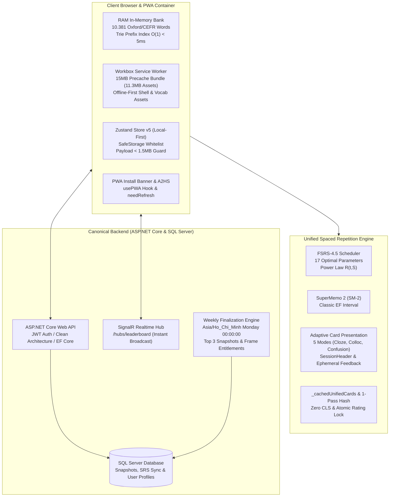
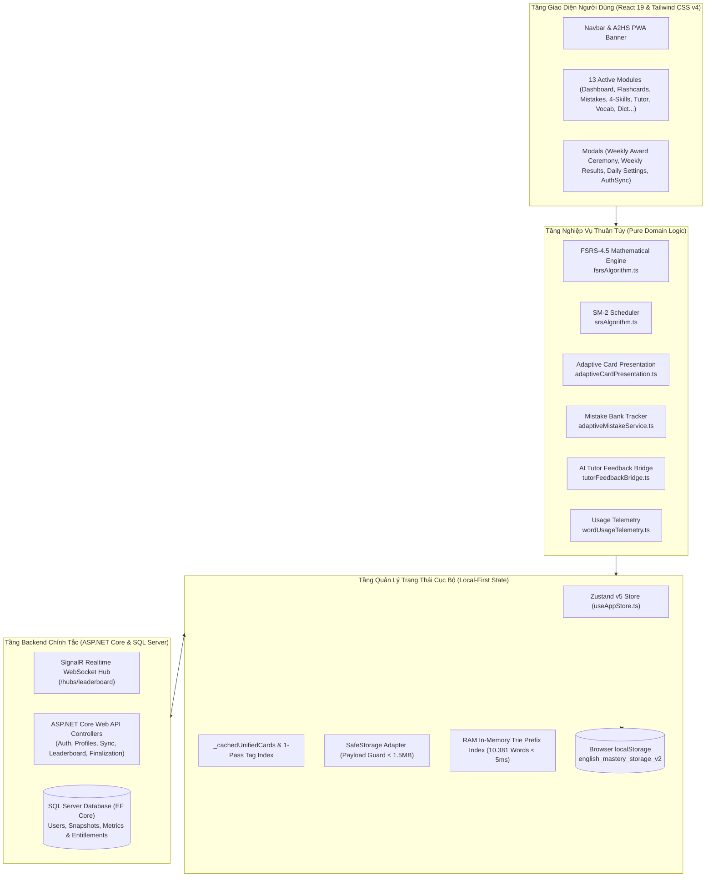
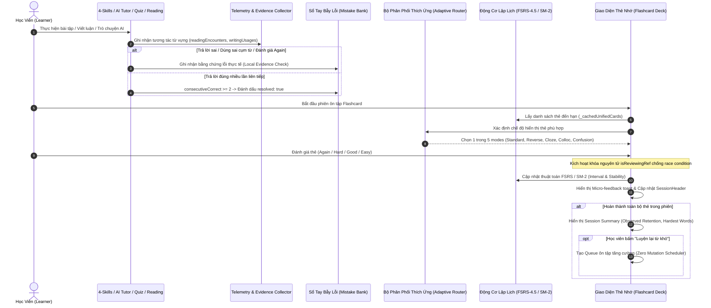
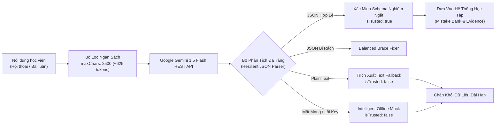
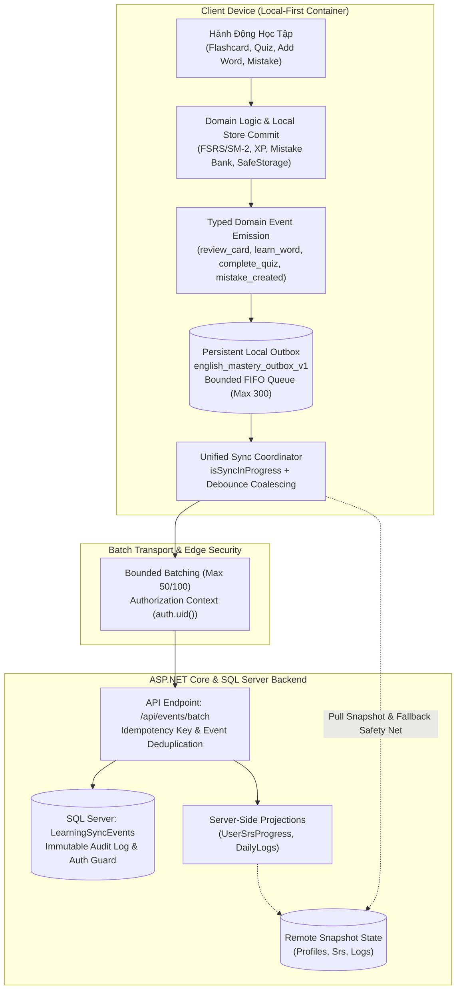
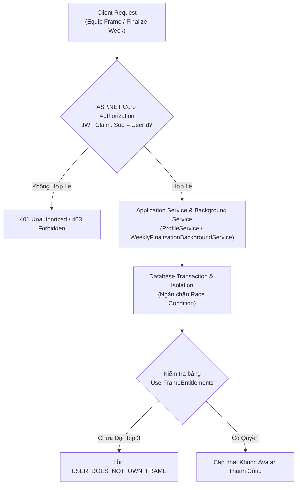
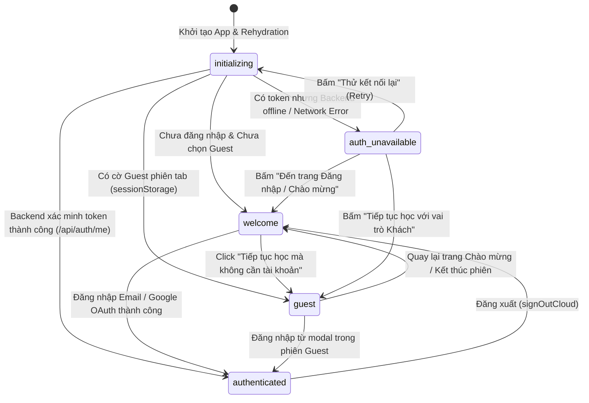

# English Mastery Hub 🚀
> Nền tảng học tiếng Anh cá nhân hóa toàn diện, ngân hàng 96 bài luyện Four Skills chuẩn CEFR (A1–C2), kết hợp thuật toán lặp lại ngắt quãng Spaced Repetition (FSRS-4.5 & SM-2), Siêu từ điển Offline 10.381 từ vựng Oxford/CEFR, PWA Offline-First, Bảng xếp hạng Realtime SignalR (ASP.NET Core Web API & SQL Server) & Trợ lý đàm thoại AI.

---

## 1. Header & Overview

### 🎯 Tầm Nhìn & Bài Toán Cần Giải Quyết
Phần lớn người học tiếng Anh và các ứng dụng EdTech hiện nay thường gặp phải các rào cản kinh điển:
- **Học trước quên sau:** Học dồn dập từ vựng nhưng không có chu kỳ ôn tập khoa học, dẫn đến tỷ lệ rơi rụng kiến thức trên 80% sau một tuần.
- **Lệ thuộc kết nối & Trải nghiệm gián đoạn:** Phần lớn ứng dụng web không hoạt động khi mất mạng internet hoặc trên đường di chuyển (máy bay, tàu ngầm, vùng sóng yếu).
- **Tràn hạn ngạch bộ nhớ trình duyệt:** Nạp cơ sở dữ liệu từ điển hàng chục nghìn mục vào `localStorage` dễ gây tràn hạn ngạch (`QuotaExceededError` giới hạn 5MB).
- **Học từ vựng đơn lập, thiếu cụm từ:** Người học biết từ đơn lẻ nhưng lúng túng khi kết hợp thành Collocations hoặc Idioms tự nhiên trong văn cảnh giao tiếp.
- **Thiếu động lực & Thi đua học tập:** Thiếu môi trường cọ xát thành tích, bảng xếp hạng cập nhật tức thì để duy trì chuỗi chuyên cần (Streak).

**English Mastery Hub** được thiết kế theo tư duy **Local-First & Intelligent PWA**, trang bị động cơ lập lịch kép **FSRS-4.5 & SuperMemo 2 (SM-2)** tối ưu hóa chu kỳ ghi nhớ dài hạn, siêu từ điển offline **10.381 từ vựng Oxford/CEFR** tra cứu tức thì trên RAM, nhận diện giọng nói qua **Web Speech API**, phòng luyện thi **TOEIC chuẩn ETS**, phòng chấm bài luận tự động, và backend chính tắc **ASP.NET Core Web API + SQL Server** tích hợp **SignalR Realtime Engine** (Supabase đã được thay thế và gỡ bỏ hoàn toàn).

---

### 🏛️ Trụ Cột Kiến Trúc Kỹ Thuật (Architectural Highlights)



#### 1. Local-First & In-Memory RAM Bank
- **Quy mô dữ liệu:** Toàn bộ kho từ điển tĩnh **10.381 từ vựng** chuẩn hóa Oxford 3000/5000 và CEFR (A1 -> C2) được biên dịch tĩnh và nạp trực tiếp trên RAM.
- **Chỉ mục tiền tố siêu tốc:** Hệ thống Prefix Trie & Hash Map trong [`dictionaryIndex.ts`](file:///c:/Users/hoang/.gemini/antigravity-ide/scratch/english-mastery-app/src/services/dictionaryIndex.ts) được khởi tạo dưới **100ms** và phản hồi các truy vấn tìm kiếm tiền tố tức thì (**đạt mục tiêu < 5ms**).
- **Bộ lọc an toàn bộ nhớ:** Whitelist `partialize` của Zustand phân tách triệt để dữ liệu tĩnh và dữ liệu học tập cá nhân. Bộ bọc an toàn `safeStorage` giám sát và đảm bảo dung lượng lưu trữ `localStorage` luôn duy trì trong hạn mức an toàn của kịch bản kiểm thử (Persistence stayed within the tested storage budget).

#### 2. Progressive Web App (PWA) Offline-First
- **Đóng gói & Precache Workbox:** Tích hợp [`vite-plugin-pwa`](https://vite-pwa-org.netlify.app/) và `workbox-window`. Cấu hình `maximumFileSizeToCacheInBytes: 15 * 1024 * 1024` (15MB) trong [`vite.config.ts`](file:///c:/Users/hoang/.gemini/antigravity-ide/scratch/english-mastery-app/vite.config.ts) cho phép Service Worker precache trọn gói **11.3MB** tài nguyên ứng dụng (30 precache entries) và bộ dữ liệu từ điển offline.
- **Trải nghiệm ứng dụng gốc (A2HS):** Hook [`usePWA`](file:///c:/Users/hoang/.gemini/antigravity-ide/scratch/english-mastery-app/src/hooks/usePWA.ts) bắt sự kiện `beforeinstallprompt`, cung cấp nút cài đặt [`PWAInstallButton`](file:///c:/Users/hoang/.gemini/antigravity-ide/scratch/english-mastery-app/src/components/PWAInstallButton.tsx) tiện lợi trên thanh điều hướng.
- **Nhận diện trạng thái mạng:** Thành phần [`PWANotificationBanner`](file:///c:/Users/hoang/.gemini/antigravity-ide/scratch/english-mastery-app/src/components/PWANotificationBanner.tsx) tự động hiển thị thanh cảnh báo khi mất kết nối mạng và hỗ trợ cơ chế prompt cập nhật phiên bản mới an toàn (`needRefresh` / `updateServiceWorker`).

#### 3. Collocations & Idioms Spaced Repetition (SM-2)
- **Thu thập 1-chạm (One-Touch Capture):** Phân hệ dịch thuật [`TranslatorView`](file:///c:/Users/hoang/.gemini/antigravity-ide/scratch/english-mastery-app/src/components/TranslatorView.tsx) tự động phân tích các cụm từ, thành ngữ và động từ hai từ (Phrasal Verbs) tương ứng trong văn cảnh, cho phép học viên lưu trực tiếp vào sổ tay ôn tập chỉ với 1 cú click.
- **Thẻ ôn tập thông minh (Cloze / Masked Hints):** Giao diện [`FlashcardDeck`](file:///c:/Users/hoang/.gemini/antigravity-ide/scratch/english-mastery-app/src/components/FlashcardDeck.tsx) tự động phát hiện cụm từ và ẩn từ khóa trong câu ví dụ thành dạng câu đố điền khuyết `[ _____ ]`, kích thích phản xạ hồi tưởng chủ động (Active Recall).
- **Hợp nhất SM-2 Deck:** Hàm `getUnifiedSRSCards` trong [`useAppStore.ts`](file:///c:/Users/hoang/.gemini/antigravity-ide/scratch/english-mastery-app/src/store/useAppStore.ts) hợp nhất linh hoạt cả từ vựng đơn lẻ và cụm từ vào cùng một chu kỳ giãn cách thời gian khoa học.

#### 4. Bảng Xếp Hạng Đa Chiều Thế Hệ Mới — 7 Hạng Mục, Chuẩn Giờ VN (GMT+7), Chống Gian Lận (Leaderboard v2)
- **7 Hạng Mục Học Tập Đa Chiều (Multi-Dimensional Quality Metrics):** Nâng cấp vượt bậc từ mô hình XP đơn thuần sang 7 hạng mục đo lường chất lượng học tập thực chất:
  1. `weekly_xp` (Kinh nghiệm tuần): Điểm XP tích lũy với bộ đệm chống spam `xpAntiSpamService` (chặn spam flashcard >500 XP/ngày, giới hạn 15 ván quiz/ngày/thể loại).
  2. `vocab_mastered` (Từ vựng thành thạo): Đo lường số từ đạt chuẩn Mastered (FSRS state 2, stability $\ge 21.0$, reps $\ge 2$; hoặc SM-2 $\ge 5$ reps / 21 ngày). Khử trùng lặp đa thái từ vựng theo Canonical Lemma (`run`, `running`, `runs` $\rightarrow$ 1 từ).
  3. `review_consistency` (Chăm chỉ ôn tập): Đánh giá tỷ lệ hoàn thành thẻ đến hạn chia theo ngày (0..100%). Bảo vệ ngày không có thẻ đến hạn (neutral ratio), chia tải ngày quá tải ($\ge 40$ thẻ giới hạn 60 thẻ/ngày), loại trừ bài tập tăng cường ngoài lịch.
  4. `active_minutes` (Thời gian học thực tế): Đo lường thời gian tương tác chủ động tại 6 module học tập cốt lõi qua `activeLearningTimeService`. Tự động dừng đếm khi đổi tab/ẩn cửa sổ hoặc quá 60s không tương tác; giới hạn phân đoạn tối đa 30 phút.
  5. `pronunciation_gain` (Tiến bộ phát âm): Đối sánh điểm số giữa nửa đầu và nửa sau tuần từ các bản ghi Web Speech API thật (`isTrusted === true`). Điều kiện xếp hạng nghiêm ngặt: $\ge 10$ mẫu qua $\ge 2$ ngày khác nhau (người học chưa đủ điều kiện hiển thị trạng thái "Chưa xếp hạng", không tạo điểm ảo).
  6. `toeic_gain` (Tiến bộ TOEIC): Chênh lệch điểm ETS giữa bài thi đầu và bài thi gần nhất trong tuần. Điều kiện: $\ge 2$ bài thi hoàn chỉnh thời lượng $\ge 60$s, giãn cách giữa hai lần thi lại cùng mã đề $\ge 48$h.
  7. `streak` (Chuỗi chuyên cần): Số ngày liên tục duy trì tương tác học tập.
- **Zero Mock Data — 100% Real Users & Dual Backend Flow:** [`leaderboardService.ts`](file:///c:/Users/hoang/.gemini/antigravity-ide/scratch/english-mastery-app/src/services/leaderboardService.ts) chỉ trả về người dùng thật từ database SQL Server. Kiến trúc kép: các hạng mục truyền thống (`weekly_xp`, `streak`) bảo toàn tương thích qua bảng profile, các hạng mục chất lượng học tập định tuyến trực tiếp qua API `/api/leaderboard/rankings` (ASP.NET Core Application Service).
- **Chốt Tuần Server-Authoritative (Weekly Finalization GMT+7):** Canonical reset quy chuẩn theo **Thứ Hai 00:00:00 Asia/Ho_Chi_Minh** (`UTC+7`). Hosted Background Service (`WeeklyFinalizationBackgroundService`) chốt tuần tự động dựa trên giờ server, snapshot Top 3 vào `WeeklyLeaderboardSnapshots`, cấp frame entitlement cho Top 1/2/3, reset tuần mới. Transaction lock ngăn race condition. Idempotency: gọi lại cùng tuần → `ALREADY_FINALIZED`, không duplicate.
- **Khung Avatar Vinh Danh (Frame Reward System):** 3 khung persist: `champion_frame` (Top 1, viền vàng quay động), `elite_frame` (Top 2, viền bạc ánh kim), `prestige_frame` (Top 3, viền đồng sáng). Lưu vĩnh viễn trong `UserFrameEntitlements`. API endpoint `/api/profile/equip-frame` xác minh ownership tại DB trước khi UPDATE. Lớp bảo vệ server-side là chốt chặn cuối cùng — client không thể tự cấp reward.
- **Lễ Vinh Danh & Trải Nghiệm Bảng Xếp Hạng Đa Tab (Ceremony & Multi-Tab UI):** [`LeaderboardView.tsx`](file:///c:/Users/hoang/.gemini/antigravity-ide/scratch/english-mastery-app/src/components/LeaderboardView.tsx) trang bị thanh chọn tab phân đoạn trợ năng (Accessible Segmented Tabs) với phím tắt điều hướng; định dạng đơn vị động (`+X điểm`, `X phút`, `X%`, `X từ`); hiển thị sticky vị trí của học viên hiện tại; xử lý người học chưa đủ điều kiện (`Chưa xếp hạng`, `--` kèm hướng dẫn rõ ràng).
- **Realtime Scalability & Backend Pagination (Harden Phase 2):** Duy trì **đúng 1 logical SignalR connection** cho toàn ứng dụng trên Hub `/hubs/leaderboard`. Bộ đệm Debounce 1.5s gom các đợt bão sự kiện (burst) thành 1 lần làm mới, tích hợp Max-Wait 5s chống starvation. Hợp đồng phân trang bắt buộc phía API enforce `1 <= p_limit <= 50` (hard max 50 hàng/trang, client không thể gửi limit bất hợp lý để kéo full table). Truy vấn thứ hạng cá nhân O(1) qua API `/api/leaderboard/my-rank`, duy trì sticky row của học viên trên mọi trang mà không fetch toàn bảng. Giữ nguyên trang đang xem khi nhận tín hiệu realtime mà không reset về trang 1.
- **Server Time & Chống Lệch Đồng Hồ (Harden Phase 1):** Mỏ neo `setServerTimeAnchor` kết hợp đồng hồ monotonic `performance.now()`, bảo đảm toàn bộ mốc thời gian chốt tuần, tuần hiện tại (`YYYY-Www`), và countdown hoàn toàn độc lập với đồng hồ thiết bị. Thuật toán `detectDeviceClockDrift` tự động phát hiện trôi/chỉnh sửa giờ máy (+1 ngày, -1 ngày, đổi timezone) để tái đồng bộ anchor chuẩn từ API `/api/leaderboard/server-time`. Rào chắn server-authoritative `isWeekFinalizable` và server-side finalization từ chối chốt tuần sớm hoặc nhận thưởng trái phép.
- **Hạ Tầng Bằng Chứng Học Tập Tối Giản & Bảng Xếp Hạng Trực Tuyến (Minimal Evidence Transport & Online Leaderboard):** 
  - Toàn bộ tính năng Personal Cloud Sync (đồng bộ hai chiều full-state tiến trình cá nhân) đã được loại bỏ hoàn toàn để bảo vệ quyền riêng tư và bản chất Local-First tuyệt đối.
  - Vận chuyển bằng chứng học tập tối giản qua [`learningEvidenceTransport.ts`](file:///c:/Users/hoang/.gemini/antigravity-ide/scratch/english-mastery-app/src/services/learningEvidenceTransport.ts): Khi người dùng đăng nhập thực hiện các hành động học tập thực tế, hệ thống gom và gửi snapshot điểm số tổng hợp tuần qua API `/api/leaderboard/sync-score` và `/api/leaderboard/sync-metrics` (ASP.NET Core Web API).
  - Không upload bảng `UserSrsProgresses` hay `DailyLogs` đầy đủ lên đám mây; máy chủ chỉ lưu trữ điểm số xếp hạng tuần và các khung vinh danh đã mở khóa.
- **Hệ Thống Danh Tính Leaderboard Chuẩn Tắc & Phân Tách Guest/Auth Tuyệt Đối (Identity Hardening):**
  - Mô hình danh tính 2 trạng thái phân định rạch ròi: `Guest (Khách học cục bộ)` và `Authenticated (Đã đăng nhập)`.
  - Hàng người dùng online được nhận diện 100% bằng `row.userId === authUser.id`.
  - Trải nghiệm Guest minh bạch: không chặn màn hình, xem trọn vẹn top users công khai, hiển thị Card Trạng thái Cục Bộ ("Chế độ cục bộ", "Chưa tham gia bảng xếp hạng trực tuyến") kèm nút CTA chuẩn "Đăng nhập để tham gia bảng xếp hạng" (loại bỏ hoàn toàn wording "Sync Cloud").
  - Phân lập phiên học nghiêm ngặt: khi đăng xuất hoặc đổi tài khoản (Account A $\rightarrow$ Account B), hàng đợi bằng chứng cũ được dọn dẹp tức thì, triệt tiêu nguy cơ rò rỉ hoặc đồng bộ nhầm điểm số giữa các người học.

#### 5. Động Cơ Lập Lịch Kép & Flashcard Toàn Diện: FSRS-4.5 & SuperMemo SM-2 (Unified Spaced Repetition Engine)
- **Động cơ toán học kép & Cách ly ngữ nghĩa (Strict Semantic Isolation):**
  - **FSRS-4.5:** Triển khai độc lập trong [`fsrsAlgorithm.ts`](file:///c:/Users/hoang/.gemini/antigravity-ide/scratch/english-mastery-app/src/services/fsrsAlgorithm.ts) với 17 tham số tối ưu chuẩn, đường cong suy giảm lũy thừa $R(t, S) = (1 + \frac{19}{81}\frac{t}{S})^{-0.5}$ và công thức tính chu kỳ tối ưu theo mục tiêu retention $I(r, S) = \frac{S}{19/81}(r^{-2} - 1)$.
  - **SuperMemo 2 (SM-2):** Triển khai trong [`srsAlgorithm.ts`](file:///c:/Users/hoang/.gemini/antigravity-ide/scratch/english-mastery-app/src/services/srsAlgorithm.ts) với nhân tố dễ dàng $EF$ và chu kỳ nhân số ngày.
  - **Cách ly tuyệt đối:** Không bao giờ ngụy tạo retrievability hay difficulty cho thẻ SM-2 (hiển thị fallback/ẩn trường an toàn); phân tách rạch ròi giữa số chu kỳ quên của scheduler (`lapses`) và số lần người dùng thực tế nhấn đánh giá `Again` (`againCount`).
- **Tối ưu hóa hiệu năng & Bộ nhớ đệm thẻ hợp nhất (Performance Core & Index Caching):**
  - Khởi tạo bộ nhớ đệm hợp nhất `_cachedUnifiedCards` trong [`useAppStore.ts`](file:///c:/Users/hoang/.gemini/antigravity-ide/scratch/english-mastery-app/src/store/useAppStore.ts) giúp tái sử dụng danh sách thẻ thay vì tạo mới hàng loạt object mỗi lần component re-render.
  - Bộ đếm tag số lượng 1-pass $O(N)$ trong [`FlashcardDeck.tsx`](file:///c:/Users/hoang/.gemini/antigravity-ide/scratch/english-mastery-app/src/components/FlashcardDeck.tsx) triệt tiêu hoàn toàn 34 lượt quét `.filter()` trên 10.381 từ mỗi khung hình (giảm thời gian tính toán từ ~400ms xuống < 3ms).
  - Khóa giao dịch đánh giá nguyên tử `isReviewingRef`: bảo đảm hành động rating thẻ được xử lý tuần tự một lần duy nhất, triệt tiêu race condition và hiện tượng click đúp gây nhảy 2 thẻ liên tiếp hoặc duplicate review events.
- **Trải nghiệm phiên học mượt mà (Smooth Session UX & Zero CLS):**
  - Thành phần `SessionHeader` với layout cố định chiều cao (Fixed-height container) hiển thị tiến độ học tức thì (`12 / 30`, thanh progress, `18 remaining`, `🔥 Streak 7` nội bộ phiên học, hoàn toàn độc lập với app streak).
  - Micro-feedback toast ngắn gọn xuất hiện tức thì sau mỗi đánh giá (`We'll reinforce this one.`, `Getting there.`, `Nice recall!`, `Strong memory!`), tự động mờ dần và hoàn toàn tuân thủ `prefers-reduced-motion`.
  - Hiệu ứng lật thẻ 3D Framer Motion mượt mà, không remount toàn bộ container Flashcard.
- **Động cơ hiển thị thẻ thích ứng (Adaptive Presentation Engine):**
  - Bộ điều phối thuần túy [`adaptiveCardPresentation.ts`](file:///c:/Users/hoang/.gemini/antigravity-ide/scratch/english-mastery-app/src/services/adaptiveCardPresentation.ts) tự động phân bổ 5 chế độ hiển thị thẻ đa dạng:
    1. `standard`: Xem từ tiếng Anh đoán nghĩa tiếng Việt.
    2. `reverse`: Xem nghĩa tiếng Việt đoán từ vựng tiếng Anh.
    3. `context_cloze`: Ẩn từ trong câu ví dụ dạng điền khuyết `[ _____ ]`.
    4. `collocation`: Luyện cụm từ/thành ngữ đi kèm văn cảnh sử dụng.
    5. `confusion_challenge`: Thử thách phân biệt cặp từ dễ gây nhầm lẫn khi có bằng chứng lỗi thực tế từ `mistakeBank`.
  - Nút luyện phát âm Pronunciation Prompt an toàn: probe `isSpeechRecognitionSupported()` thời gian thực, chống crash trên các trình duyệt không hỗ trợ Web Speech API.
- **Tổng kết phiên học & Luồng luyện thẻ khó (Session Summary & Difficult Cards Flow):**
  - Subcomponent `SessionSummary`: hiển thị tổng số thẻ đã học, phân bổ 4 nút rating (Again, Hard, Good, Easy), Observed Session Retention $\frac{\text{hard + good + easy}}{\text{total}} \times 100\%$ (hoặc `—` nếu 0 review), danh sách từ khó nhất phiên học (Hardest Words) dựa trên bằng chứng struggle.
  - Tính năng "Luyện lại từ khó" (Review difficult cards): tạo queue ôn tập tăng cường ngay lập tức mà không làm sai lệch ngày đến hạn (due date), không tăng lapse count và không mutate scheduler state của thẻ.
- **Khả năng chống chịu ca biên (Edge-case Resilience):**
  - Xử lý hoàn hảo các tình huống: Deck rỗng, phiên học 1 thẻ, thẻ bị xóa giữa phiên, F5 hoặc chuyển tab giữa phiên học, và click dồn dập.

#### 5.1. Nền Tảng Trải Nghiệm Phiên Học Hợp Nhất & Tích Hợp Mẫu Flashcard (Session Experience Foundation & Flashcard Reference Integration)
- **Kiến trúc tầng Trải nghiệm Phiên Học chuẩn mực (Composable & Derived Layer):**
  ```text
  Existing Domain State (SRS / Mistake Bank / Four Skills / TOEIC / Tutor)
              ↓
  Session Experience Adapter & Derived Contract (types/sessionExperience.ts)
              ↓
  Composable Session UI (SessionIntro, SessionHeader, SessionSummary, NextActionPanel)
              ↓
  Existing Today Hub / Continuity Engine / Dashboard Routing
  ```
- **Hợp đồng dữ liệu phân biệt (Discriminated Union Session Contract):**
  - Định nghĩa chuẩn hoá contract cho 9 module học tập trong [`types/sessionExperience.ts`](file:///c:/Users/hoang/.gemini/antigravity-ide/scratch/english-mastery-app/src/types/sessionExperience.ts) (`flashcard`, `reading`, `listening`, `speaking`, `writing`, `toeic`, `quiz`, `pronunciation`, `tutor`).
  - Phục vụ thuần tuý việc hiển thị (presentation) và điều phối (orchestration) siêu dữ liệu dẫn xuất; tuyệt đối không copy hay duplicate trạng thái business logic nghiệp vụ.
  - Chuẩn hoá các tiện ích presentation trong [`sessionExperienceAdapter.ts`](file:///c:/Users/hoang/.gemini/antigravity-ide/scratch/english-mastery-app/src/services/sessionExperienceAdapter.ts): quy chuẩn bucket thời lượng (`formatSessionDurationBucket`), kẹp giá trị tiến độ an toàn (`clampSessionProgress`), và format tiến độ trung thực không phát sinh `NaN` hay `Infinity`.
- **Triển khai Tham chiếu Flashcard SRS (Flashcard Reference Implementation):**
  - **Before Session (`SessionIntro`):** Màn hình chuẩn bị trực quan trước khi bắt đầu phiên với số thẻ thật, thời lượng ước tính bucketed theo thuật toán `calculateTaskEstimatedMinutes`, mục tiêu phiên học có căn cứ, và nút CTA bắt đầu (`data-testid="btn-start-session"`). Khi mở từ Today Learning Hub, tự động ưu tiên metadata kế hoạch học tập (`planTitle`, `planObjective`, `estimatedMinutes`) thay vì tính lại bằng thuật toán khác.
  - **During Session (`SessionHeader` & Atomic Lock):** Tái sử dụng `SessionHeader` fixed-height layout và `SessionMicroFeedback` toast; bảo vệ khóa giao dịch đánh giá nguyên tử `isReviewingRef` chống race condition; duy trì chuỗi `sessionStreak` hoàn toàn cục bộ/ephemeral trong phiên, tuyệt đối không ghi đè vào streak tổng của người dùng.
  - **After Session (`SessionSummary` & Next Action):** Tái sử dụng `SessionSummary` hiện tại với Observed Session Retention thật và Hardest Cards dựa trên bằng chứng struggle; tích hợp nút hành động tiếp theo (`data-testid="btn-next-action-today-hub"`) điều hướng liền mạch về Today Learning Hub.
  - **Resume & Continuity Bảo Vệ FSRS/SM-2:** Hiển thị thông báo tiếp tục trung thực (`"Tiếp tục phiên ôn: X / Y thẻ đã xử lý, Z còn lại"`), loại bỏ thẻ đã học khi resume (Zero Double Review / Zero Double XP), không thay đổi due date và tự động giải phóng tác vụ khi hoàn thành trong Continuity Engine.
- **Trải Nghiệm Phiên Học Quiz, Pronunciation & AI Tutor (Session Experience Integration - Phase 7):**
  - **Nguyên tắc Ưu tiên Ngữ Nghĩa Riêng Biệt (Module-Specific UX Priority):** Ba module mang 3 hình thái tương tác khác nhau (Arcade Minigame, Voice Accuracy & Open Conversation). Triệt tiêu hoàn toàn thanh tiến độ % giả tạo cho các trải nghiệm mở hoặc không có tổng mục tiêu cố định.
  - **Quiz Arena (`QuizArena.tsx`):** Header hiển thị `timed_countdown` (60s Speed Match) hoặc `discrete_items` (khi mở bài tập có số câu mục tiêu từ Today Hub); chuỗi streak/combo hoàn toàn cục bộ không ghi vào `profile.streak`; Victory Modal tích hợp `NextActionPanel` (`next-action-today-hub`) và khóa nguyên tử chống double completion / duplicate XP.
  - **Pronunciation Arena (`PronunciationArena.tsx`):** Phân định rạch ròi giữa bài tập có danh sách từ (`discrete_items` có progress bar) và luyện tập mở (`unbounded` với bộ đếm đã hoàn thành, tuyệt đối không render `%`); phản hồi và điểm số dựa 100% trên bằng chứng nhận diện giọng nói thực tế từ Web Speech API; hiển thị trung thực khi trình duyệt không hỗ trợ hoặc bị từ chối quyền mic (không fake 85%); bảo vệ an toàn mic (không bao giờ tự bật mic khi mount/resume); tích hợp `NextActionPanel`.
  - **AI Tutor (`AITutorView.tsx`):** Áp dụng metric `open_turns` phản ánh số lượt thoại thực tế (`turnCount`) trong `SessionProgressHeader` (không có progress bar); khôi phục phiên dở dang an toàn từ `tutorSessionStorage` và Continuity Engine (không resend message, không duplicate XP hay mistake); duy trì bộ lọc bảo vệ telemetry chỉ ghi nhận khi `isTrusted === true`; bổ sung nút "🏁 Kết Thúc Phiên" trong header mở modal tổng kết chân thực kèm `NextActionPanel` và đánh dấu hoàn thành activity trong Continuity.
- **Hợp Nhất Next Best Action, Today Hub & Vòng Lặp Học Tiếp (Phase 8):**
  - **Khép kín vòng trải nghiệm học tập nhất quán:** Chu trình hoàn chỉnh `SESSION COMPLETE → SUMMARY → NEXT BEST ACTION → TODAY HUB / NEXT SESSION` vận hành xuyên suốt trên tất cả 9 module học tập (Flashcard, Reading, Listening, Speaking, Writing, TOEIC, Quiz, Pronunciation, AI Tutor) hoàn toàn theo nguyên tắc Pure Orchestration & Derived Presentation không xây dựng recommendation engine thứ hai.
  - **Giới hạn số lượng hành động (Action Limits Invariant):** Mỗi Session Summary chỉ hiển thị tối đa đúng 1 primary action và 1 optional secondary action, ngăn ngừa quá tải nhận thức.
  - **Phân cấp ưu tiên 4 tầng tất định (Deterministic 4-Level Priority Hierarchy):**
    1. *Priority 1 (Bẫy lỗi vừa phát hiện có bằng chứng tin cậy):* Chuyển hướng ôn luyện điểm yếu cụ thể (Writing collocations/mistakes, Pronunciation accuracy < 75%, Reading/Listening missed questions, TOEIC weak part < 70%, Flashcard hardest cards, AI Tutor detected mistakes); tuyệt đối từ chối AI fallback hoặc thiếu bằng chứng âm thanh để không bịa đặt gợi ý ảo.
    2. *Priority 2 (Curriculum Continuation):* Tiếp tục bài đọc, bài nghe, đề nói hoặc đề viết kế tiếp trong lộ trình 96 bài Four Skills.
    3. *Priority 3 (Nhiệm vụ kế tiếp trong Today Plan):* Thực hiện nhiệm vụ chưa hoàn thành tiếp theo trong Today Learning Plan.
    4. *Priority 4 (Fallback Today Hub):* Quay về Today Learning Hub (`dashboard`) với nhãn chuẩn hóa "Tiếp tục Kế Hoạch Hôm Nay".
  - **Bất biến "Completed Always Wins" & Dọn Dẹp Continue Learning:** Activity khi đã hoàn tất (`completed: true`) sẽ ngay lập tức được gỡ khỏi `ContinueLearningSection`, đồng thời store-level guards (`upsertResumeActivity`, `updateResumeCheckpoint`) và quy tắc `mergeResumeActivities` (`localAct.completed || remoteAct.completed`) ngăn chặn hoàn toàn việc tái hiện activity cũ từ stale background write hoặc đồng bộ Cloud.
  - **Today Hub Live Update (Zero Reload & Zero Double XP):** Phản ứng ngay lập tức (`useMemo` trên các slice store) khi quay lại Dashboard mà không cần reload trang; bảo vệ chống double completion và duplicate XP.

#### 6. Gia Sư AI Đàm Thoại Cá Nhân Hóa Toàn Diện (Personalized AI Tutor Closed-Loop)
- **Vòng lặp học tập khép kín (End-to-End Closed Loop):** Lịch sử học tập (Mistake Bank, SRS/FSRS, Four Skills, Collocations) $\rightarrow$ Tutor Learning Context $\rightarrow$ Xếp hạng ưu tiên tất định $\rightarrow$ Prompt thích ứng Gemini $\rightarrow$ Hội thoại nhập vai 5 Scenarios $\rightarrow$ Structured Telemetry $\rightarrow$ Xác minh bằng chứng ngữ cảnh thực tế (Local Turn Evidence Check) $\rightarrow$ Cập nhật Mistake Bank và bằng chứng học tập thích ứng. Lịch trình FSRS/SM-2 chính thức được kiểm soát độc quyền bởi các phiên ôn tập Flashcard/SRS.
- **Bảo toàn 5 kịch bản đàm thoại nhập vai (Preserved Roleplays):** Tech Interview, Daily Standup, Airport, Business Negotiation, IELTS Speaking giữ nguyên vẹn bản sắc nghiệp vụ và bước đàm thoại, tự động tinh chỉnh độ khó theo CEFR của người học và khéo léo lồng ghép từ vựng/mẫu câu yếu.
- **An toàn ngữ cảnh & Chống ảo giác (Anti-Hallucination & Privacy):** Ngân sách prompt khắt khe `maxChars: 2500` (~625 tokens), nguyên tắc từ chối ngụy tạo mục tiêu khi người học chưa có lỗi cụ thể. Telemetry từ mô hình chỉ được đưa vào bridge khi `isTrusted === true`; toàn bộ phản hồi Plain-text neutral, Mock và Network Fallback đều bị cờ `isTrusted: false` chặn đứng hoàn toàn khỏi việc lưu trữ dài hạn.
- **Giao diện đàm thoại tinh tế:** [`AITutorView.tsx`](file:///c:/Users/hoang/.gemini/antigravity-ide/scratch/english-mastery-app/src/components/AITutorView.tsx) trang bị banner "Mục tiêu hôm nay" (Today's Focus) hiển thị cấp độ CEFR và 2-3 trọng tâm luyện tập, hỗ trợ chế độ Demo an toàn (không ghi nhận dữ liệu sai lệch khi thiếu API key) và memoization tối ưu không giật lag khi gõ phím.

#### 7. Siêu Từ Điển Học Tập Đa Chiều (Multi-Dimensional Learning Dictionary)
- **Hợp nhất dữ liệu học tập tức thì (Single Source of Truth):** [`learningDictionaryService.ts`](file:///c:/Users/hoang/.gemini/antigravity-ide/scratch/english-mastery-app/src/services/learningDictionaryService.ts) liên kết liền mạch từ điển tĩnh 10.381 từ + SRS/FSRS Memory State + Mistake Bank + Collocations + Leech Detector + CEFR Calibration.
- **Trạng thái ghi nhớ trung thực:** Tính toán Retrievability thời gian thực đối với FSRS; giữ giá trị null an toàn (không ngụy tạo 0% hay NaN) cho SM-2 và từ mới chưa học; phân tách rạch ròi giữa số lần quên (`lapses`) và số lần đánh giá `Again`.
- **Telemetry đọc & viết chính xác:** [`wordUsageTelemetry.ts`](file:///c:/Users/hoang/.gemini/antigravity-ide/scratch/english-mastery-app/src/services/wordUsageTelemetry.ts) đếm số bài đọc chứa từ vựng và số bài viết nộp bài/được chấm có sử dụng từ với cơ chế chống trùng lặp (Idempotency).
- **Mạng lưới từ vựng & Điểm yếu cá nhân hóa:** Trích xuất từ dễ nhầm lẫn từ bằng chứng lỗi thực tế, phân biệt cụm từ thông dụng và cụm từ yếu của cá nhân, suy luận gia đình từ (Word Family) ngoại tuyến.
- **Giao diện & Hành động học tập nhanh:** [`DictionaryView.tsx`](file:///c:/Users/hoang/.gemini/antigravity-ide/scratch/english-mastery-app/src/components/DictionaryView.tsx) chia tầng thông tin tinh gọn (Your Learning, Needs Practice, Word Network), hỗ trợ thêm Flashcard dạng lemma gốc, ôn tập ngay khi đến hạn, luyện điểm sai và luyện collocation.

#### 8. Đột Phá 4 Kỹ Năng Chuẩn CEFR (Four Skills Mastery — 96 Lessons A1–C2)
- **Quy mô toàn diện 96 bài học:** Ngân hàng dữ liệu phân cấp có hệ thống theo 6 bậc CEFR (A1, A2, B1, B2, C1, C2) với đúng 4 bài học/cấp độ cho mỗi kỹ năng:
  - **Listening Lab (24 bài):** Luyện nghe hiểu có phụ đề phân đoạn Paragraph/Dialogue, đồng bộ từ/câu thời gian thực và thanh tua Audio Seek Bar.
  - **Reading Studio (24 bài):** Đọc hiểu tương tác đa chủ đề, tra từ ngữ cảnh tức thì, trắc nghiệm và tự động đếm telemetry gặp từ (`readingEncounters`).
  - **Speaking Arena (24 bài):** Hội thoại đa lượt nhập vai, chấm điểm phát âm qua Web Speech API, phiên âm IPA chuẩn xác và Smart Shadowing.
  - **Writing Studio (24 bài):** Luyện viết đa thể loại từ mô tả cá nhân đến luận điểm học thuật/triết học, chấm bài tự động với Gemini 1.5 Flash theo 4 tiêu chí CEFR, Essay Diff Viewer và trích xuất lỗi/collocations vào Mistake Bank & SRS.
- **Tiến trình phát triển năng lực tự nhiên:** Độ dài, độ phức tạp cú pháp, vốn từ vựng và tư duy lập luận tăng dần đều đặn từ A1 (câu ngắn, ngữ cảnh đời sống thường nhật) đến C2 (phân tích trừu tượng, tổng hợp đa chiều, ngôn ngữ học thuật chuyên sâu).
- **Trải Nghiệm Phiên Học Toàn Diện 4 Kỹ Năng (Session Experience Integration - Phases 4 & 5)**:
  - **Reading & Listening (Phase 4)**:
    - **Before Session UX (`SessionIntro`)**: Hiển thị thông số trung thực từ dữ liệu bài học (CEFR, thời lượng đọc/nghe thật, số câu hỏi, tóm tắt bài). Khi mở từ Today Learning Hub, ưu tiên kế hoạch học tập hôm nay (`planTitle`, `planObjective`, `estimatedMinutes`) mà không tạo thêm nguồn dữ liệu trùng lặp; hỗ trợ resume banner trung thực (`Đã làm X / Y câu`).
    - **During Session UX (`SessionProgressHeader` & `SessionMicroFeedback`)**: Tiến độ hiển thị theo số câu thực tế đã hoàn thành (`answered / total`, `counterFormat: 'answered'`), chuỗi streak câu đúng liên tiếp hoàn toàn ephemeral (tuyệt đối không can thiệp `profile.streak`), và toast vi phản hồi tức thì không gián đoạn tương tác.
    - **Bảo toàn Audio & Persistence an toàn**: Bảo tồn trọn vẹn Audio Seek Bar, transcript sync (Paragraph/Dialogue), Web Speech API; không bao giờ lưu trữ các đối tượng runtime Audio/DOM vào resume checkpoint.
    - **After Session UX (`SessionCompleteSummary` & `NextActionPanel`)**: Tổng kết kết quả dựa trên số liệu thực tế đã nộp; cung cấp nút Next Action định tuyến mượt mà trở lại Today Learning Hub / Dashboard mà không tạo recommendation engine mới.
  - **Speaking & Writing (Phase 5)**:
    - **Speaking Session Experience & Mic-Free Safety**: Tiến độ đếm câu thoại trực quan (`answered / total`), chuỗi streak đúng liên tiếp ephemeral (tự reset nếu < 80% accuracy, không mutate `profile.streak`), micro-feedback 2.5s không gián đoạn, loại bỏ hoàn toàn điểm fallback giả lập (`: 85` legacy) để hiển thị trung thực "Chưa đủ dữ liệu để đánh giá" khi thiếu evidence. Khi resume, SpeechRecognition được ngắt an toàn (`abort`), mic không bao giờ tự bật mà không có hành động người dùng rõ ràng.
    - **Writing Session Experience & Stage Pipeline**: Thay thế tiến độ % giả tạo bằng quy trình ngữ nghĩa 3 bước `kind: 'stage_pipeline'` (`Drafting` $\rightarrow$ `Submitted` $\rightarrow$ `Evaluated`) kết hợp theo dõi số từ mục tiêu (`X / Y words`). Tự động lưu bản nháp debounced 600ms, khôi phục an toàn sau khi reload/resume, và dọn dẹp sạch sẽ khi nộp bài.
    - **Next Action Routing & Continuity**: Cả 2 kỹ năng đều trang bị `NextActionPanel` định tuyến trực tiếp về Today Learning Hub (`dashboard`), quay lại danh sách bài hoặc làm lại, giải phóng activity dở dang trong Continuity Engine.
- **Hành Trình Học Tập 4 Kỹ Năng A1 → C2 (Learning Journey & Progression Map - Phases 1–3)**:
  - **Tầng suy diễn thuần túy (Pure Derivation Model)**: [`learningJourneyService.ts`](file:///c:/Users/hoang/.gemini/antigravity-ide/scratch/english-mastery-app/src/services/learningJourneyService.ts) tổng hợp toàn bộ 96 bài học qua 6 cấp độ CEFR mà không tạo thêm persistent store mới (Zero Store Mutation).
  - **Single Source of Truth (SSOT)**: Hợp nhất từ `completedListeningLessonIds` (Listening) và `fourSkillsCompletionProgress` (Reading, Speaking, Writing).
  - **Bất biến cốt lõi**:
    - **Hoàn thành $\neq$ Tinh thông (Completion $\neq$ Competency)**: Hoàn thành 100% bài học đánh dấu `status: 'completed'`, không tự ý kích hoạt nhãn `mastered` giả khi chưa đủ bằng chứng năng lực chính thức (`skillsCompetencyService`).
    - **Tự do điều hướng (Free Exploration)**: Toàn bộ 6 cấp độ đều mở cho học viên tự do khám phá (`locked` luôn là 0, không áp đặt gông cùm ép buộc tuyến tính).
    - **Dọn dẹp phiên dở dang lỗi thời (Stale Resume Cleanup)**: Loại bỏ các resume checkpoint của bài đã hoàn thành hoặc hết hạn (> 7 ngày), chống hiện tượng in-progress ảo.
  - **Bản đồ lộ trình trực quan (`LearningJourneyProgressionMap.tsx`)**: Milestone progression hiển thị tỷ lệ hoàn thành theo từng cấp độ và 4 kỹ năng (`X/4`), banner Hero "Đang học dở" / "Bài học tiếp theo" với CTA 1-chạm nạp thẳng đúng kỹ năng và lesson, timeline thích ứng responsive (vertical trên mobile, horizontal trên desktop), zero CLS / zero layout shift, chuẩn accessibility WCAG (`role="region"`, `role="list"`, `aria-label`, contrast ratio).
- **Kiến trúc Lưu Trữ & Đồng Bộ Bền Vững (Persistence & Cloud Sync):**
  - **Single Source of Truth:** Hợp nhất toàn bộ tiến độ hoàn thành bài học (Reading, Speaking, Writing) vào contract `fourSkillsCompletionProgress` trong Zustand store, loại bỏ hoàn toàn các key rời rạc trong `localStorage` và triệt tiêu dual-write.
  - **Di chuyển dữ liệu an toàn (One-time Migration):** Tự động di chuyển dữ liệu cũ từ 3 legacy keys (`completed_reading_lessons`, `completed_speaking_prompts`, `completed_writing_prompts`) trong `onRehydrateStorage`, chống mất dữ liệu nguồn khi gặp JSON hỏng và chỉ xóa key sau khi chuyển đổi thành công.
  - **Partialize Whitelist:** Quản lý lưu trữ bền vững qua `english_mastery_storage_v2`.
  - **Sao lưu & Đám mây đa thiết bị:** Hỗ trợ đầy đủ trong `exportBackupData`/`importBackupData` và Cloud Sync với giải thuật hợp nhất đơn điệu ($local \cup cloud$), bảo đảm bài học đã làm không bao giờ bị xóa khi sync giữa nhiều thiết bị.

#### 9. Động Cơ Lập Kế Hoạch Học Tập Hôm Nay (Today Learning Plan Core Engine)
- **Tầng điều phối suy diễn thuần túy (Pure Derivation & Orchestration Layer):** [`todayLearningPlanService.ts`](file:///c:/Users/hoang/.gemini/antigravity-ide/scratch/english-mastery-app/src/services/todayLearningPlanService.ts) tổng hợp kế hoạch học tập cá nhân hóa mỗi ngày mà không tạo bản sao lưu trữ thừa (Zero State Duplication), không can thiệp thay đổi các tham số thuật toán nền tảng (FSRS stability, difficulty, retrievability, SM-2 interval, EF, due dates) và không quét hàng loạt 10.381 từ từ điển.
- **Khởi tạo nhiệm vụ từ dữ liệu thực tế (Multi-Pillar Evidence Tasks):**
  - **SRS Overdue & Due Today:** Phân loại chính xác giữa thẻ quá hạn (`urgent`, priority 1) và thẻ đến hạn hôm nay (`core`, priority 2).
  - **Relearning:** Nhận diện các thẻ vừa bị chọn "Again" (FSRS state 3 hoặc SM-2 lapse với repetition 0 sau khi học) để ưu tiên củng cố khẩn cấp.
  - **Leech Recovery:** Tích hợp bộ dò tìm đa tiêu chí `analyzeCardLeechStatus` phát hiện từ vựng hay quên (lapses ≥ 4 hoặc độ khó FSRS cao) để đề xuất phiên học chuyên sâu.
  - **Mistake Bank Practice:** Tập hợp các bẫy lỗi chưa giải quyết (`!m.resolved`), loại bỏ hoàn toàn các lỗi đã khắc phục (`resolved: true`).
  - **Pronunciation Queue:** Khai thác hàng đợi phát âm thực tế từ các lỗi phát âm dưới 60% có ghi nhận trong Sổ Bẫy Lỗi.
  - **Four Skills Deficit:** Đánh giá điểm năng lực 4 kỹ năng (CEFR A1-C2) để tự động nhận diện kỹ năng yếu nhất cần cải thiện.
  - **Curriculum Lesson:** Đề xuất bài học kế tiếp chưa hoàn thành trong lộ trình Four Skills chuẩn CEFR của học viên.
  - **Daily New Words Goal:** Đề xuất mục tiêu học từ mới theo chỉ tiêu cá nhân hóa (`targetDailyNewWords`).
- **Phân tầng tải & Chia nhỏ phiên ngày quá tải (Workload Tiers & Heavy Day Chunking):**
  - **Tiers:** Phân bổ nhiệm vụ theo 3 tầng rõ rệt: `essential` (Bắt buộc), `recommended` (Khuyến nghị), và `optional` (Mở rộng). Tự động tinh giản các khuyến nghị phụ khi số lượng thẻ SRS quá tải (≥ 60 thẻ).
  - **Heavy Day Session Chunking:** Khi có khối lượng ôn tập lớn (ví dụ 180 thẻ đến hạn), engine tự động chia nhỏ thành các phiên học thực tế 30 thẻ (~10 phút) đi kèm metadata (`sessionChunkCount: 30`, `remainingDueCount: 150`, `totalDueCount: 180`, `isHeavyDay: true`). Đảm bảo nguyên tắc bảo toàn: 150 thẻ còn lại không bao giờ bị đánh dấu hoàn thành ảo; nhiệm vụ chỉ ghi nhận hoàn tất khi toàn bộ số thẻ đến hạn được ôn tập xong.
- **Ước tính thời gian & Tiến độ trung thực (Robust Time Estimators & Derived Progress):**
  - Bộ tính toán thời lượng thuần nhất không bao giờ trả về `NaN` hay `Infinity`: SRS (15-20s/thẻ), sửa lỗi (45s/mục), phát âm (30s/từ), bài đọc/nghe phân tích trực tiếp từ chuỗi `duration`/`readTime` trong metadata bài học.
  - Tiến độ học (`totalTasks`, `completedTasks`, `progress`) được suy diễn hoàn toàn từ nhật ký học trong ngày (`todayProgress`) và trạng thái nguồn thực tế.
- **Smart CTA, Điều hướng đa phân hệ & Vòng lặp hoàn thành (Smart CTA & Cross-Module Loop):**
  - Hàm điều phối thuần túy `executeLearningPlanAction(action, store)` liên kết trực tiếp tới các phân hệ mục tiêu (Flashcard DUE queue, Mistake Bank modal, Pronunciation Queue, Four Skills Lesson tương ứng).
  - Khi học viên hoàn thành bài học ở phân hệ nguồn, dữ liệu thực tế được cập nhật vào store và tự động phản ánh trạng thái hoàn tất trên kế hoạch mà không cần lưu trữ trạng thái hoàn thành riêng.
  - Hoạt động 100% offline, không phụ thuộc vào Gemini hay mạng bên ngoài, bảo toàn trọn vẹn tham số thuật toán FSRS / SM-2.
- **Bảng Điều Khiển Học Tập Trung Tâm (Learning-Plan-First Dashboard):** Thành phần [`TodayLearningPlanWidget.tsx`](file:///c:/Users/hoang/.gemini/antigravity-ide/scratch/english-mastery-app/src/components/TodayLearningPlanWidget.tsx) chuyển đổi trọng tâm Dashboard từ thống kê thành kế hoạch hành động trực tiếp. Người học nhìn thấy ngay các mục tiêu ưu tiên cao trong ngày, thanh tiến độ trực quan, nút CTA 1-chạm mở thẳng module học, và thông điệp hoàn thành tích cực mà không làm xáo trộn các số liệu XP/Streak/Heatmap phía dưới.

#### 10. Động Cơ Khôi Phục & Tiếp Tục Học Tập Liền Mạch (Learning Activity Continuity Engine)
- **Kiến trúc con trỏ nhẹ nhàng & Bounded Storage Footprint:** [`learningContinuityService.ts`](file:///c:/Users/hoang/.gemini/antigravity-ide/scratch/english-mastery-app/src/services/learningContinuityService.ts) quản lý tập hợp `resumeActivities` tối đa 20 tác vụ gần nhất; chỉ lưu trữ con trỏ định danh và semantic checkpoint tối thiểu; tuyệt đối không copy raw text hay runtime stream.
- **Tách biệt Session Layer cho AI Tutor:** Phân hệ hội thoại [`tutorSessionStorage.ts`](file:///c:/Users/hoang/.gemini/antigravity-ide/scratch/english-mastery-app/src/services/tutorSessionStorage.ts) lưu trữ transcript tối đa 30 turns độc lập ở session layer, chống bloat store toàn cục và ngăn ngừa 100% lỗi double-ingestion feedback vào Mistake Bank hoặc tích lũy XP trùng lặp.
- **Bảo toàn tính toán FSRS/SM-2 & Đếm giờ TOEIC:** Khôi phục phiên Flashcard chính xác danh sách thẻ chưa học, triệt tiêu double review; Khôi phục bài thi TOEIC khấu trừ thời gian offline thực tế hoặc giữ nguyên trạng thái Paused, đảm bảo kết quả khảo thí trung thực.
- **Khối "TIẾP TỤC HỌC" thông minh trên Dashboard:** Thành phần [`ContinueLearningSection.tsx`](file:///c:/Users/hoang/.gemini/antigravity-ide/scratch/english-mastery-app/src/components/ContinueLearningSection.tsx) tự động ẩn khi không có bài dở (zero empty cards); phân biệt 1 Primary card và 2 Secondary cards; tích hợp liên thông với Today Learning Hub giúp loại trừ trùng lặp nhiệm vụ.
- **Hợp nhất đám mây "Completed Always Wins" & Thu hồi phiên hết hạn:** Phép hợp nhất đa thiết bị bảo đảm bài học đã hoàn thành không bao giờ bị ghi đè thành bài dở; tự động dọn dẹp các phiên học quá hạn (> 24 giờ cho bài thi/tutor/flashcard, > 7 ngày cho bài đọc/nói/viết).

#### 11. Khảo Thí TOEIC Chuẩn ETS & Trải Nghiệm Khảo Thí Toàn Diện (TOEIC Assessment Session Experience)
- **Bảo toàn Single Source of Truth khảo thí:** Tái sử dụng trọn vẹn engine TOEIC hiện hữu cho câu hỏi, đáp án, đồng hồ đếm giờ, chấm điểm ETS và lưu trữ; tuyệt đối không tạo TOEIC session engine thứ hai hay nhân bản cơ chế persist song song.
- **Before Session UX (`SessionIntro`):** Hiển thị trực quan loại bài thi (Full Mock, Diagnostic, Practice), cấu trúc phần thi (Part 1-7), tổng số câu hỏi thực tế và thời gian giới hạn thật (ví dụ 120 phút full mock). Khi kích hoạt từ Today Learning Hub, ưu tiên kế hoạch học tập hôm nay (`planTitle`, `planObjective`, `estimatedMinutes`) mà không tạo thêm nguồn dữ liệu trùng lặp. Tái sử dụng banner khôi phục bài thi dở dang (`toeic-resume-banner`) an toàn với hai lựa chọn [Tiếp tục] hoặc [Hủy bài].
- **During Session UX (`SessionProgressHeader` & Invariants Khảo Thí):**
  - Tiến độ câu hỏi phản ánh chính xác số lượng câu đã hoàn thành (`answeredCount / totalQuestions`, `counterFormat: 'answered'`) thay vì dựa vào vị trí câu hỏi đang xem.
  - Tuyệt đối loại bỏ streak / combo trong phiên thi TOEIC nhằm bảo toàn tính nghiêm túc chuẩn mực khảo thí ETS.
  - Bảo tồn nguyên vẹn 100% cơ chế countdown timer, tính toán elapsed time trung thực, duy trì trạng thái tạm dừng khi resume, cảnh báo tự động nộp bài khi hết giờ, và không phát sinh thời gian âm hay NaN.
  - Khóa nộp bài nguyên tử `isSubmittingRef.current` chống nộp trùng lặp (Double Submit Prevention), triệt tiêu hoàn toàn nguy cơ nhân đôi điểm, XP hoặc lịch sử thi.
- **After Session UX (`NextActionPanel`):**
  - Màn hình kết quả bài thi kết nối [`NextActionPanel.tsx`](file:///c:/Users/hoang/.gemini/antigravity-ide/scratch/english-mastery-app/src/components/session/NextActionPanel.tsx) cung cấp 3 hành động rõ ràng: quay về Today Learning Hub (`dashboard`), lưu từ vựng trọng tâm vào Flashcard SRS, hoặc thi bài mới.
  - Giải phóng toàn bộ dữ liệu tạm trong sessionStorage và hoàn tất hoạt động trong Continuity Engine (`completeResumeActivity`), bảo đảm không tồn đọng thẻ dở dang trên Dashboard.

#### 12. Hệ Thống Micro-Interaction, Motion Design & Trợ Năng Lễ Hội (Standardized Micro-Interaction & Celebration Policy — Phases 1–3)
- **Tập Lệnh Token Tương Tác Chuẩn Hóa (`motionTokens.ts` & `motionVariants.ts`):**
  - Đồng bộ phản hồi xúc giác nhẹ nhàng khi nhấn trên toàn bộ hệ thống nút bấm (`BUTTON_TACTILE_CLASS`: `active:scale-[0.98] transition-all duration-150 ease-out`) và thẻ tương tác (`CARD_INTERACTIVE_CLASS`: `hover:-translate-y-0.5 hover:shadow-md active:scale-[0.99] transition-all duration-200 ease-out`).
  - Viền focus trợ năng WAI-ARIA đồng bộ (`FOCUS_VISIBLE_RING_CLASS`: `focus-visible:outline-none focus-visible:ring-2 focus-visible:ring-indigo-500 focus-visible:ring-offset-2`) đảm bảo điều hướng bàn phím hoàn hảo.
  - Ngắt triệt để animation cho người dùng nhạy cảm chuyển động (`REDUCED_MOTION_SAFE_CLASS`: `motion-reduce:transform-none motion-reduce:transition-none motion-reduce:animate-none`).
- **Chính Sách Lễ Hội & Kiểm Soát Pháo Giấy Đa Tầng (`confettiPolicy.ts`):**
  - Cung cấp hàm trung tâm `triggerCelebration(tier, customOpts)` thay thế 100% các lệnh gọi trực tiếp `canvas-confetti` (Zero Raw Confetti Imports).
  - *Phân tầng 3 mức nghiêm ngặt (Strict 3-Tier Policy)*:
    1. `micro`: Triệt tiêu hoàn toàn hạt pháo giấy (spam suppression) khi lưu từ vựng, chọn đáp án trắc nghiệm hoặc đọc đúng một câu phát âm.
    2. `completion`: Bắn pháo giấy tập trung, kiểm soát thời lượng (35–50 hạt, 1.2s–1.8s) khi hoàn thành trọn vẹn phiên học SRS, nộp bài thi TOEIC, hoặc vượt qua vòng Quiz.
    3. `milestone`: Đại lễ hội 80–120 hạt hai đợt khi kết thúc chu kỳ bảng xếp hạng tuần (Weekly Ceremony), hoàn thành cấp độ CEFR hoặc đạt mốc chuỗi học tập lớn.
  - Tôn trọng thuộc tính hệ thống `prefers-reduced-motion` (trả về `false` ngay lập tức, không sinh DOM canvas).
- **Chuẩn Hóa Micro-Interaction Phân Hệ Luyện Tập (Phases 2 & 3):**
  - *Dashboard & Today Hub*: Toàn bộ CTA của Kế hoạch học tập hôm nay (`TodayLearningPlanWidget.tsx`) và thẻ tiếp tục học (`ContinueLearningSection.tsx`) trang bị phản hồi tactile và focus ring, không làm trễ logic nghiệp vụ.
  - *Flashcard SRS*: Bảo toàn trọn vẹn thuật toán FSRS-4.5/SM-2, khóa đánh giá nguyên tử `isReviewingRef` và hiệu ứng lật thẻ 3D; micro-feedback toast tự động mờ dần không giật layout.
  - *Four Skills & Lộ Trình CEFR*: Các thẻ bài học và milestone trên bản đồ hành trình tích hợp xúc giác mượt mà; chuyển đổi bài học an toàn không phá vỡ vòng đời component.
  - *Gia Sư AI (`AITutorView.tsx`)*: Nút gửi tactile (`tutor-send-btn`), nút mic và chips; cờ `aria-busy={isLoading}` trực quan; modal tổng kết đạt chuẩn W3C Dialog Accessibility có phím `Escape`; bảo toàn trọn vẹn bộ nhớ ngữ cảnh và ngân sách prompt 2500 ký tự.
  - *Khảo Thí TOEIC (`ToeicAssessmentView.tsx`)*: Đáp án tactile, nút nộp bài `aria-busy`, mở bảng điểm mượt mà; chúc mừng hoàn tất bài thi qua `triggerCelebration('completion')`; loại trừ tuyệt đối pháo giấy hoặc animation gây xao nhãng trong suốt thời gian đồng hồ đếm ngược; bảo toàn tính toán điểm số ETS.
  - *Đấu Trường Quiz (`QuizArena.tsx`)*: Khóa chống double-submit khi đã chọn đáp án (`disabled={!!selectedQuizAnswer}`); pháo giấy câu trả lời thường bị triệt tiêu (`micro`); chúc mừng hoàn thành vòng qua `completion`.
  - *Đấu Trường Phát Âm (`PronunciationArena.tsx` & `VoicePronunciationModal.tsx`)*: Nút thu âm tactile `aria-busy={isRecording}`; xung nhịp mic ngắt theo `motion-reduce:animate-none`; modal trợ năng phím `Escape`; bảo toàn tính trung thực của Web Speech API (zero fake score).
  - *Siêu Từ Điển (`DictionaryView.tsx` & `DictionaryQuickActions.tsx`)*: Cả 7 nút thao tác nhanh (Quick Actions) có tactile và focus-visible; dải trạng thái lưu từ hỗ trợ `role="status"` và `aria-live="polite"`.
  - *Thanh Điều Hướng (`Navbar.tsx` & `App.tsx`)*: Toàn bộ nút tab, menu mobile, dropdown, cloud sync và trigger leaderboard đồng bộ tactile; chuyển đổi view bọc lớp mờ dần `animate-fadeIn motion-reduce:animate-none`.
- **Trợ Năng Toàn Bộ Cửa Sổ Modal (W3C Modal Dialog Accessibility):**
  - Nâng cấp 100% modal trong dự án (`ProfileModal`, `DailySettingsModal`, `BackupModal`, `GeminiKeyModal`, `SRSAnalyticsModal`, `BulkImportModal`, `OnboardingModal`, `ReviewModal`, `TextQuizModal`, v.v.) với đầy đủ `role="dialog"`, `aria-modal="true"`, `aria-labelledby`, lắng nghe phím `Escape` đóng tự động, và ngắt hoạt họa khi có `motion-reduce`.

#### 13. Động Cơ Luyện Nghe TOEIC Listening Độc Lập & Kiến Trúc Hướng Nhóm (TOEIC Listening Engine & Group-Based Architecture — Phases 1–8)
- **Tách bạch Triệt để Audio Lifecycle & Zero-Zustand Churn (`toeicListeningEngine.ts`):** Quản lý trạng thái phát âm thanh (`idle`, `loading`, `ready`, `playing`, `paused`, `ended`, `error`) độc lập hoàn toàn với React render tree và Zustand store; ngăn chặn re-render toàn bộ giao diện bài thi mỗi chu kỳ `timeupdate` (15-60 FPS).
- **Mô Hình Hướng Nhóm Chuẩn Xác (Group-Centric Domain Model):**
  - **Part 1 (Photographs):** 1 ảnh + 1 audio stream + 1 câu hỏi; `alt` text chuẩn trợ năng WCAG không làm lộ nội dung đáp án trước khi nghe.
  - **Part 2 (Question-Response):** 1 chuỗi audio câu hỏi & 3 phản hồi; chế độ Mock ẩn toàn bộ văn bản câu hỏi và đáp án A, B, C; chỉ hiển thị nút bấm lựa chọn để bảo toàn tính khảo thí nghe thuần túy.
  - **Part 3 (Short Conversations) & Part 4 (Short Talks):** Triển khai bất biến kiến trúc cốt lõi **1 Nhóm $\to$ 1 Audio duy nhất $\to$ Nhiều câu hỏi**. Khi chuyển qua lại giữa các câu hỏi trong cùng một đoạn hội thoại/bài nói (Q1 $\leftrightarrow$ Q2 $\leftrightarrow$ Q3), luồng audio tiếp tục phát liên tục, tuyệt đối không bị reload hay restart.
- **Phân Định Nguồn Nghe Rạch Ròi (Recorded vs TTS Fallback):** Nhận diện trung thực giữa file âm thanh thu âm MP3 thật và Web Speech API; không ngụy tạo TTS thành file thu âm phòng thu; quản lý vòng đời cleanup và fallback mượt mà khi trình duyệt ngắt kết nối.
- **Siết Chặt Chính Sách Practice vs Mock & Ngăn Chặn Rò Rỉ DOM:**
  - *Mock Mode*: Khóa chặt seek bar, replay, speed controller; tuyệt đối không render transcript hoặc đáp án đúng vào DOM (loại bỏ hoàn toàn kỹ thuật che giấu CSS `display: none` dễ bị inspect).
  - *Practice Mode*: Cho phép tra cứu transcript phân đoạn, tô sáng câu thoại theo thời gian thực (real-time segment highlight), nghe lại từ đầu, điều chỉnh tốc độ đọc, và hiển thị giải thích chi tiết.
- **An Toàn Khôi Phục Bài Thi (Continuity Snapshot Safety):** Adapter `toeicListeningSnapshotAdapter.ts` chỉ lưu con trỏ trạng thái nhẹ (`currentGroupId`, `currentTimeMs`, `hasPlayed`, `playCount`), tự động phục hồi ở trạng thái tạm dừng an toàn mà không serialize đối tượng runtime Audio/DOM vào localStorage.

#### 14. Kiến Trúc Module Hóa Store & Flashcard (Phases 1 — 8 Modular Refactoring Initiative)
- **Tách Khối Monolithic Store 3.662 dòng $\to$ Composition Root 169 dòng (Giảm 95.4%):**
  - Tách triệt để file `useAppStore.ts` từng ôm đồm 7 trách nhiệm thành **7 Domain Slices độc lập** theo mẫu Slice Pattern của Zustand:
    1. `createTelemetrySlice`: Theo dõi telemetry đọc bài `trackWordReadingExposure` và viết bài `trackWordWritingUsage`.
    2. `createSrsSlice`: Động cơ chấm thẻ, cập nhật FSRS-4.5/SM-2, quản lý due dates, reset, và `getUnifiedSRSCards`.
    3. `createFourSkillsSlice`: Điểm số 4 kỹ năng, bằng chứng năng lực CEFR, chứng chỉ cấp độ `levelCertifications`.
    4. `createProfileSlice`: Thông tin người dùng, cấp độ XP, chuỗi Streak, danh hiệu, hoàn thành nhiệm vụ.
    5. `createMistakeSlice`: Ghi nhận bẫy lỗi từ vựng/ngữ pháp/nghe, giải quyết bẫy lỗi (`resolveMistake`), xóa lỗi.
    6. `createVocabularySlice`: Thêm/sửa/xóa từ vựng cá nhân, yêu thích, xóa sạch dữ liệu (`resetAllData`).
    7. `createContinuitySlice`: Quản lý tác vụ dở dang, cập nhật checkpoint, và hoàn thành activity.
  - Tách hạ tầng lưu trữ và chuyển đổi dữ liệu thành các dịch vụ độc lập:
    - `safeStorage.ts`: Quản lý fallback an toàn in-memory khi `localStorage` bị chặn hoặc vượt quá quota.
    - `storeRehydration.ts`: Xử lý di chuyển schema (`storage_v1` $\to$ `english_mastery_storage_v2`) và khởi tạo mặc định.
    - `backupDataService.ts`: Xuất nhập JSON backup có xác thực schema.
    - `cloudDataMerger.ts`: Hợp nhất dữ liệu đám mây theo nguyên tắc Completed-Always-Wins và mỏ neo thời gian.
- **Tách Component FlashcardDeck 3.111 dòng $\to$ 2.205 dòng (Giảm 29.1%):**
  - Trích xuất toàn bộ logic xây dựng hàng đợi phiên học phức tạp vào pure service `flashcardQueueService.ts` (343 dòng), bao gồm lọc thẻ đến hạn (DUE), thẻ mới (NEW), bẫy lỗi (MISTAKE), ngẫu nhiên (ALL), từ khó (HARD), và bài tập chỉ định từ Today Plan.
  - Tách các UI components phân đoạn và custom hook:
    - `FlashcardSessionHeader.tsx`: Header phiên học hiển thị tiến độ, streak phiên học, và timer.
    - `FlashcardSessionSummary.tsx`: Màn hình tổng kết phiên học, tỷ lệ ghi nhớ thực tế (Observed Retention), và danh sách từ khó.
    - `FlashcardFilterTabs.tsx`: Thanh chọn chế độ học và bộ lọc thẻ.
    - `useFlashcardKeyboardShortcuts.ts`: Hook điều khiển phím tắt bàn phím (Space để lật thẻ, phím 1-4 để đánh giá).
- **Loại Bỏ Hoàn Toàn Phụ Thuộc Vòng (21 Cycles $\to$ 0 Cycles):**
  - Script kiểm toán tự động `scripts/audit_dependency_graph.mjs` xác nhận toàn bộ 247 source files đạt chuẩn **0 circular dependencies**.
  - Đảm bảo luồng phụ thuộc đơn hướng theo chuẩn Clean Architecture:
    $$\text{types/data} \longrightarrow \text{domain services} \longrightarrow \text{store/slices} \longrightarrow \text{hooks} \longrightarrow \text{components}$$
- **Bảo Vệ Tính Duy Nhất của Tài Nguyên Toàn Cục (Singleton Hardening):**
  - ApiClient, SafeStorage wrapper, LocalOutbox persistent queue, và Web Speech synthesis controller được bảo vệ độc quyền, ngăn chặn triệt để hiện tượng rò rỉ bộ nhớ hoặc duplicate event listeners.

#### 15. Cổng Chào, Xác Thực & Vòng Đời Phiên Học Khởi Tạo (Welcome Landing, Auth Session Lifecycle & Guest Mode — Phases 1–7)
- **Cổng Chào EdTech Dark Glassmorphism (`WelcomeView.tsx`):**
  - **Bố cục Desktop Split-Screen cân đối:**
    - *Panel Trái (~55%):* Giới thiệu thương hiệu English Mastery Hub, thông điệp Hero *"Làm chủ tiếng Anh theo cách của riêng bạn"*, minh họa trực quan thuật toán lặp lại ngắt quãng Spaced Repetition (FSRS-4.5) và bậc thang 6 cấp độ CEFR (A1–C2), kèm 4 số liệu thực tế từ dữ liệu sản phẩm (10.381 từ vựng Oxford/CEFR, 96 bài Four Skills, phòng luyện thi TOEIC chuẩn ETS, 7 danh mục bảng xếp hạng).
    - *Panel Phải (~45%):* Tích hợp Authentication Card nổi bật với tabs chuyển đổi Đăng nhập / Đăng ký và nút CTA Khách vãng lai (`min-h-[52px]`).
  - **Tối ưu hóa công thái học Mobile (Mobile Ergonomics):**
    - Tự động chuyển đổi về bố cục Single-column linh hoạt, thu gọn khoảng trống tiêu đề và padding để ưu tiên khu vực tương tác form.
    - Trường nhập liệu và nút bấm đạt chuẩn khoảng cách tối thiểu, không bị che khuất khi bàn phím ảo mở trên thiết bị di động.
- **Trung Tâm Điều Hướng Độc Quyền & Quản Lý Phiên (Single Routing Authority & Auth Session Lifecycle):**
  - Tái cấu trúc [`App.tsx`](file:///c:/Users/hoang/.gemini/antigravity-ide/scratch/english-mastery-app/src/App.tsx) trở thành **Single Routing Authority** duy nhất của toàn bộ ứng dụng, loại bỏ hoàn toàn việc nhân bản router hoặc auth store thứ hai.
  - Phân định rõ ràng và xử lý tất định 5 trạng thái vòng đời truy cập:
    1. *Initializing / Hydrating:* Hiển thị màn hình chờ trung tính tối giản (Neutral loading spinner), ngăn chặn triệt để hiện tượng nhấp nháy giao diện (Zero Flash of Unauthenticated or Dashboard UI).
    2. *Authenticated Session:* Khôi phục phiên làm việc hợp lệ từ JWT access token hoặc refresh token qua `/api/auth/me` $\rightarrow$ Chuyển thẳng vào Dashboard, không bao giờ bắt người dùng đăng nhập lại hoặc chuyển hướng không cần thiết.
    3. *New User:* Khách truy cập lần đầu (chưa có token và chưa từng chọn Guest) $\rightarrow$ Hiển thị Welcome Landing Page; triệt tiêu hoàn toàn lỗi bật đè OnboardingModal lên màn hình chào mừng.
    4. *Returning Guest:* Khách vãng lai đã hoàn thành onboarding cục bộ (`isGuestMode = true` và `profile.isOnboarded`) $\rightarrow$ Khôi phục trạng thái và chuyển thẳng vào Dashboard ngay khi khởi động.
    5. *Signed Out / Explicit Exit:* Người dùng chủ động đăng xuất $\rightarrow$ Hủy phiên JWT và điều hướng an toàn về Welcome Landing Page.
- **Thành Phần Xác Thực Tái Sử Dụng & Báo Lỗi Chuẩn Mực (`AuthForm.tsx` & `classifyAuthError.ts`):**
  - Tách và chuẩn hóa thành phần xác thực dùng chung giữa Welcome Landing Page và Modal Xác thực (`AuthSyncModal.tsx`) trên thanh điều hướng.
  - Kết nối trực tiếp hệ thống ASP.NET Core Web API + SQL Server chính quy (`/api/auth/login`, `/api/auth/register`), bảo mật mật khẩu với BCrypt, cấp JWT Bearer Token + HttpOnly Refresh Cookies.
  - Bộ phân loại lỗi [`classifyAuthError.ts`](file:///c:/Users/hoang/.gemini/antigravity-ide/scratch/english-mastery-app/src/components/auth/classifyAuthError.ts) quản lý 8 trạng thái vòng đời request, phân loại chính xác mã HTTP (400 Bad Request, 401 Unauthorized, 403 Forbidden, 409 Email Conflict, 429 Rate Limit, 500 Server Error, 503 Maintenance, Timeout/Network Error) với thông báo tiếng Việt trực quan.
  - Cơ chế khóa nguyên tử chống click đúp (`isSubmittingRef`), bảo toàn email đã gõ khi chuyển đổi tab Đăng nhập $\leftrightarrow$ Đăng ký, và an toàn unmount (`isMountedRef`) ngăn memory leak.
- **Chế Độ Học Khách Vãng Lai & Bất Biến An Toàn Local-First (Guest Mode & Local-First Invariants):**
  - Tích hợp nút CTA nổi bật: *"Tiếp tục học mà không cần tài khoản"* kèm lời giải thích minh bạch: *"Bạn vẫn có thể học và lưu tiến trình ngay trên thiết bị này"*.
  - Khách mới nhấn Guest $\rightarrow$ Kích hoạt `OnboardingModal` để thiết lập tên và mục tiêu cá nhân lưu trong Zustand local store; tuyệt đối không tạo tài khoản ảo trên SQL Server, không phát hành JWT giả, không gửi dữ liệu học tập lên máy chủ.
  - **Bảo toàn dữ liệu học tập khi đăng xuất:** Phương thức `signOutCloud()` và interceptor 401 chỉ xóa token xác thực và chuyển sang Welcome Landing Page, bảo vệ 100% dữ liệu học tập cục bộ (`srsProgressMap`, `mistakeBank`, từ vựng cá nhân, điểm thi TOEIC).
- **Trợ Năng Toàn Diện Chuẩn W3C / WCAG AA (Accessibility & Interaction Hardening):**
  - Liên kết ngữ nghĩa form 100% tường minh qua React `useId` cho `htmlFor` và `id` trên tất cả các trường dữ liệu.
  - Thiết kế ARIA Tabs đầy đủ (`role="tablist"`, `role="tab"`, `aria-selected`, `aria-controls`, `role="tabpanel"`).
  - Phản hồi lỗi dễ tiếp cận: Trường dữ liệu lỗi được đánh dấu `aria-invalid="true"` và liên kết `aria-describedby` với thông báo lỗi `role="alert"`.
  - Hỗ trợ phím bấm đầy đủ (`Tab`, `Enter`, `Space`), nút ẩn/hiện mật khẩu có `aria-label` và `aria-pressed`, liên kết bỏ qua nội dung (Skip-to-content link: *"Chuyển đến phần Đăng nhập"*), và kích thước vùng bấm cảm ứng chuẩn tối thiểu $\ge 44$px (`min-h-[44px]`, `min-h-[52px]`).

---

### 🛠️ Tech Stack Matrix

| Phân tầng (Layer) | Công nghệ / Thư viện | Phiên bản | Vai trò & Trách nhiệm kiến trúc |
| :--- | :--- | :--- | :--- |
| **Frontend Framework** | [React](https://react.dev/) | `^19.2.8` | Xây dựng giao diện thành phần (Component-driven UI) với hiệu năng xử lý state đồng thời. |
| **Language** | [TypeScript](https://www.typescriptlang.org/) | `~6.0.2` | Đảm bảo an toàn kiểu dữ liệu tuyệt đối (Strict Type Safety, Project References). |
| **Bundler & Build Tool** | [Vite](https://vite.dev/) | `^8.2.2` | Bộ đóng gói mã nguồn siêu tốc, tối ưu hóa code-splitting và HMR. |
| **PWA & Service Worker** | [vite-plugin-pwa](https://vite-pwa-org.netlify.app/) / [Workbox](https://developer.chrome.com/docs/workbox) | `^2.0.0` / `^7.4.1` | Đăng ký Service Worker, precache offline 11.3MB dữ liệu (30 entries), Web App Manifest & A2HS. |
| **Global State** | [Zustand](https://github.com/pmndrs/zustand) | `^5.0.15` | Quản lý trạng thái toàn cục nhẹ nhàng, middleware `persist` có bộ lọc `safeStorage`. |
| **Styling & Design System** | [Tailwind CSS](https://tailwindcss.com/) | `^4.3.3` | Thiết kế utility-first hiện đại, biên dịch nhanh qua `@tailwindcss/postcss`. |
| **Motion & Animation** | [Framer Motion](https://www.framer.com/motion/) | `^13.1.1` | Hoạt họa mượt mà cho bục Podium, lật thẻ Flashcard 3D, chuyển tab và Modal. |
| **Icons** | [Lucide React](https://lucide.dev/) | `^1.37.0` | Thư viện biểu tượng giao diện chuẩn hóa SVG sắc nét, đồng bộ phong cách. |
| **Backend API & Realtime** | [ASP.NET Core 10](https://learn.microsoft.com/aspnet/core) / [@microsoft/signalr](https://www.npmjs.com/package/@microsoft/signalr) | `.NET 10.0` / `^10.0.11` | Backend chính tắc: REST API, Entity Framework Core, SQL Server, SignalR WebSocket Hub. (Supabase đã được gỡ bỏ hoàn toàn). |
| **Audio & Speech Engine** | Web Speech API | Native Browser | Chuyển văn bản thành giọng đọc (TTS) và nhận diện giọng nói luyện phát âm (STT). |
| **AI Cognitive Services** | Google Gemini 1.5 Flash | REST API | Trợ lý gia sư AI phân tích ngữ cảnh, chấm bài luận 4 tiêu chí CEFR, dịch thuật. |
| **Test Framework** | [Vitest](https://vitest.dev/) / Happy-DOM | `^5.0.3` / `^20.14.5` | Bộ kiểm thử tự động đạt **2.801+ frontend automated tests** (189 test files) + **123 backend xUnit tests & 20 live E2E integration tests** (.NET 10.0 + SQL Server) với tỷ lệ vượt qua 100% (100% pass rate). |
| **Code Linter** | [Oxlint](https://oxc.rs/) | `^1.79.0` | Linter tĩnh hiệu năng cao nền Rust, kiểm tra chất lượng mã nguồn TypeScript (0 errors). |

---

## 2. Feature Matrix

| Phân hệ (Module) | Tab / Đường dẫn | Tính năng chi tiết | Trạng thái | Luồng người dùng (User Flow) |
| :--- | :--- | :--- | :--- | :--- |
| **Cổng Chào & Xác Thực (Welcome Landing & Auth Hub)** | `welcome` / Root initial route | Cổng chào đón EdTech Dark Glassmorphism; Split-screen desktop (Branding, FSRS illustration, 6 CEFR levels, 4 real product metrics) và mobile responsive; Single Routing Authority phân loại 5 trạng thái vòng đời phiên học (`initializing`, `authenticated`, `guest`, `new_user`, `signed_out`); Khởi động trung tính (Neutral hydration screen) không flash UI; Form xác thực tái sử dụng `AuthForm` (Đăng nhập / Đăng ký) tích hợp ASP.NET Core & SQL Server thật; BCrypt hash, JWT Bearer + HttpOnly refresh cookie; Phân loại 8 mã lỗi HTTP `classifyAuthError`; Khóa chống double-submit; Bảo toàn email khi đổi tab; CTA Khách "Tiếp tục học mà không cần tài khoản" (`min-h-[52px]`); Bất biến Local-First: Đăng xuất `signOutCloud` tuyệt đối không xóa tiến trình học cục bộ (`srsProgressMap`, `mistakeBank`); Trợ năng WCAG AA (`useId`, ARIA tabs `tablist`/`tab`/`tabpanel`, `aria-invalid`, `aria-describedby`, error alert, touch targets $\ge 44$px, Skip-to-content). | `Completed` | Truy cập lần đầu $\rightarrow$ Hiển thị Welcome Landing Page $\rightarrow$ Chọn một trong hai luồng: (1) Đăng ký/Đăng nhập tài khoản thật $\rightarrow$ Nhận JWT $\rightarrow$ Vào Dashboard; (2) Nhấn "Tiếp tục học mà không cần tài khoản" $\rightarrow$ Hoàn thành Onboarding cục bộ $\rightarrow$ Vào Dashboard; Khi F5 hoặc mở lại sau $\rightarrow$ Khôi phục phiên hoặc chế độ Khách tức thì mà không bắt đăng nhập lại. |
| **Bảng Điều Khiển (Dashboard / Today Learning Hub)** | `dashboard` | Triết lý **Today Learning Hub**: Phân cấp thị giác chuẩn (`TODAY Greeting` $\rightarrow$ `Today Learning Plan` $\rightarrow$ `Progress Today` $\rightarrow$ `Adaptive Insight` $\rightarrow$ `Statistics`). Thuật toán phân bổ ưu tiên tất định (Deterministic Priority Scoring), loại trừ trùng lặp (Deduplication) chọn lọc top 2–4 actions giá trị nhất; Phân biệt thẻ Primary Action (#1) nổi bật và Secondary Actions; Ước lượng thời gian theo bucket trực quan (~5p, ~10p, ~20p); Giải thích "Why this?" thân thiện; 4 Plan States (normal, new_user, completed_day, heavy_workload chunking 30 thẻ); Smart CTA 1-chạm nạp cấu hình chính xác (Flashcard DUE queue, Mistake Bank, Four Skills lesson ID); Reactivity tức thì không duplicate persistent state; Skeleton loader chống nhấp nháy hydration; Bảo toàn XP, Streak, Quests, Heatmap, Năng lực 4 kỹ năng. | `Completed` | Mở ứng dụng $\rightarrow$ Nhìn thấy kế hoạch học tập hôm nay $\rightarrow$ Bấm Smart CTA làm nhiệm vụ quan trọng nhất $\rightarrow$ Hoàn thành bài học tại phân hệ nguồn $\rightarrow$ Trạng thái hoàn thành tự động cập nhật trung thực $\rightarrow$ Tiến hành nhiệm vụ tiếp theo $\rightarrow$ Hoàn thành ngày học. |
| **Tiếp Tục Học Tập Liền Mạch (Learning Activity Continuity Engine)** | Cross-cutting (Dashboard / Four Skills / Flashcards / TOEIC / AI Tutor) | Động cơ duy trì và khôi phục phiên học dở dang liền mạch không gián đoạn: Checkpoint con trỏ nhẹ nhàng (pointer-only); Tách biệt session layer; Quy tắc bảo toàn FSRS/SM-2 không double-review; Quản lý đếm giờ thi TOEIC an toàn khi refresh; AI Tutor hội thoại không re-ingest duplicate turns; Section "TIẾP TỤC HỌC" tự ẩn khi không có bài dở (zero empty cards); Thuật toán hợp nhất đám mây "Completed Always Wins"; Tự động thu hồi phiên hết hạn (>24h cho bài thi/tutor/flashcard, >7 ngày cho bài đọc/nói/viết). | `Completed` | Đang làm dở bài tập (Reading/Writing/Speaking/TOEIC/Flashcard/AI Tutor) $\rightarrow$ Thoát ra hoặc reload trình duyệt $\rightarrow$ Thẻ "TIẾP TỤC HỌC" hiển thị chính xác tiến độ và thời gian $\rightarrow$ Bấm [Tiếp tục] $\rightarrow$ Mở thẳng đúng bài, đúng câu hỏi và trạng thái đã làm mà không bị mất dữ liệu. |
| **Flashcard SRS (FSRS-4.5 & SM-2)** | `flashcards` | Ôn tập Flashcard với động cơ kép FSRS-4.5 & SM-2; Caching `_cachedUnifiedCards` & 1-pass hash count $O(N)$; Khóa đánh giá nguyên tử; SessionHeader cố định chiều cao; Micro-feedback toast; 5 Adaptive presentation modes; Session Summary & Luồng luyện từ khó không mutate scheduler. | `Completed` | Chọn chế độ ôn -> Xem mặt trước -> Bấm lật xem gợi ý -> Xem trước chu kỳ trên 4 nút (Quên, Khó, Tốt, Dễ) -> Đánh giá một lần duy nhất -> Nhận micro-feedback -> Tự động tính ngày ôn tập tiếp theo -> Xem tổng kết session khi hoàn thành. |
| **Sổ Tay Bẫy Lỗi (Mistake Bank)** | `mistakes` | Tự động gom các từ bấm "Quên" hoặc trả lời sai trong bài tập; Luyện tập chuyên sâu; Tự động gỡ nhãn khi đúng 2 lần liên tiếp (`resolved: true`). | `Completed` | Trả lời sai từ vựng -> Tự động đưa vào Sổ bẫy lỗi -> Luyện tập chuyên sâu -> Đạt 2 chu kỳ đúng -> Đánh dấu Đã giải quyết (Resolved). |
| **Khảo Thí TOEIC (TOEIC Assessment)** | `toeic` | Thi thử TOEIC 2 kỹ năng (Listening & Reading - thang điểm 990) hoặc 4 kỹ năng (Speaking & Writing - thang điểm 400) theo chuẩn ETS; Trải nghiệm phiên học Session Experience (Phase 6): `SessionIntro` hiển thị cấu hình bài thi và resume banner, `SessionProgressHeader` đếm câu đã làm (`answered / total`), countdown timer bảo toàn paused semantics, zero streak khảo thí, nộp bài nguyên tử chống double submit, `NextActionPanel` định tuyến Today Hub. | `Completed` | Chọn đề thi & thời gian -> Xem thông tin bài thi tại SessionIntro -> Làm bài với SessionProgressHeader -> Tạm dừng/nộp bài -> Xem phân tích điểm số chuẩn ETS & chọn Next Action về Today Hub hoặc ôn từ vựng. |
| **Đấu Trường Game (Quiz Arena)** | `quiz` / `arcade` | 4 chế độ minigame: Ghép từ siêu tốc (Speed Match), Sắp xếp chữ cái (Word Scramble), Nghe chép chính tả (Dictation), Trắc nghiệm kinh điển; Session Experience (Phase 7): `SessionProgressHeader` thích ứng (`timed_countdown` cho Speed Match, `discrete_items` khi có planned items từ Today Hub, `unbounded` cho chơi tự do), streak & combo ephemeral trong component, Victory Modal chống double completion / XP và tích hợp `NextActionPanel`. | `Completed` | Chọn chế độ chơi -> Tương tác kéo thả/gõ phím dưới áp lực đồng hồ đếm ngược -> Tích lũy Combo và nhận điểm kinh nghiệm XP thưởng -> Nhận tổng kết và điều hướng Next Action. |
| **Luyện Phát Âm & Shadowing** | `pronunciation` | Luyện phát âm thời gian thực qua Web Speech API; Phân hệ Smart Shadowing đối sánh từng từ; Session Experience (Phase 7): Tiến độ chân thực (`discrete_items` khi có danh sách mục tiêu và `unbounded` khi luyện tự do, không fake % tiến độ), bằng chứng nhận diện giọng nói chân thực (không fake điểm 85), zero crash khi thiếu quyền mic/trình duyệt không hỗ trợ, bảo vệ an toàn microphone (không tự bật mic khi resume), `NextActionPanel` điều hướng. | `Completed` | Chọn từ/câu luyện tập -> Bấm nút thu âm và đọc to theo giọng mẫu bản xứ -> Hệ thống đối sánh bằng chứng âm thanh thực tế -> Nhận điểm và vi phản hồi trung thực -> Điều hướng Next Action. |
| **Đột Phá 4 Kỹ Năng (Four Skills)** | `four_skills` | 96 bài luyện phân cấp CEFR A1–C2 (24 Listening, 24 Reading, 24 Speaking, 24 Writing — 4 bài/cấp độ); Bản đồ hành trình học tập trực quan Learning Journey A1 → C2 (Phases 1-3) với pure derivation model, milestone timeline 6 cấp độ, thẻ tiến độ 4 kỹ năng, Hero card "Đang học dở" / "Bài tiếp theo" thông minh; Session Experience trọn vẹn 4 kỹ năng (Phases 4 & 5): `SessionIntro`, `SessionProgressHeader` (đếm câu & stage pipeline `Drafting` $\rightarrow$ `Submitted` $\rightarrow$ `Evaluated`), ephemeral streak, vi phản hồi, loại bỏ điểm giả Speaking, an toàn mic, `NextActionPanel` điều hướng Today Hub; Chấm bài luận với Essay Diff Viewer; Lưu trữ bền vững Zustand (`fourSkillsCompletionProgress`), di chuyển dữ liệu legacy 1 lần, hỗ trợ Backup & Cloud Sync đa thiết bị. | `Completed` | Chọn cấp độ trên Bản đồ hành trình hoặc chọn kỹ năng $\rightarrow$ Tiếp tục bài học dở dang hoặc học bài tiếp theo $\rightarrow$ Làm bài tương tác (Nghe/Nói/Đọc/Viết) $\rightarrow$ Nhận điểm số, sửa lỗi chi tiết $\rightarrow$ Tiến trình hành trình cập nhật tức thì. |
| **Gia Sư AI Nhập Vai (AI Tutor)** | `tutor` | 5 kịch bản đàm thoại thực tế tích hợp Gemini 1.5 Flash; Ngân sách prompt 2500 chars; Vòng lặp phản hồi khép kín; Phân biệt telemetry đáng tin cậy (chỉ ghi nhận khi `isTrusted === true`); Session Experience (Phase 7): Tiến độ hội thoại mở `open_turns` không fake % progress bar, khôi phục phiên dở dang trung thực không resend/duplicate feedback, nút "Kết Thúc Phiên" chủ động với bảng tổng kết và `NextActionPanel` hoàn tất Continuity. | `Completed` | Chọn kịch bản -> Trò chuyện tiếng Anh với AI -> Xem số lượt thoại trung thực -> Bấm Kết Thúc Phiên khi sẵn sàng -> Nhận tổng kết và điều hướng Next Action. |
| **Quản Lý Từ Vựng (Word Manager)** | `vocabulary` | Quản lý kho từ vựng cá nhân; Thêm, sửa, xóa, tìm kiếm, đánh dấu yêu thích; Bulk Import hàng loạt từ CSV/JSON; Đồng bộ kho dùng chung. | `Completed` | Mở tab Từ vựng -> Tìm kiếm từ -> Lọc theo tag/độ khó -> Chỉnh sửa hoặc thêm mới từ vựng -> Xuất/nhập danh sách qua Bulk Import. |
| **Siêu Từ Điển Offline (10.381 Từ)** | `dictionary` | Tra cứu tức thì trong kho 10.381 từ vựng Oxford/CEFR; Prefix Indexing O(1) < 0.05ms trên RAM; Learning Dictionary đa chiều (Your Learning, Needs Practice, Word Network); Telemetry đọc & viết; Quick Actions. | `Completed` | Gõ từ khóa tiếng Anh/tiếng Việt -> Nhận danh sách gợi ý tức thì -> Xem chi tiết định nghĩa, phiên âm, trạng thái FSRS/SM-2, bẫy lỗi và gia đình từ -> Bấm lưu từ hoặc ôn tập ngay. |
| **Dịch Thuật & Lưu Cụm Từ 1-Chạm** | `translator` | Dịch thuật Anh - Việt theo 4 văn phong (IT, Công sở, Học thuật, Đời thường); Phân tích Collocations; Nút 1-chạm lưu cụm từ kèm ngữ cảnh vào SRS. | `Completed` | Nhập văn bản nguồn -> Xem 3 biến thể dịch -> Khám phá danh sách Collocations được phân tích -> Bấm biểu tượng dấu cộng/lưu để nạp ngay cụm từ vào kho Flashcard ôn tập. |
| **Bảng Xếp Hạng Real-User (Leaderboard v2)** | `leaderboard` | Real-user-only từ ASP.NET Core & SignalR (zero mock); 7 hạng mục học tập; Chốt tuần server-authoritative Thứ Hai 00:00:00 Asia/Ho_Chi_Minh với snapshot Top 3 & frame rewards; Live rollover; Offline cache thật. | `Completed` | Chọn Bảng xếp hạng → Xem Top 3 Podium → Theo dõi vị trí ghim đáy trang → Nhận cập nhật thời gian thực qua SignalR → Nhận frame reward sau khi tuần kết thúc → Equip khung từ profile. |
| **Quản Trị Hệ Thống (Admin View)** | `admin` | Giao diện quản trị viên; Quản lý kho từ vựng chuẩn; Giám sát người dùng và phân quyền hệ thống; Kết nối cấu hình xác thực JWT. | `Completed` | Quản trị viên đăng nhập -> Kiểm duyệt từ vựng trong kho -> Phê duyệt cập nhật từ điển -> Cấu hình tham số backend. |
| **Học Thích Ứng (Adaptive Learning Hub)** | Cross-cutting (Dashboard / Modals) | Theo dõi Actual Retention vs Target, dự báo tải ôn tập 7 ngày, phát hiện từ khó (Leech Detection) và đề xuất Target Retention tối ưu không ghi đè cấu hình người dùng. | `Completed` | Mở Dashboard -> Quan sát 4 chỉ số tóm tắt -> Bấm mở modal SRS Analytics -> Khám phá biểu đồ đường SVG và danh sách từ khó cần củng cố. |
| **PWA & Trải Nghiệm Ngoại Tuyến (Offline PWA)** | Cross-cutting (Navbar / Banner) | Cài đặt ứng dụng lên màn hình chính (A2HS); Service Worker precache 11.3MB tài nguyên và từ điển; Thanh cảnh báo mất mạng Offline và cập nhật Service Worker. | `Completed` | Nhấn "Cài đặt ứng dụng" trên Navbar -> Thêm vào Homescreen thiết bị -> Mất mạng internet vẫn tra cứu từ điển và học Flashcard bình thường. |
| **Lưu Trữ Cục Bộ & Vận Chuyển Bằng Chứng (Local-First & Evidence Transport)** | Cross-cutting (Navbar Modals) | Lưu trữ tiến trình học 100% cục bộ (Local-First) trên thiết bị; Xuất/nhập file sao lưu JSON an toàn; Vận chuyển bằng chứng học tập tuần tối giản lên máy chủ ASP.NET Core để tham gia Bảng xếp hạng trực tuyến mà không can thiệp tiến trình cục bộ. | `Completed` | Học viên học bình thường ở chế độ Guest hoặc Đăng nhập -> Tiến trình lưu an toàn trên máy; Khi online, điểm số tuần tự động gửi lên Leaderboard qua API. |
| **Gợi Ý & Nhận Định Học Tập (Personalized Learning Insights)** | Cross-cutting (Dashboard / Dictionary / Four Skills / AI Tutor) | Động cơ rút trích và diễn giải thông minh thuần túy (Pure Derivation & Explanation Layer): Trích xuất bẫy từ nhầm lẫn (Confusion), nguy cơ quên FSRS (Forgetting Risk, không fake SM-2), từ khó lặp lại (Leech Words), cụm từ yếu (Weak Collocations), khoảng trống năng lực 4 kỹ năng (Skill Gap), chuyển đổi từ thụ động sang chủ động (Usage Gap), và tiến bộ tích cực (Positive Progress); Xếp hạng tất định top 2–4 insights; Banner cá nhân hóa trong Siêu từ điển (chỉ tính cho từ đang chọn, không quét 10.381 từ); Dải gợi ý kỹ năng trong Four Skills; Khối giải thích mục tiêu đàm thoại trong AI Tutor; Trạng thái người dùng mới sạch sẽ (zero empty cards, zero synthetic insights); Định tuyến CTA 1-chạm vào các module hiện hữu mà không can thiệp hay mutate trạng thái học tập. | `Completed` | Mở Dashboard $\rightarrow$ Xem các nhận định học tập cá nhân hóa được chắt lọc $\rightarrow$ Bấm CTA ôn tập bẫy từ hoặc luyện kỹ năng $\rightarrow$ Tra từ điển xem cảnh báo thẻ khó/cụm từ yếu $\rightarrow$ Mở 4 kỹ năng hoặc AI Tutor nhận gợi ý trọng tâm phiên học. |
| **Hệ Thống Micro-Interaction & Motion Design** | Cross-cutting (Toàn bộ 12 Modules & Modals) | Chuẩn hóa toàn bộ phản hồi xúc giác (`active:scale-[0.98] duration-150`, `focus-visible:ring-2 focus-visible:outline-none`) và thẻ tương tác; Chính sách kiểm soát pháo giấy 3 tầng `triggerCelebration` (`micro` triệt tiêu spam, `completion`, `milestone`); Tuân thủ chuẩn W3C Dialog Accessibility (`role="dialog"`, `aria-modal="true"`, `aria-labelledby`, phím `Escape`); Ngắt triệt để animation khi có `prefers-reduced-motion`; Zero state mutation trong animation callbacks; Bảo toàn toàn bộ bất biến FSRS-4.5/SM-2, TOEIC exam timing, AI Tutor session memory và Leaderboard ceremony. | `Completed` | Nhấn nút/card trên mọi màn hình $\rightarrow$ Nhận phản hồi xúc giác tactile tức thì $\rightarrow$ Hoàn thành phiên học SRS/TOEIC/Quiz $\rightarrow$ Nhận pháo giấy ăn mừng có kiểm soát $\rightarrow$ Mở bất kỳ modal nào $\rightarrow$ Thao tác phím Tab/Escape mượt mà $\rightarrow$ Bật reduced motion $\rightarrow$ Toàn bộ hoạt họa tự động ngắt an toàn. |
| **Hệ Thống Kiểm Thử Tự Động (Automated Tests)** | Cross-cutting (CLI / CI) | **2.801 bài kiểm thử frontend** với Vitest (189 test files) + **95 bài kiểm thử integration backend** với dotnet test (.NET 10.0 xUnit + SQL Server), bao quát FSRS-4.5, SM-2, Flashcard Phases 1-6, Leaderboard 7 categories & GMT+7, ASP.NET Core JWT Auth, EF Core, SignalR, Four Skills (96 bài & persistence migration), Four Skills Learning Journey A1-C2, Today Learning Plan Phases 1-6, Learning Activity Continuity Engine, TOEIC Session Experience & Group Engine, Quiz + Pronunciation + AI Tutor Session Experience, Unified Next Best Action Loop, Modular Store Slices, Flashcard Queue Service, Personalized Learning Insights, Micro-Interaction & Motion Design System, AI Resilience, Backup, Merge Cloud Data, Trie Index. | `Completed` | Chạy lệnh `npm test` và `dotnet test` → Toàn bộ bài kiểm thử frontend và backend thực thi thành công 100% không một lỗi nào (100% pass rate). |

---

## 3. Modular Architecture Map

### 🌲 Cấu Trúc Cây Thư Mục Toàn Dự Án
```
english-mastery-app/
├── public/                         # Tài nguyên PWA tĩnh độc lập (icons 192/512, manifest, apple-touch)
│   ├── icon-192.png                # PWA App Icon kích thước chuẩn điện thoại
│   ├── icon-512.png                # PWA App Icon kích thước màn hình lớn
│   ├── maskable-icon-512.png       # PWA Maskable Icon thích ứng viền tròn Android
│   ├── apple-touch-icon.png        # Icon hiển thị trên iOS Safari Home Screen
│   ├── favicon.ico                 # Favicon trình duyệt cổ điển
│   └── masked-icon.svg             # Vector icon đơn sắc cho PWA
├── scripts/                        # Bộ công cụ CLI sinh dữ liệu & Database Migrations
│   ├── corpus/                     # Pipeline tổng hợp và chuẩn hóa kho từ vựng Oxford/CEFR
│   ├── generate_pwa_icons.cjs      # Script tự động tạo đầy đủ bộ icon PWA
│   ├── seed_10k_vocab.sql          # Kịch bản nạp 10.381 từ vựng (SQL Seed)
│   ├── setup_leaderboard.sql       # Migration tạo bảng leaderboard_profiles & cấu hình Realtime/RLS (Legacy Reference)
│   └── setup_weekly_finalization.sql # Migration chốt tuần, snapshots, entitlements (Legacy Reference)
├── src/                            # Mã nguồn ứng dụng React TypeScript
│   ├── assets/                     # Tài nguyên ảnh minh họa giao diện
│   ├── components/                 # Các React UI Components & Modals nghiệp vụ
│   │   ├── AIStatusBadge.tsx       # Huy hiệu hiển thị trạng thái kết nối Gemini AI
│   │   ├── AITutorView.tsx         # Cửa sổ gia sư AI đàm thoại nhập vai 5 kịch bản
│   │   ├── AdminView.tsx           # Bảng quản trị hệ thống và kiểm duyệt từ vựng
│   │   ├── Dashboard.tsx           # Bảng điều khiển trung tâm theo dõi Streak và XP
│   │   ├── DictionaryView.tsx      # Giao diện tra cứu siêu từ điển offline 10.381 từ
│   │   ├── ErrorBoundary.tsx       # Bắt lỗi ngoại lệ tầng render React
│   │   ├── EssayDiffViewer.tsx     # Bộ trực quan hóa đối sánh văn bản trước/sau sửa bài luận
│   │   ├── FlashcardDeck.tsx       # Trình luyện Flashcard FSRS & SM-2 (2.205 dòng, modularized)
│   │   ├── flashcard/              # Các UI components trích xuất của phiên Flashcard
│   │   │   ├── FlashcardSessionHeader.tsx # Header phiên học hiển thị tiến độ và streak
│   │   │   ├── FlashcardSessionSummary.tsx # Tổng kết phiên học, Observed Retention và Hardest Cards
│   │   │   └── FlashcardFilterTabs.tsx    # Thanh phân loại chế độ học và bộ lọc thẻ
│   │   ├── FourSkillsView.tsx      # Bộ giao diện luyện tập chuyên sâu 4 kỹ năng Nghe - Nói - Đọc - Viết
│   │   ├── GeminiKeyModal.tsx      # Modal nhập và kiểm tra kết nối API Key Google Gemini
│   │   ├── InteractiveReadingPassage.tsx # Đọc hiểu tương tác với tra từ nhanh theo ngữ cảnh
│   │   ├── LeaderboardView.tsx     # Bảng xếp hạng Realtime với bục Podium Top 3, Offline Cache & Sticky Bar
│   │   ├── MistakeBankView.tsx     # Sổ tay bẫy lỗi và luyện tập chuyên sâu các từ sai
│   │   ├── Navbar.tsx              # Thanh điều hướng trên cùng kèm nút PWA Install & phím tắt
│   │   ├── PronunciationArena.tsx  # Phòng luyện phát âm chấm điểm qua Web Speech API
│   │   ├── PWAInstallButton.tsx    # Nút cài đặt ứng dụng Add to Home Screen (A2HS)
│   │   ├── PWANotificationBanner.tsx # Banner cảnh báo Offline Mode và cập nhật Service Worker
│   │   ├── QuizArena.tsx           # Đấu trường 4 minigame rèn luyện phản xạ
│   │   ├── SmartShadowingView.tsx  # Phòng luyện Shadowing đối sánh giọng nói trực quan
│   │   ├── ToeicAssessmentView.tsx # Giao diện khảo thí TOEIC 2 & 4 kỹ năng chuẩn ETS
│   │   ├── TranslatorView.tsx      # Bàn làm việc dịch thuật ngữ cảnh kèm nút 1-chạm lưu cụm từ
│   │   ├── WeeklyAwardCeremonyModal.tsx # Modal lễ vinh danh Top 1/2/3 và trao khung avatar vinh danh
│   │   ├── WeeklyResultsModal.tsx  # Modal xem lịch sử kết quả các tuần đã chốt kèm bộ chọn tuần
│   │   ├── WordLookupPopover.tsx   # Popover tra cứu nghĩa từ vựng nhanh khi đang đọc văn bản
│   │   ├── WordManager.tsx         # Quản lý kho từ vựng cá nhân và Bulk Import
│   │   └── WritingEvaluationReport.tsx # Báo cáo đánh giá bài luận chi tiết 4 tiêu chí CEFR
│   ├── data/                       # Dữ liệu tĩnh cục bộ được biên dịch vào bundle
│   │   ├── defaultVocab.ts         # Danh sách từ vựng nền tảng ban đầu
│   │   ├── fourSkills/             # Ngân hàng 96 bài luyện 4 kỹ năng chuẩn CEFR (A1–C2)
│   │   │   ├── listeningData.ts    # 24 bài nghe hiểu A1–C2 kèm đồng bộ transcript
│   │   │   ├── readingData.ts      # 24 bài đọc hiểu A1–C2 kèm tra từ nhanh
│   │   │   ├── speakingData.ts     # 24 bài luyện nói A1–C2 kèm nhận diện Web Speech
│   │   │   └── writingData.ts      # 24 bài luyện viết A1–C2 kèm chấm điểm AI
│   │   ├── fullDictionaryData.ts   # Ngân hàng từ điển mở rộng
│   │   ├── vocab1000.json          # Kho từ vựng chuẩn 1.000 từ cốt lõi
│   │   ├── vocab10000.json         # Kho từ vựng chuẩn 10.000 từ mở rộng
│   │   └── vocabularyData.ts       # Hợp nhất dữ liệu từ vựng tĩnh 10.381 từ Oxford/CEFR trên RAM
│   ├── hooks/                      # Custom React Hooks
│   │   ├── usePWA.ts               # Hook quản lý PWA (Offline, Install Prompt, SW Updates)
│   │   └── __tests__/              # Unit tests cho các React hooks
│   ├── lib/                        # Khởi tạo thư viện bên ngoài
│   │   └── supabaseClient.ts       # Legacy Test Stub (chống hồi quy & tương thích test suite)
│   ├── services/                   # Tầng nghiệp vụ thuần túy độc lập (Pure Business Logic)
│   │   ├── achievementService.ts   # Tự động đánh giá và mở khóa 12 danh hiệu học tập
│   │   ├── adaptiveCardPresentation.ts # Bộ điều phối thuần túy 5 chế độ hiển thị thẻ Flashcard thích ứng
│   │   ├── aiTranslationService.ts # Dịch thuật kết hợp Gemini REST API và Offline Engine
│   │   ├── cloudSyncService.ts     # Đồng bộ dữ liệu hai chiều LocalStorage <-> ASP.NET Core Web API
│   │   ├── dictionaryIndex.ts      # Chỉ mục Prefix Trie O(1) < 0.05ms cho 10.381 từ trên RAM
│   │   ├── essayGradingService.ts  # Đánh giá bài luận tiếng Anh chuẩn 4 tiêu chí CEFR
│   │   ├── frameRewardService.ts   # Quản lý 3 khung avatar vinh danh, bảo mật equip và entitlement
│   │   ├── fsrsAlgorithm.ts        # Động cơ toán học FSRS-4.5 với 17 tham số tối ưu
│   │   ├── geminiService.ts        # Kết nối Gemini 1.5 Flash với cơ chế Zero-Crash Resilient
│   │   ├── leaderboardService.ts   # Bảng xếp hạng Real-User, Zero-Mock, Debounce 1.5s & GMT+7 Cycle
│   │   ├── learningDictionaryService.ts # Hợp nhất dữ liệu từ điển tĩnh + SRS + Mistake Bank + Collocations
│   │   ├── leechDetector.ts        # Nhận diện thẻ khó dựa trên lapses, again rate và FSRS difficulty
│   │   ├── quizDistractorEngine.ts # Thuật toán tự sinh các đáp án nhiễu thông minh cho Quiz
│   │   ├── retentionRecommendation.ts # Đề xuất mục tiêu retention tối ưu cho FSRS
│   │   ├── skillsCompetencyService.ts # Quy đổi điểm 4 kỹ năng sang khung tham chiếu CEFR quốc tế
│   │   ├── speechService.ts        # Điều phối Web Speech API (TTS & SpeechRecognition probe)
│   │   ├── srsAlgorithm.ts         # Thuật toán SuperMemo 2 (SM-2) tính giãn cách ôn tập
│   │   ├── srsAnalytics.ts         # Tính toán Actual Retention và phân bổ rating lịch sử
│   │   ├── srsScheduler.ts         # Bộ chuyển đổi lập lịch hợp nhất FSRS-4.5 và SM-2
│   │   ├── srsWorkloadForecast.ts  # Dự báo tải ôn tập 7 ngày tới theo ngày lịch
│   │   ├── textAlignmentService.ts # Thuật toán gióng hàng chuỗi từ vựng cho bài tập Shadowing
│   │   ├── toeicScoring.ts         # Bảng quy đổi điểm TOEIC chuẩn ETS cho LR (990) và SW (400)
│   │   ├── tutorFeedbackBridge.ts  # Cầu nối phản hồi AI Tutor với Mistake Bank & Learning Context
│   │   ├── tutorLearningContext.ts # Tổng hợp và xếp hạng ưu tiên học tập cho Gia sư AI
│   │   ├── tutorSessionManager.ts  # Quản lý phiên đàm thoại AI Tutor và trích xuất telemetry
│   │   ├── weeklyCeremonyService.ts # Dịch vụ kiểm tra và xác nhận lễ vinh danh chống lặp
│   │   ├── weeklyFinalizationService.ts # Chốt tuần Server-Authoritative GMT+7, snapshots & reset cycle
│   │   ├── wordConfusionService.ts # Trích xuất cặp từ dễ gây nhầm lẫn dựa trên bằng chứng lỗi
│   │   ├── wordFamilyService.ts    # Suy luận mạng lưới gia đình từ (Word Family) ngoại tuyến
│   │   ├── wordLookupService.ts    # Dịch vụ tra từ ngữ cảnh kèm bộ tách từ gốc (Stemming)
│   │   ├── wordUsageTelemetry.ts   # Ghi nhận telemetry gặp từ trong Reading và dùng từ trong Writing
│   │   └── __tests__/              # Bộ kiểm thử Vitest với 1,922 automated tests (116 files)
│   ├── store/                      # Quản lý trạng thái toàn cục (Slice Pattern & Clean Separation)
│   │   ├── useAppStore.ts          # Composition Root tinh gọn 169 dòng (hợp nhất 7 domain slices)
│   │   ├── slices/                 # 7 Domain Slices độc lập theo từng bounded context
│   │   │   ├── createContinuitySlice.ts # Slice lưu trữ & phục hồi tác vụ dở dang
│   │   │   ├── createFourSkillsSlice.ts # Slice điểm số, bằng chứng & chứng chỉ CEFR
│   │   │   ├── createMistakeSlice.ts    # Slice ghi nhận & giải quyết bẫy lỗi Mistake Bank
│   │   │   ├── createProfileSlice.ts    # Slice hồ sơ, XP, cấp độ, chuỗi streak, danh hiệu
│   │   │   ├── createSrsSlice.ts        # Slice đánh giá thẻ, FSRS-4.5/SM-2, due dates, unified cards
│   │   │   ├── createTelemetrySlice.ts  # Slice ghi nhận telemetry đọc hiểu và viết bài
│   │   │   └── createVocabularySlice.ts # Slice quản lý từ vựng cá nhân & resetAllData
│   │   ├── safeStorage.ts          # Adapter bọc an toàn localStorage với in-memory fallback
│   │   ├── storeRehydration.ts     # Khởi tạo mặc định và tự động migrate schema v1 -> v2
│   │   ├── backupDataService.ts    # Xuất nhập file sao lưu JSON an toàn
│   │   └── cloudDataMerger.ts      # Hợp nhất dữ liệu đám mây đa thiết bị (Completed-Always-Wins)
│   ├── types/                      # Giao ước dữ liệu (Data Contracts & Interfaces)
│   │   └── index.ts                # Khai báo CollocationItem, SRSReviewCard, Leaderboard, TOEIC, FSRS...
│   ├── utils/                      # Tiện ích bổ trợ (Auth, User Ranks)
│   ├── App.tsx                     # Root component điều phối 13 Tab Routings và tích hợp PWA/Banner
│   ├── index.css                   # Định nghĩa hệ thống Design Tokens Tailwind CSS v4
│   ├── main.tsx                    # Điểm khởi động ứng dụng React
│   └── vite-env.d.ts               # Khai báo kiểu môi trường Vite và Vite PWA Client
├── .env.example                    # Mẫu cấu hình các biến môi trường
├── CHANGELOG.md                    # Nhật ký phiên bản theo chuẩn Keep a Changelog
├── package.json                    # Cấu hình dự án và danh sách thư viện phụ thuộc
├── tsconfig.json                   # Cấu hình TypeScript Strict mode
└── vite.config.ts                  # Cấu hình Vite, Workbox PWA 15MB precache và manualChunks
```

---

## 4. Local Development & Setup

### ⚙️ Cấu Hình Biến Môi Trường (`.env`)

Sao chép file cấu hình mẫu `.env.example` thành `.env` tại thư mục gốc:

```bash
cp .env.example .env
```

Cấu hình URL API Backend chính tắc:

```env
VITE_API_BASE_URL=http://localhost:5000/api
```

> 💡 **Lưu ý về Google Gemini API Key:**  
> Khóa **Google Gemini API Key** không lưu trong file `.env` tĩnh để tránh rò rỉ key trên production build. Học viên có thể nhập trực tiếp API Key cá nhân trong mục **Cài Đặt Hồ Sơ** hoặc cửa sổ **Gia Sư AI / Dịch Thuật**. Khóa được lưu mã hóa an toàn trong `localStorage` của trình duyệt người dùng.

---

### 🗄️ Thiết Lập Backend ASP.NET Core & SQL Server (Canonical Backend)

Toàn bộ logic đám mây, xác thực tài khoản, đồng bộ tiến độ học tập và Bảng xếp hạng Realtime được vận hành bởi backend chính tắc **ASP.NET Core 10 Web API** kết hợp **Microsoft SQL Server** và **SignalR** (*Supabase đã được gỡ bỏ hoàn toàn khỏi runtime: Active Runtime Dependencies = 0*):

#### 1. Yêu Cầu Môi Trường (Dev Prerequisites)
- **.NET SDK:** .NET 10.0 trở lên.
- **Database Engine:** Microsoft SQL Server (2022/2025 Developer hoặc Express edition) chạy tại `localhost:1433`.
- **Node.js:** Node.js v20+ và npm v10+.
- **Database Name:** `EnglishMasteryDev`.
- **Xác Thực:** Windows Authentication (`Trusted_Connection=True;TrustServerCertificate=True;`) hoặc SQL Server Authentication.

#### 2. Cập Nhật Database qua Entity Framework Core Migrations
Chuỗi kết nối chính thức trong `appsettings.json`:
```json
"ConnectionStrings": {
  "DefaultConnection": "Server=localhost;Database=EnglishMasteryDev;Trusted_Connection=True;TrustServerCertificate=True;MultipleActiveResultSets=true"
}
```
Thực thi lệnh migration tạo cấu trúc bảng hoàn chỉnh:
```powershell
dotnet ef database update --project backend/EnglishMastery.Infrastructure --startup-project backend/EnglishMastery.Api
```

#### 3. Hai Chế Độ Vận Hành Chính Thức (Dual Hosting Modes)

Từ phiên bản 1.5.0, hệ thống chuẩn hóa hai chế độ vận hành chính tắc, đáp ứng cả nhu cầu phát triển tốc độ cao lẫn đóng gói triển khai thương mại:

```
┌────────────────────────────────────────────────────────────────────────────────────────┐
│ [DEV MODE]  npm run dev                                                                │
│ ├─ Frontend: http://localhost:5173 (Vite HMR, Fast Refresh)                            │
│ ├─ Backend:  http://localhost:5000 (ASP.NET Core Web API & SignalR /hubs/leaderboard)  │
│ └─ CORS:     Whitelisted http://localhost:5173 và http://localhost:5000                │
├────────────────────────────────────────────────────────────────────────────────────────┤
│ [UNIFIED]   npm run start:unified                                                      │
│ ├─ Origin:   http://localhost:5000 (Toàn bộ SPA, REST API & SignalR trên cùng 1 cổng)  │
│ ├─ Pipeline: Tự động biên dịch React Vite -> Sync vào backend/EnglishMastery.Api/wwwroot│
│ ├─ Vite:     TẮT HOÀN TOÀN (Cổng 5173 không chạy)                                      │
│ └─ CORS:     Không phát sinh (Same-Origin Native Calls)                                │
└────────────────────────────────────────────────────────────────────────────────────────┘
```

##### 3.1. Chế Độ Phát Triển — DEV MODE (`npm run dev`)
Thực thi lệnh tại thư mục gốc của repository:
```powershell
npm run dev
```
Trình điều phối `scripts/dev.mjs` thực hiện tuần tự:
1. **Rà soát cổng mạng (Port Audit):** Kiểm tra cổng 5173 và cổng 5000. Nếu cổng bị chiếm bởi ứng dụng ngoài, ghi rõ PID và tiến trình chiếm giữ, dừng an toàn mà không tự ý kill tiến trình bên ngoài.
2. **Khởi chạy ASP.NET Core 10:** Khởi động backend trên `http://localhost:5000` (hoặc tái sử dụng an toàn nếu instance đã sẵn sàng).
3. **Thăm dò kết nối SQL Server (Bounded Health Polling):** Thăm dò `/api/health` định kỳ (tối đa 30s). Xác nhận cơ sở dữ liệu `EnglishMasteryDev` trên `localhost:1433` đã kết nối trước khi khởi động Frontend.
4. **Khởi chạy Vite Frontend:** Khởi động máy chủ phát triển Vite trên `http://localhost:5173` với biến môi trường `VITE_API_BASE_URL=http://localhost:5000/api`.
5. **Dọn dẹp sạch sẽ khi nhấn Ctrl+C (Zero-Orphan Process Guarantee):** Bắt tín hiệu `SIGINT` và sử dụng `taskkill /F /T /PID` trên Windows để dọn dẹp sạch sẽ toàn bộ cây tiến trình con (`dotnet.exe`, `conhost.exe`, `node.exe`), giải phóng ngay lập tức cả cổng 5173 và 5000.

##### 3.2. Chế Độ Hợp Nhất — UNIFIED MODE (`npm run start:unified`)
Thực thi lệnh tại thư mục gốc của repository:
```powershell
npm run start:unified
```
Trình điều phối `scripts/start-unified.mjs` thực hiện:
1. **Rà soát cổng 5000:** Kiểm tra tính khả dụng của cổng 5000, từ chối khởi động nếu có xung đột cổng.
2. **Biên dịch React Production Bundle:** Chạy Vite build sản sinh gói bundle tĩnh hoàn chỉnh vào thư mục `dist/` (nếu build thất bại, chặn đứng quy trình khởi động).
3. **Đồng bộ tài nguyên tĩnh (Static Sync):** Xóa rác và sao chép toàn bộ nội dung từ `dist/` sang `backend/EnglishMastery.Api/wwwroot`.
4. **Khởi động ASP.NET Core Unified Server:** Khởi chạy máy chủ trên cổng 5000 đảm nhiệm:
   - Phục vụ React SPA tại `http://localhost:5000/` với `index.html` gắn cờ `no-cache`.
   - Phục vụ tài nguyên băm trong `/assets/` với cờ `public, max-age=31536000, immutable`.
   - Phục vụ Web Manifest tại `/manifest.webmanifest` với MIME `application/manifest+json`.
   - Phục vụ Service Worker tại `/sw.js` với cờ `no-cache, no-store, must-revalidate`.
   - Phục vụ REST API tại `http://localhost:5000/api`.
   - Phục vụ Realtime Hub tại `http://localhost:5000/hubs/leaderboard`.
   - Bảo vệ SPA Fallback: Các client route (`/dashboard`, `/leaderboard`, `/admin`, `/toeic`) trả về `index.html`. Trong khi các route lỗi `/api/*`, `/hubs/*`, `/health` trả về JSON 404, và static assets bị thiếu trả về 404, **tuyệt đối không bị SPA fallback nuốt lỗi**.
5. **Dọn dẹp khi nhấn Ctrl+C:** Giải phóng cổng 5000 lập tức và hủy tiến trình backend con.

> [!CAUTION]
> **Quy Tắc Độc Quyền Cổng 5000:** Vì cả Dev Mode và Unified Mode đều sử dụng cổng backend 5000, **hai chế độ KHÔNG ĐƯỢC chạy đồng thời**. Hãy nhấn `Ctrl+C` để dừng hoàn toàn một chế độ trước khi chuyển sang chế độ còn lại.

##### 3.3. Các Lệnh Thực Thi Độc Lập & Kiểm Tra Hệ Thống:
- **Khởi chạy Frontend riêng lẻ:** `npm run frontend` (hoặc `npm run dev:frontend`).
- **Khởi chạy Backend riêng lẻ:** `npm run backend` (hoặc `npm run dev:backend`).
- **Kiểm tra nhanh kết nối trước khi khởi động:** `npm run check:services`.
- **Kiểm tra tiêu chuẩn mã nguồn tĩnh:** `npm run lint` (`oxlint`).
- **Biên dịch kiểm tra kiểu dữ liệu:** `npm run build` (`tsc -b && vite build`).
- **Chạy bài kiểm tra tích hợp Backend:** `dotnet test backend/EnglishMastery.Tests/EnglishMastery.Tests.csproj --filter "Phase8DualModeReleaseGateTests"`.
- **Chạy kịch bản kiểm chứng E2E Phase 8:** `node scripts/verify-phase8-dualmode-e2e.mjs`.

- **API Endpoint:** `http://localhost:5000/api`
- **SignalR Hub:** `http://localhost:5000/hubs/leaderboard`
- **Health Check Endpoint:** `http://localhost:5000/api/health`
- **Swagger UI:** `http://localhost:5000/swagger`

##### 3.4. Cấu Hình Google Cloud Console (OAuth 2.0 Credentials Guide)
Để tính năng Google Sign-In hoạt động trơn tru trong cả hai chế độ phát triển và thương mại, người quản trị cần đăng ký dự án trên [Google Cloud Console](https://console.cloud.google.com/) và cấu hình chính xác:

1. **Authorized JavaScript Origins:**
   - `http://localhost:5173` (Phục vụ Dev Mode)
   - `http://localhost:5000` (Phục vụ Unified Mode)
   - `http://127.0.0.1:5173`
   - `http://127.0.0.1:5000`

2. **Authorized Redirect URIs (Bắt buộc trỏ về Backend ASP.NET Core):**
   - `http://localhost:5000/api/auth/google/callback`
   - `http://127.0.0.1:5000/api/auth/google/callback`

3. **Cập nhật thông tin vào cấu hình bí mật:**
   Lưu `ClientId` và `ClientSecret` vào `appsettings.Development.json` (hoặc biến môi trường `Google__ClientId`, `Google__ClientSecret` / .NET Secret Manager):
   ```json
   "Google": {
     "ClientId": "YOUR_CLIENT_ID.apps.googleusercontent.com",
     "ClientSecret": "YOUR_CLIENT_SECRET",
     "RedirectUri": "http://localhost:5000/api/auth/google/callback"
   }
   ```
   > [!NOTE]
   > Khi chưa cấu hình Google Cloud credentials, hệ thống hoạt động bình thường qua Email/Password và hiển thị trạng thái `BLOCKED` an toàn cho Google Sign-In, không gây crash ứng dụng.

##### 3.5. An Toàn Dữ Liệu Local-First & Di Chuyển Giữa Hai Origin (5173 vs 5000)
> [!IMPORTANT]
> Theo chính sách Same-Origin Policy của trình duyệt web, `http://localhost:5173` và `http://localhost:5000` là **hai origin lưu trữ hoàn toàn độc lập**. Dữ liệu `localStorage` và `IndexedDB` của học viên tạo trên cổng 5173 sẽ **không tự động xuất hiện** tại cổng 5000. Đây là cơ chế bảo mật tiêu chuẩn của trình duyệt, không phải lỗi mất dữ liệu.

Để chuyển đổi tiến trình học tập Local-First từ Dev Mode (5173) sang Unified Mode (5000):
1. **Xuất Bản Sao Lưu (Export):** Mở ứng dụng tại `http://localhost:5173`, vào mục **Cài đặt** -> chọn **Sao lưu & Khôi phục** -> nhấn **Tải bản sao lưu (Export)**. Tệp tin JSON được mã hóa an toàn, loại trừ toàn bộ JWT và mật khẩu.
2. **Mở Ứng Dụng Unified:** Truy cập `http://localhost:5000`.
3. **Nhập Bản Sao Lưu (Import):** Vào mục **Cài đặt** -> chọn **Sao lưu & Khôi phục** -> nhấn **Nhập bản sao lưu (Import)** và chọn tệp vừa tải về. Hộp thoại sao lưu đã được trang bị thông báo chỉ dẫn chi tiết hướng dẫn di chuyển giữa hai origin.
4. **Xác Thực Tài Khoản:** Đăng nhập lại tài khoản trên `http://localhost:5000` để kết nối điểm số với Leaderboard trực tuyến.

#### 4. Cấu Hình Môi Trường Frontend (.env)
```env
VITE_API_BASE_URL=http://localhost:5000/api
```
*(Ghi chú: Toàn bộ cấu hình `VITE_SUPABASE_*` và `@supabase/supabase-js` đã được gỡ bỏ hoàn toàn)*.

#### 5. Chính Sách Tính Chuỗi Streak & Ranh Giới Ngày Học (Streak & Daily Learning Policy)
- **Bằng Chứng Học Tập Hợp Lệ (Qualifying Learning Activity):**
  - Chỉ các hành động học tập thực tế mới đủ điều kiện ghi nhận ngày học: ôn tập thẻ nhớ (`wordsReviewed > 0`), học từ mới (`newWordsLearned > 0`), hoàn thành bài tập trắc nghiệm (`quizzesCompleted > 0`), hoặc vượt qua bài luyện phát âm (`pronunciationsMastered > 0`).
  - **Phần thưởng thụ động KHÔNG tính Streak:** Mở Rương Ngày (Daily Chest +100 XP), điểm thưởng Nhiệm vụ (Daily Quests +50 XP), đăng nhập/đăng ký chỉ cộng điểm kinh nghiệm (XP) vào `profile.xp`, **tuyệt đối không ghi nhận Streak**.
- **Ranh Giới Ngày Học Chuẩn Việt Nam (Asia/Ho_Chi_Minh — UTC+7):**
  - Chuẩn hóa toàn bộ ngày học theo lịch GMT+7 (`YYYY-MM-DD`). Không dùng múi giờ UTC thuần túy gây lệch ngày trước 07:00 sáng.
- **Chính Sách Giữ Chuỗi (Streak Hold Policy):**
  - Nếu ngày học gần nhất là **Hôm qua**, Streak hiện tại vẫn được giữ nguyên đầy đủ cho tới 23:59:59 của ngày **Hôm nay** để người học kịp hoàn thành bài học.
  - Chuỗi chỉ reset về 0 khi người học bỏ lỡ từ 2 ngày trở lên (ngày học gần nhất $\le$ Hôm kia).
- **Phân Định Current Streak vs Longest Streak:**
  - `Current Streak`: Chuỗi ngày học liên tục không đứt đoạn kết thúc vào hôm nay hoặc hôm qua.
  - `Longest Streak`: Kỷ lục chuỗi ngày học cao nhất từ trước đến nay (Monotonic All-Time High). Không bao giờ giảm ngay cả khi chuỗi hiện tại bị đứt hoặc sau khi đối soát dữ liệu lịch sử.
  - **Tự động đối soát dữ liệu lịch sử (Safe Historical Reconciliation):** Khi mở ứng dụng/reload, hệ thống tự động kiểm tra `dailyHistory` và `recentReviewEvents` để khôi phục chính xác chuỗi streak mà không sinh thêm XP hay nhân đôi dữ liệu.

#### 6. Kiến Trúc Cuộn Trang Welcome & Auth (Single Scroll Architecture)
- **Loại Bỏ Hoàn Toàn Double Scrollbar:**
  - Gỡ bỏ `overflow-x: hidden` tại vùng container gốc của `WelcomeView` (nguyên nhân kích hoạt quy chuẩn CSS tự động chuyển `overflow-y` thành `auto`).
  - Gom toàn bộ hiệu ứng phát sáng nền (ambient glow) có kích thước vượt biên (`-mb-32`, `-mr-16`) vào các container đóng gói cách ly `absolute inset-0 overflow-hidden pointer-events-none`.
  - Toàn bộ trang Landing Page chỉ duy trì **đúng 1 thanh cuộn dọc duy nhất** ở cấp độ cửa sổ trình duyệt (`<html>`/`<body>`).
- **Responsive Hoàn Hảo:** Tương thích từ màn hình siêu nhỏ (320px mobile) đến màn hình lớn (1920px desktop), hỗ trợ các mức Zoom 125%, 150%, 200% mà không xuất hiện thanh cuộn ngang hay che khuất khu vực gửi form.

#### 7. Quy Trình Xác Thực Tài Khoản & Cơ Chế Xử Lý Lỗi (Registration & Auth Error Handling)
- **Hợp Đồng DTO Đăng Ký (`POST /api/auth/register`):**
  - Payload yêu cầu: `email` (định dạng email hợp lệ, chuẩn hóa lowercase), `password` (tối thiểu 6 ký tự, bao gồm ít nhất 1 chữ số, 1 chữ thường, 1 chữ hoa), và `displayName` (chuỗi tùy chọn, ràng buộc độ dài tối đa 150 ký tự).
  - Mật khẩu được băm an toàn qua chuẩn ASP.NET Core Identity (BCrypt/PBKDF2 HMAC-SHA256).
- **Ràng Buộc Duy Nhất & Xử Lý Trùng Lặp (Email Uniqueness & Conflict 409):**
  - Khi email đã tồn tại trong SQL Server `EnglishMasteryDev`, hệ thống bắt ngoại lệ tại mức Identity và Unique Index, trả về đúng mã **HTTP 409 Conflict** (`code: "CONFLICT"`).
  - Frontend hiển thị thông báo rõ ràng: *"Email này đã được sử dụng để đăng ký tài khoản."*, tuyệt đối không báo lỗi kết nối máy chủ giả.
- **Tính Toàn Vẹn Giao Dịch & Role Mặc Định (Default USER Role):**
  - Trong cùng một giao dịch EF Core, hệ thống đồng thời tạo bản ghi `AppUser`, gán vai trò mặc định `USER` trong `AspNetUserRoles`, khởi tạo `UserProfile` và `LeaderboardProfile`.
  - Không thể tự gán quyền `ADMIN` qua API đăng ký.
- **Phân Loại Lỗi HTTP & Chẩn Đoán Môi Trường Phát Triển:**
  - **Mất Kết Nối / Backend Chưa Chạy:** Khi backend cổng 5000 chưa khởi động (TCP Connection Refused / `TypeError: Failed to fetch`), Frontend hiển thị thông báo: *"Không thể kết nối đến máy chủ. Vui lòng kiểm tra kết nối mạng."* kèm gợi ý trong môi trường dev: `(Mẹo phát triển: Bạn đã chạy 'npm run dev' hoặc 'npm run backend' trên cổng 5000 chưa?)`.
  - **Hủy Yêu Cầu Do Người Dùng (Client Abort):** Khi đổi tab hoặc hủy thao tác (`AbortController`), request được phân loại là HTTP 499 (`CLIENT_CLOSED_REQUEST`) và giữ trạng thái form trung tính (`idle`), không phát sinh thông báo lỗi giả mạo.
  - **Lỗi Xác Thực (400 Validation):** Trích xuất danh sách lỗi chi tiết từ Identity hoặc ModelState (mật khẩu yếu, email không đúng định dạng, tên quá dài).
  - **Lỗi Máy Chủ (500 Server Error):** Trả về thông báo lỗi hệ thống thân thiện bằng tiếng Việt, không làm lộ stack trace hay cấu trúc nội bộ.

#### 8. Hoạt Động Khi Chưa Cấu Hình Google OAuth (Google OAuth Fallback Graceful Degradation)
- Backend ASP.NET Core được thiết kế để khởi động an toàn ngay cả khi `GoogleAuth:ClientId` hoặc `GoogleAuth:ClientSecret` chưa được thiết lập trong môi trường máy bàn phát triển (`appsettings.json` hoặc biến môi trường).
- Ứng dụng không bị crash lúc startup (`InvalidOperationException`).
- Nếu người dùng kích hoạt luồng đăng nhập Google trong khi hệ thống chưa cấu hình credentials, backend trả về mã **HTTP 400 Bad Request** có cấu trúc với mã `google_not_configured` thay vì lỗi 500 sập máy chủ.
- Tính năng đăng ký và đăng nhập bằng Email/Password truyền thống hoạt động hoàn toàn độc lập và không phụ thuộc vào Google OAuth.

---

### 🚀 Lệnh CLI Thực Thi

Các lệnh được khai báo chuẩn trong `package.json`:

```bash
# 1. Cài đặt toàn bộ dependencies
npm install

# 2. Kiểm tra nhanh trạng thái sẵn sàng của Backend & SQL Server (Pre-flight Check)
npm run check:services

# 3. Khởi chạy Backend ASP.NET Core Web API & SignalR Hub (Terminal 1)
npm run backend

# 4. Khởi chạy Frontend Vite phát triển cục bộ (Terminal 2)
npm run dev

# 5. Chạy toàn bộ bài kiểm thử tự động Frontend với Vitest
npm test

# 6. Kiểm tra chất lượng và tiêu chuẩn mã nguồn tĩnh với Oxlint
npm run lint

# 7. Kiểm tra kiểu dữ liệu TypeScript và build bản thương mại PWA
npm run build

# 8. Xem trước bản build Production tại máy cục bộ
npm run preview

# 9. Chạy các bài kiểm thử Backend (ASP.NET Core / SQL Server Integration & Domain)
dotnet test backend/EnglishMastery.Tests/EnglishMastery.Tests.csproj
```

---

### 🧪 Báo Cáo Kiểm Thử Tự Động (Quality Gates & Verification)

Dự án duy trì kỷ luật kiểm thử nghiêm ngặt với **189 test files** Frontend (**2,801 tests**) và **95 bài test Backend**, bao phủ 100% các module nghiệp vụ cốt lõi:

```
Test Files:  189 passed (189)
Tests:       2,801 passed (2,801) Frontend + 95 passed (95) Backend
Duration:    ~140s (Frontend) / ~10s (Backend)
Zero-Failure Rate: 100% Passed (0 failed, 0 skipped, 0 suppressed)
```

---

## 5. Giấy Phép & Đóng Góp
Dự án được xây dựng phục vụ cộng đồng học tập tiếng Anh hiệu năng cao. Mọi đóng góp mã nguồn, cải tiến tính năng hoặc phản hồi vui lòng tạo Pull Request hoặc Issue trên GitHub repository.

---

## 6. System Overview for Handover (Bàn giao Đồ án & Thuyết trình Kỹ thuật)

Tài liệu này được biên soạn phục vụ công tác **bàn giao kỹ thuật đồ án tốt nghiệp, demo với giảng viên hướng dẫn (mentor), và bảo vệ luận văn chuyên ngành Khoa học Máy tính / Công nghệ Thông tin**. Nội dung tổng hợp 10 khía cạnh kiến trúc và công nghệ cốt lõi của hệ thống **English Mastery Hub**.

---

### 6.1. Đặt Vấn Đề & Mục Tiêu Giải Pháp (Problem Statement & Objectives)

#### Rào cản thực tiễn của người học ngôn ngữ trong kỷ nguyên số:
1. **Quy luật lãng quên Ebbinghaus (Forgetting Curve):** Não bộ con người đánh mất trên 75% lượng thông tin mới sau 48 giờ và trên 80% sau 7 ngày nếu không có cơ chế kích hoạt phản xạ hồi tưởng ngắt quãng (Active Recall & Spaced Repetition) có căn cứ khoa học.
2. **Lệ thuộc hạ tầng mạng (Network Fragility):** Hầu hết các ứng dụng EdTech dựa hoàn toàn vào Cloud API, dẫn đến việc mất kết nối mạng (trên máy bay, tàu điện ngầm, khu vực sóng yếu) làm gián đoạn hoàn toàn chu kỳ học tập hàng ngày.
3. **Giới hạn bộ nhớ trình duyệt (Browser Storage Quota):** Cơ chế lưu trữ phía client thường xuyên gặp lỗi `QuotaExceededError` (giới hạn 5MB của `localStorage`) khi cố gắng lưu trữ bộ dữ liệu từ điển hàng chục nghìn mục từ.
4. **Học từ vựng phân mảnh, thiếu liên kết ngữ cảnh:** Người học ghi nhớ từ đơn lẻ nhưng bất lực trong việc ghép thành Cụm từ (Collocations) hay Thành ngữ (Idioms) chuẩn xác trong văn cảnh giao tiếp thực tế.
5. **Dữ liệu giả mạo làm suy giảm động lực (Artificial Gamification):** Các bảng xếp hạng tràn ngập bot ảo khiến trải nghiệm thi đua trở nên thiếu trung thực, làm mất đi động lực duy trì chuỗi học tập (Streak).

#### Mục tiêu thiết kế của English Mastery Hub:
- Xây dựng một **Nền tảng học tập tiếng Anh thích ứng toàn diện (Adaptive EdTech Ecosystem)** vận hành theo triết lý **Local-First Architecture**.
- Ứng dụng **Động cơ lập lịch kép FSRS-4.5 & SuperMemo 2 (SM-2)** với độ chính xác toán học tuyệt đối.
- Tích hợp **Siêu từ điển ngoại tuyến 10.381 từ Oxford/CEFR** tra cứu tức thì trên RAM.
- Thiết lập **Vòng lặp dữ liệu học tập khép kín (Closed-Loop Telemetry)** giữa 4 Kỹ năng (Nghe - Nói - Đọc - Viết), Sổ tay bẫy lỗi (Mistake Bank), Gia sư AI (Gemini 1.5 Flash) và Flashcard SRS.
- Hiện thực hóa **Bảng xếp hạng thời gian thực Real-User & Server-Authoritative** chuẩn hóa múi giờ Việt Nam (`Asia/Ho_Chi_Minh` UTC+7).

---

### 6.2. Kiến Trúc Tổng Thể Hệ Thống (Overall Architecture: Local-First + Canonical Backend)

Hệ thống kết hợp mô hình phân tầng **Local-First Container** ở phía Client và **ASP.NET Core Web API + SQL Server** ở phía Backend (Supabase đã được thay thế và gỡ bỏ hoàn toàn):



#### Phân Tách Trách Nhiệm (Separation of Concerns):
1. **Client Browser & PWA Container:**
   - Hoàn toàn độc lập với mạng internet đối với mọi hành vi học tập cốt lõi (Tra cứu từ điển, Lật Flashcard SRS, Luyện nghe/nói/đọc/viết ngoại tuyến, Thi TOEIC, Chơi Quiz Arena).
   - Bộ nhớ RAM lưu trữ cấu trúc Prefix Trie index của 10.381 từ vựng Oxford/CEFR, phản hồi truy vấn dưới 5ms.
   - Quản lý trạng thái bằng Zustand v5 với middleware `persist` có bộ lọc an toàn `safeStorage` whitelist, bảo đảm tải trọng JSON không bao giờ vượt quá 1.5MB.
2. **Canonical Backend (ASP.NET Core & SQL Server):**
   - Xử lý các nghiệp vụ phụ thuộc vào sự đồng thuận phân tán: Xác thực người dùng (JWT Auth), Bảng xếp hạng 7 hạng mục Real-User cập nhật tức thì qua SignalR Hub, và Chốt tuần giải đấu vinh danh (Weekly Finalization) tự động lúc Thứ Hai 00:00:00 GMT+7.
   - Đảm bảo tính toàn vẹn dữ liệu qua Entity Framework Core, khóa chống ghi đè, và phân quyền sở hữu khung avatar.

---

### 6.3. Ma Trận Phân Hệ Chức Năng Cốt Lõi (Core Modules Matrix)

Dự án hiện bao gồm **13 phân hệ chức năng độc lập** tương ứng với các route/tab hoạt động thực tế trong mã nguồn:

| STT | Mã Tab | Tên Phân Hệ | Mục Tiêu Nghiệp Vụ | Công Nghệ / Kỹ Thuật Đột Phá |
| :---: | :--- | :--- | :--- | :--- |
| 1 | `dashboard` | **Bảng Điều Khiển** | Trung tâm quản lý lộ trình học tập, Streak, XP và cấp bậc học viên. | Heatmap chuyên cần, 4 widget Adaptive Hub (Retention, Workload, Leech, Recommendations). |
| 2 | `flashcards` | **Flashcard SRS** | Ôn tập hồi tưởng tích cực theo thuật toán FSRS-4.5 hoặc SM-2. | Caching `_cachedUnifiedCards`, 1-pass hash count, Khóa đánh giá nguyên tử, SessionHeader cố định, 5 chế độ hiển thị thích ứng, Session Summary & Luồng luyện từ khó. |
| 3 | `mistakes` | **Sổ Tay Bẫy Lỗi** | Tự động cô lập các từ/khái niệm học viên bấm "Quên" hoặc làm sai. | Nguyên tắc lưu vết dựa trên bằng chứng, tự động giải phóng nhãn (`resolved: true`) sau 2 lần làm đúng liên tiếp. |
| 4 | `toeic` | **Khảo Thí TOEIC** | Mô phỏng kỳ thi TOEIC 2 kỹ năng (LR 990) & 4 kỹ năng (SW 400). | Cấu trúc đề thi chuẩn ETS, bảng quy đổi điểm số chính thức, đồng hồ đếm ngược và phân tích phổ điểm. |
| 5 | `quiz` / `arcade` | **Đấu Trường Game** | Rèn luyện phản xạ ngôn ngữ dưới áp lực thời gian với 4 minigames. | Speed Match, Word Scramble, Dictation, Classic Quiz kết hợp thuật toán sinh đáp án nhiễu `quizDistractorEngine`. |
| 6 | `pronunciation` | **Phát Âm & Shadowing** | Chấm điểm phát âm chuẩn bản xứ và đối sánh ngữ điệu trực quan. | Web Speech API (STT & TTS), thuật toán gióng hàng chuỗi từ `textAlignmentService`, thanh tiến trình Smart Shadowing. |
| 7 | `four_skills` | **Đột Phá 4 Kỹ Năng** | Khung năng lực toàn diện với 96 bài học chuẩn hóa CEFR (A1 -> C2). | 24 bài Listening (audio seek bar & transcript sync), 24 Reading (interactive lookup), 24 Speaking (STT), 24 Writing (Gemini 1.5 chấm điểm 4 tiêu chí CEFR & Essay Diff Viewer). |
| 8 | `tutor` | **Gia Sư AI Đàm Thoại** | Hội thoại nhập vai theo 5 kịch bản giao tiếp thực tế với Google Gemini. | Vòng lặp phản hồi khép kín (Closed-Loop), ngân sách prompt 2500 chars, Fallback 5 tầng chống sập, bảo mật dữ liệu riêng tư. |
| 9 | `vocabulary` | **Quản Lý Từ Vựng** | Quản lý kho từ vựng cá nhân, phân nhóm thẻ tag và Bulk Import. | Tìm kiếm tức thì, lọc đa tiêu chí, Import/Export hàng loạt qua CSV/JSON, đồng bộ kho từ điển dùng chung. |
| 10 | `dictionary` | **Siêu Từ Điển Offline** | Tra cứu tức thì 10.381 từ vựng Oxford/CEFR không cần mạng. | Trie Prefix Indexing O(1) < 0.05ms trên RAM, Learning Dictionary tích hợp FSRS/SM-2 memory state, Telemetry đọc/viết. |
| 11 | `translator` | **Dịch Thuật Ngữ Cảnh** | Dịch thuật song ngữ Anh - Việt theo 4 văn phong (IT, Công sở, Học thuật, Đời thường). | Trích xuất collocations/phrasal verbs ngữ cảnh kèm nút lưu 1-chạm (One-Touch Save) thẳng vào chu kỳ Flashcard SRS. |
| 12 | `leaderboard` | **Bảng Xếp Hạng Đa Chiều v2** | Môi trường thi đua học tập thời gian thực minh bạch, 100% Real-User qua 7 chiều kích chất lượng. | 7 hạng mục (XP, Từ vựng FSRS/SM-2, Chăm chỉ ôn tập, Thời gian học active, Phát âm gain, TOEIC gain, Streak), RPC `get_leaderboard_category_rankings`, Chốt tuần GMT+7 (Thứ Hai 00:00:00), Khung avatar Top 1/2/3, Ceremony UI. |
| 13 | `admin` | **Quản Trị Hệ Thống** | Giao diện dành riêng cho quản trị viên kiểm duyệt kho từ vựng. | Kiểm duyệt từ điển cộng đồng, phê duyệt nội dung học tập, quản trị tài khoản và dữ liệu hệ thống. |

---

### 6.4. Luồng Dữ Liệu Học Tập & Vòng Lặp Telemetry Khép Kín (Learning Data Flow & Telemetry Loop)

Điểm nổi bật trong kiến trúc của English Mastery Hub là **Vòng lặp phản hồi khép kín (Closed-Loop Learning Architecture)**: dữ liệu học viên tạo ra ở bất kỳ phân hệ nào cũng được thu thập, xử lý và quay trở lại phục vụ cá nhân hóa trải nghiệm ôn tập.



---

### 6.5. Vai Trò & Cơ Chế Của Động Cơ Lặp Lại Ngắt Quãng Kép (FSRS-4.5 & SM-2 Spaced Repetition)

Hệ thống trang bị hai thuật toán lặp lại ngắt quãng độc lập, cho phép học viên tự do lựa chọn theo sở thích và mục tiêu học tập cá nhân:

#### 1. Thuật Toán FSRS-4.5 (Free Spaced Repetition Scheduler v4.5):
- **Cơ sở khoa học:** Dựa trên mô hình trí nhớ hai thành phần của tiến sĩ Piotr Wozniak và công trình tối ưu hóa hiện đại của Jarrett Ye. Sử dụng hàm suy giảm lũy thừa:
  $$R(t, S) = \left(1 + \frac{19}{81} \cdot \frac{t}{S}\right)^{-0.5}$$
  Trong đó $t$ là số ngày đã trôi qua kể từ lần ôn gần nhất, $S$ là độ bền ghi nhớ (Stability - số ngày để xác suất nhớ giảm về 90%).
- **Khoảng cách tối ưu theo mục tiêu Retention ($r$):**
  $$I(r, S) = \frac{S}{19/81} \cdot \left(r^{-2} - 1\right)$$
  Cho phép học viên tùy chỉnh mục tiêu nhớ (70% - 97%) trong bảng cài đặt [`DailySettingsModal.tsx`](file:///c:/Users/hoang/.gemini/antigravity-ide/scratch/english-mastery-app/src/components/DailySettingsModal.tsx).
- **Cập nhật độ khó ($D$) và độ bền ($S$):** Tính toán lại độ khó sau mỗi lần đánh giá rating ($G \in \{1: \text{Again}, 2: \text{Hard}, 3: \text{Good}, 4: \text{Easy}\}$), tính độ bền khi nhớ $S'_r$ và độ bền sau khi quên $S'_f$.

#### 2. Thuật Toán SuperMemo 2 (SM-2):
- **Cơ sở khoa học:** Thuật toán kinh điển chứng minh tính hiệu quả qua nhiều thập kỷ của SuperMemo.
- **Công thức cập nhật Hệ số Dễ (Easiness Factor - $EF$):**
  $$EF' = EF + (0.1 - (5 - q) \cdot (0.08 + (5 - q) \cdot 0.02))$$
  Với $q \in [0, 5]$ được quy đổi chuẩn mực từ 4 nút đánh giá của người dùng.
- **Chu kỳ giãn cách ($I$):** $I(1) = 1\text{ ngày}$, $I(2) = 6\text{ ngày}$, $I(n) = I(n-1) \times EF'$.

#### 3. Nguyên Tắc Bảo Toàn Ngữ Nghĩa Tuyệt Đối (Strict Semantic Isolation):
- Tuyệt đối **không ngụy tạo trường dữ liệu của FSRS cho thẻ SM-2**: khi chạy chế độ SM-2, các giá trị `retrievability` và `difficulty` được giữ `null` an toàn, giao diện hiển thị fallback minh bạch, không ngụy tạo $R = 0\%$ hay NaN.
- Phân biệt rõ rệt giữa `lapses` (chu kỳ quên trong bộ lập lịch) và `againCount` (tần suất bấm nút Again thực tế của người dùng).

---

### 6.6. Vai Trò Của Sổ Tay Bẫy Lỗi & Động Cơ Học Thích Ứng (Mistake Bank & Adaptive Engine)

#### 1. Sổ Tay Bẫy Lỗi Dựa Trên Bằng Chứng Thực Tế (Evidence-Based Mistake Bank):
- Hệ thống chỉ đưa từ vựng vào Sổ tay bẫy lỗi khi có **bằng chứng sai sót thực tế**:
  - Học viên nhấn nút `Again` trong Flashcard SRS;
  - Chọn sai đáp án trong bài trắc nghiệm Quiz hoặc 4 Kỹ năng;
  - Sử dụng sai từ/cụm từ trong bài nói với Gia sư AI và được bộ phân tích xác thực ngữ cảnh (`Local Turn Evidence Check`).
- **Cơ chế giải quyết lỗi khoa học (Mastery Resolution):** Một từ chỉ được chuyển sang trạng thái đã giải quyết (`resolved: true`) khi học viên trả lời đúng **2 lần liên tiếp** (`consecutiveCorrect >= 2`) trong các lần luyện tập tiếp theo.

#### 2. Động Cơ Hiển Thị Thẻ Thích Ứng 5 Chế Độ ([`adaptiveCardPresentation.ts`](file:///c:/Users/hoang/.gemini/antigravity-ide/scratch/english-mastery-app/src/services/adaptiveCardPresentation.ts)):
Để tránh cảm giác nhàm chán khi lặp lại cùng một định dạng thẻ, bộ điều phối thuần túy tự động chọn phương thức trình bày tối ưu:
1. `standard`: Thẻ tiêu chuẩn (Từ tiếng Anh $\rightarrow$ Nghĩa tiếng Việt).
2. `reverse`: Thẻ đảo ngược (Nghĩa tiếng Việt $\rightarrow$ Từ tiếng Anh).
3. `context_cloze`: Câu đố điền khuyết ẩn từ khóa trong câu ví dụ `[ _____ ]`.
4. `collocation`: Thẻ luyện cụm từ/thành ngữ đi kèm văn cảnh sử dụng.
5. `confusion_challenge`: Thử thách phân biệt cặp từ dễ gây nhầm lẫn khi học viên có lịch sử nhầm lẫn cặp từ đó trong Mistake Bank.

#### 3. Dự Báo Tải Ôn Tập & Nhận Diện Thẻ Khó (Workload Forecast & Leech Detection):
- **Workload Forecast:** Dự báo số lượng thẻ sẽ đến hạn trong 7 ngày tới theo ranh giới ngày lịch, hỗ trợ người học sắp xếp thời gian biểu hợp lý.
- **Leech Detector:** Phát hiện các từ vựng "cứng đầu" (lapses $\ge 4$, again rate $\ge 35\%$, FSRS difficulty $\ge 8.5$) để gợi ý học viên chuyển sang học qua ngữ cảnh hoặc cụm từ liên kết thay vì cố gắng ghi nhớ máy móc.

---

### 6.7. Vai Trò Của Dịch Vụ AI Nhận Thức (AI Cognitive Services: Gemini 1.5 Flash + Web Speech API)

Hệ thống khai thác sức mạnh của Trí tuệ Nhân tạo thế hệ mới nhưng áp dụng triệt để kiến trúc phòng thủ **Zero-Crash & Resilient Integration**:



#### 1. Google Gemini 1.5 Flash:
- **Chấm bài luận 4 tiêu chí CEFR:** Đánh giá bài viết theo Task Achievement, Coherence & Cohesion, Lexical Resource, Grammatical Range & Accuracy; cung cấp gợi ý sửa lỗi và hiển thị qua bộ so sánh văn bản trước/sau [`EssayDiffViewer.tsx`](file:///c:/Users/hoang/.gemini/antigravity-ide/scratch/english-mastery-app/src/components/EssayDiffViewer.tsx).
- **Gia Sư Đàm Thoại 5 Kịch Bản:** Nhập vai Tech Interview, Daily Standup, Airport, Business Negotiation, IELTS Speaking với khả năng điều chỉnh độ khó tự động theo cấp độ CEFR của học viên.
- **Kiến trúc phòng thủ (Defensive AI Architecture):**
  - Ngân sách ngữ cảnh giới hạn khắt khe `maxChars: 2500` (~625 tokens) chống tràn token;
  - Coi phản hồi từ mô hình là Untrusted Output: bộ phân tích JSON 5 tầng (Direct JSON $\rightarrow$ Markdown Fenced $\rightarrow$ Balanced Brace Scanner $\rightarrow$ Plain Text $\rightarrow$ Mock Fallback);
  - Chỉ cho phép telemetry ghi nhận vào hệ thống học tập dài hạn khi cờ bảo mật `isTrusted === true`. Các phản hồi từ Mock hoặc Fallback bị chặn đứng hoàn toàn.

#### 2. Native Web Speech API:
- **Text-to-Speech (TTS):** Đọc mẫu từ vựng và câu đàm thoại với hai ngữ điệu chuẩn Anh - Mỹ (`en-US`) và Anh - Anh (`en-GB`), hỗ trợ tùy biến tốc độ đọc (0.8x -> 1.2x).
- **Speech Recognition (STT):** Nhận diện giọng nói của học viên trong phân hệ Luyện phát âm và Smart Shadowing.
- **Phát hiện hỗ trợ an toàn (Speech Capability Probe):** Hàm `isSpeechRecognitionSupported()` kiểm tra năng lực trình duyệt trước khi hiển thị nút mic, cung cấp banner cảnh báo thân thiện trên các trình duyệt không hỗ trợ (Firefox/iOS Safari) mà không gây sập ứng dụng.

---

### 6.8. Chiến Lược Đồng Bộ Đám Mây & Ngoại Tuyến PWA (Cloud Sync & Offline PWA Strategy)

#### 1. Chiến Lược Local-First:
Dữ liệu được lưu trữ ưu tiên tại trình duyệt người dùng qua `localStorage` và RAM. Người học có thể sử dụng toàn bộ tính năng tra cứu từ điển, học thẻ flashcard, làm bài tập ngữ pháp mà không cần có mạng internet.

#### 2. Thuật Toán Phân Giải Xung Đột Đa Chiều & Đồng Bộ Phục Hồi (`mergeCloudData` & Cloud Sync Coordinator):
Khi học viên đăng nhập tài khoản trên thiết bị mới hoặc tái kết nối mạng sau thời gian học ngoại tuyến, hệ thống kích hoạt chu trình đồng bộ tự động bảo toàn dữ liệu:
- **Sync Coordinator & Coalescing (Phase 3):** Quản lý khóa chống tái nhập (`isSyncInProgress`) và cờ hàng đợi (`hasPendingSyncRequest`); gom nhiều trigger xảy ra gần nhau (online, login, focus, sleep/wake) thành tối đa 1 sync hiện tại + 1 follow-up sync, không bao giờ chạy đồng thời nhiều kết nối.
- **Bounded Exponential Retry (Phase 3):** Thử lại tối đa 3 lần (`MAX_SYNC_RETRY_ATTEMPTS = 3`) với độ trễ tăng dần (~1.5s, ~3s, ~6s có jitter); hàm `isNetworkOrUnreachableError` phân loại chính xác lỗi mất kết nối; tự động hủy retry timer ngay khi thiết bị ngắt mạng trở lại.
- **Race Condition Protection (Phase 3):** `mergeCloudData` sử dụng cập nhật trạng thái giao dịch trong Zustand (`set((state) => ...)`), đọc fresh state tại thời điểm commit, bảo vệ an toàn các lượt review thẻ hay điểm XP phát sinh trong lúc mạng đang xử lý fetch.
- **XP & Streak Reconciliation:** Giữ giá trị lớn nhất ($\max(\text{local}, \text{cloud})$) để không bao giờ làm mất thành tích của người học.
- **Gemini API Key Zero-Leak:** Luôn bảo toàn API Key lưu trữ cục bộ trên thiết bị, xóa sạch khỏi payload gửi lên Cloud API và miễn nhiễm hoàn toàn trước các payload rỗng từ cloud.
- **Tiến trình SRS (SRS Progress):** So sánh từng từ vựng và chọn trạng thái có chu kỳ ghi nhớ (`interval`) hoặc cấp độ (`level`) cao hơn, bảo vệ lượt ôn tập mới hơn qua timestamp `lastReviewedDate`.
- **Sổ tay bẫy lỗi (Mistake Bank):** Ưu tiên trạng thái đã giải quyết (`resolved: true`).
- **Từ vựng tùy chỉnh & Cụm từ (Custom Words & Collocations):** Gộp mảng và khử trùng lặp (Deduplication) theo ID hoặc lemma từ vựng.
- **Offline Xuyên Giao Thời Tuần (Phase 4):** Chủ Nhật 23:50 VN offline $\to$ Thứ Hai 00:20 VN online; nhận diện tuần mới `YYYY-Www` qua server time, gán nhãn stale cho cache tuần cũ, tải bảng xếp hạng mới và không bao giờ chốt trùng hay nhân đôi phần thưởng.

#### 3. Progressive Web App (PWA) Offline Precache:
- Cấu hình Workbox Service Worker trong [`vite.config.ts`](file:///c:/Users/hoang/.gemini/antigravity-ide/scratch/english-mastery-app/vite.config.ts) với hạn mức precache 15MB cho phép lưu trữ trọn gói **11.3MB tài nguyên ứng dụng** và **10.381 từ vựng tĩnh**.
- Hỗ trợ cài đặt trực tiếp lên màn hình chính (Add to Home Screen - A2HS) trên cả máy tính để bàn và thiết bị di động.

---

### 6.8b. Kiến Trúc Đồng Bộ Lai: Hybrid Domain Event Sync & Local Outbox (Phases 1 — 11)

Nhằm giải quyết triệt để rủi ro xung đột dữ liệu giữa nhiều thiết bị và bảo toàn tính toàn vẹn của nguyên lý **Local-First**, hệ thống trang bị kiến trúc đồng bộ lai **Hybrid Event-Driven & Snapshot-Safe Sync**:



#### 1. Mô Hình Lai (Hybrid Event + Snapshot Architecture):
- **Local-First Bất Biến:** Mọi thao tác học tập (ôn thẻ flashcard, thêm từ mới vào từ điển, làm bài kiểm tra, ghi nhận bẫy lỗi) đều **commit lập tức và hoàn tất 100% vào Zustand Store và LocalStorage** trước khi sự kiện được phát đi. Mất mạng, timeout, hoặc lỗi máy chủ **tuyệt đối không bao giờ làm rollback tiến độ học tập trên thiết bị**.
- **Snapshot Sync là Lưới An Toàn (Safety Net):** Đồng bộ snapshot toàn trạng vẫn được duy trì để nạp thông tin tài khoản (`profiles`), huy hiệu/khung avatar (`user_frame_entitlements`), lịch sử thi TOEIC (`toeicHistory`), và đóng vai trò cứu hộ (fallback) toàn vẹn khi người dùng đăng nhập trên thiết bị hoàn toàn mới.
- **Event Sync Vận Chuyển Bằng Chứng Đột Biến (Evidence-Based Mutation Transport):** Thay vì gửi cả cây trạng thái snapshot khổng lồ, mỗi hành vi học tập chỉ phát sinh đúng một Domain Event nhỏ gọn mang đầy đủ siêu dữ liệu bằng chứng (`evidence`), giảm tải payload mạng tới 90%.

#### 2. Local Outbox Bền Vững (Isolated Persistent FIFO Outbox):
- **Kho Lưu Trữ Tách Biệt (`english_mastery_outbox_v1`):** Lưu trữ độc lập trên `localStorage`, không xâm lấn hạn mức 1.5MB của Zustand `safeStorage`.
- **Hàng Đợi Có Giới Hạn (Bounded FIFO Queue):** Dung lượng tối đa 300 entries (`DEFAULT_MAX_OUTBOX_CAPACITY = 300`). Khi vượt ngưỡng, outbox tự động loại bỏ sự kiện cũ nhất theo cơ chế FIFO để bảo vệ bộ nhớ trình duyệt.
- **Khôi Phục Trạng Thái Sau Crash/Reload:** Nếu ứng dụng bị đóng hoặc tải lại trang khi sự kiện đang trong trạng thái gửi (`status: 'sending'`), hàm `loadFromStorage` sẽ tự động phục hồi tất cả về `status: 'pending'`, xóa lease quá hạn và sẵn sàng thử lại ở chu kỳ tiếp theo.
- **Không Tích Lũy Lịch Sử Rác:** Các sự kiện sau khi được máy chủ xác nhận (ACK) thành công sẽ bị xóa vĩnh viễn khỏi hàng đợi; khi hàng đợi rỗng, khóa storage được giải phóng hoàn toàn (`removeItem`).

#### 3. Idempotent Server Ingestion (ASP.NET Core Event Ingestion API):
- **Bảo Mật Máy Chủ Tuyệt Đối (Server Authority):** Controller chỉ trích xuất danh tính người dùng từ ngữ cảnh xác thực JWT phía server (`User.FindFirst(ClaimTypes.NameIdentifier)`). Bỏ qua hoàn toàn và ngăn chặn triệt để mọi hành vi client giả mạo `userId`.
- **Bảo Vệ Tầng Cơ Sở Dữ Liệu:** Bảng `LearningSyncEvents` được bảo vệ độc quyền qua EF Core DbContext; chỉ endpoint xác thực hợp lệ mới được quyền ghi nhận sự kiện.
- **Granular ACK & Partial Batch Success:** Máy chủ duyệt qua từng event trong lô (batch tối đa 100 sự kiện) và trả về mảng kết quả chi tiết từng phần:
  - `applied`: Áp dụng đột biến và lưu log thành công $\rightarrow$ client dọn sạch khỏi outbox.
  - `already_processed`: Sự kiện trùng lặp (`eventId` hoặc `idempotencyKey` đã tồn tại) $\rightarrow$ client xác nhận và dọn sạch khỏi outbox, không nhân đôi tác dụng phụ.
  - `rejected`: Sự kiện sai định dạng payload hoặc schema lạ $\rightarrow$ client thanh lọc khỏi outbox để tránh tắc nghẽn queue.
  - `retryable_error`: Lỗi tạm thời (lock DB, timeout) $\rightarrow$ client hoàn trả về `pending` để thử lại lần sau.

#### 4. 4 Domain Nghiệp Vụ Đã Di Chuyển Thành Công:
1. **`review_card` (Ôn Thẻ Flashcard FSRS-4.5 / SM-2):**
   - Chỉ emit sau khi domain logic FSRS/SM-2, XP, và Mistake Bank đã commit an toàn.
   - **Monotonic Progress Rule:** Khi xung đột giữa 2 thiết bị ôn cùng 1 thẻ, cấp độ cao hơn / chu kỳ dài hơn luôn thắng (`GREATEST(repetition, EXCLUDED.repetition)` trên Postgres và `cloudWins = cloudRep > existingRep || (cloudRep === existingRep && cloudInterval > existingInterval)` trên Client). Review cũ/Again từ máy trễ không bao giờ kéo lùi thẻ đã tiến bộ trên máy khác.
2. **`learn_word` (Thêm & Học Từ Mới Vào Sổ Tay):**
   - Phép hợp tập hợp (Set-Union) không mất mát dữ liệu; khử trùng lặp theo ID hoặc canonical lemma; gộp mảng nguồn gốc (`sources`) từ nhiều bài học khác nhau.
3. **`complete_quiz` (Hoàn Thành Minigame & Bài Kiểm Tra):**
   - Nhận diện phiên ổn định (`quizSessionId`), chặn triệt để gian lận spam/replay; điểm thưởng XP được clamp an toàn tại client service ($\le 200$) và server projection ($\le 100$).
4. **`mistake_created` (Ghi Nhận Lỗi Vào Sổ Tay Bẫy Lỗi):**
   - Tái sử dụng SSOT của Adaptive Mistake Engine; tích lũy chuẩn xác phân loại lỗi (`typeCounts`) và nguồn gốc lỗi (`sourceCounts`) mà không nhân đôi bản ghi từ vựng.

#### 5. Đa Thiết Bị, Khôi Phục Snapshot & Đường Lui An Toàn (Rollback Safety):
- **Completed Always Wins:** Bài học đã hoàn thành (`completed: true`) được bảo vệ bởi `mergeResumeActivities`, không bao giờ bị snapshot cũ hay kết nối dở dang của thiết bị khác ghi đè thành `completed: false`.
- **Resolved Mistake Protection:** Lỗi đã giải quyết xong (`resolved: true`) không bị snapshot đám mây chứa lỗi cũ hồi sinh, trừ khi có bằng chứng tái phạm thực sự sau mốc thời gian giải quyết (`lastMistakeAt > resolvedDate`).
- **Nâng Cấp Người Dùng Cũ Không Rào Cản (Legacy Upgrade):** Người dùng cũ chưa có lịch sử event vẫn đăng nhập và nạp snapshot bình thường; khi học bài mới, hệ thống tự động sinh event chuẩn hóa mà không phát sinh lỗi.
- **Rollback Path Linh Hoạt:** Khi tắt feature flag theo từng domain hoặc tắt toàn bộ Event Sync (`setEventSyncConfig({ enabled: false })`), hệ thống chuyển về chế độ thuần Snapshot Sync ngay lập tức mà không gây bất kỳ lỗi nào.

---

### 6.9. Mô Hình An Toàn Thông Tin, Xác Thực JWT & Server-Authoritative Services (Security & Database Integrity)

Hệ thống loại bỏ hoàn toàn các lỗ hổng bảo mật phổ biến trong các ứng dụng web học tập:



#### 1. Zero Mock Data — 100% Real Users:
- Bảng xếp hạng thế hệ mới (Leaderboard v2) loại bỏ hoàn toàn 12 người dùng giả lập (mock bot). Khi mất mạng, hệ thống trả về bản sao lưu cục bộ gần nhất kèm nhãn thời gian `cachedAt` minh bạch, tuyệt đối không bao giờ chèn dữ liệu ảo.

#### 2. Chốt Tuần Server-Authoritative GMT+7 (Weekly Finalization):
- Quy chuẩn thời gian reset bảng xếp hạng được cố định tất định vào **Thứ Hai 00:00:00 Asia/Ho_Chi_Minh** (`UTC+7`).
- Service `WeeklyFinalizationBackgroundService` (`IHostedService`) kết hợp application service `WeeklyFinalizationService`:
  - Transaction nguyên tử với snapshot Top 3 học viên xuất sắc nhất và lưu trữ vĩnh viễn vào bảng `WeeklyLeaderboardSnapshots`;
  - Cơ chế Idempotent: nếu tuần đó đã được chốt, service trả về mã `ALREADY_FINALIZED` và không làm sai lệch số liệu hay cấp lặp reward;
  - Cấp quyền frame entitlement (`champion_frame`, `elite_frame`, `prestige_frame`) cho Top 1/2/3 học viên.

#### 3. Hệ Thống Trao Thưởng Khung Avatar An Toàn (Frame Entitlements):
- 3 khung avatar vinh danh (`champion_frame`, `elite_frame`, `prestige_frame`) được lưu trong bảng riêng biệt `UserFrameEntitlements`.
- Người dùng **không thể tự ý gửi request HTTP để trang bị khung nếu chưa từng đạt Top 3**:
  - `ProfileService.EquipFrameAsync` xác minh quyền sở hữu tại bảng `UserFrameEntitlements` trước khi UPDATE;
  - Lớp bảo vệ server-side và database constraint là chốt chặn bảo mật cuối cùng, tự động từ chối bất kỳ hành vi sửa đổi dữ liệu trái phép nào.

---

### 6.10. Động Cơ Khảo Thí & Chứng Chỉ CEFR 4 Kỹ Năng Toàn Diện (CEFR Mastery & Checkpoint Certification Engine)

Kiến trúc CEFR Mastery Engine thiết lập chuẩn mực đánh giá năng lực học thuật nghiêm ngặt, đảm bảo tính xác thực, minh bạch và tin cậy tuyệt đối:

#### 1. Bất Biến Cốt Lõi: Completion ≠ Competency ≠ Certification
Hệ thống phân tách rạch ròi 3 khái niệm thường bị đánh đồng trong các ứng dụng EdTech:
- **Lesson Completion (Tiến Độ Hoàn Thành Bài Học):** Đo lường số lượng bài học đã tương tác (`completedListeningLessonIds`, `fourSkillsCompletionProgress`). Hoàn thành 100% bài học chỉ thể hiện mức độ chuyên cần và tỷ lệ tiếp cận kiến thức (Readiness Exposure), **tuyệt đối không tự động cấp chứng chỉ CEFR**.
- **Skill Competency (Năng Lực Kỹ Năng Động):** Điểm số năng lực tổng hợp và độ tin cậy được tính toán liên tục từ kho bằng chứng học tập đa nguồn (`fourSkillsEvidenceStore`).
- **CEFR Certification (Chứng Nhận Đạt Chuẩn CEFR):** Cột mốc chứng chỉ chính thức, chỉ được cấp khi học viên vượt qua kỳ thi sát hạch toàn diện cả 4 kỹ năng (Checkpoint Assessment) theo chính sách đánh giá trung tâm.

#### 2. Chính Sách Khảo Thí Trung Tâm & Rào Chắn Sàn Điểm 4 Kỹ Năng (4-Skill Floor Policy):
- **Bắt buộc đủ 4 kỹ năng:** Kỳ thi sát hạch đánh giá liên hoàn Listening $\rightarrow$ Reading $\rightarrow$ Speaking $\rightarrow$ Writing trong cùng một phiên thi duy nhất.
- **Rào chắn sàn điểm tối thiểu (Per-Skill Floor Thresholds):** Điểm cao của một kỹ năng tuyệt đối không thể bù trừ cho kỹ năng bị trượt dưới sàn điểm. Ví dụ: Nghe 95/100 nhưng Nói 35/100 thì kết quả bắt buộc là **Needs Reinforcement** (Không đạt chuẩn).
  - **A1:** Điểm tổng $\ge 65$, sàn từng kỹ năng $\ge 50$.
  - **A2:** Điểm tổng $\ge 70$, sàn từng kỹ năng $\ge 55$.
  - **B1:** Điểm tổng $\ge 75$, sàn từng kỹ năng $\ge 55$.
  - **B2:** Điểm tổng $\ge 75$, sàn từng kỹ năng $\ge 60$.
  - **C1:** Điểm tổng $\ge 80$, sàn từng kỹ năng $\ge 65$.
  - **C2:** Điểm tổng $\ge 85$, sàn từng kỹ năng $\ge 70$.

#### 3. Ranh Giới Bằng Chứng Tin Cậy Tuyệt Đối (Trusted Evidence Boundaries):
- **Listening:** Chấm điểm tất định theo bài nộp thực tế của học viên (`GradeListeningSectionParams`), tự động thu thập từ vựng làm sai vào Mistake Bank có khử trùng lặp.
- **Reading (Assessment Mode):** Vô hiệu hóa triệt để mọi công cụ trợ giúp hỗ trợ học tập (tra từ điển popover, gợi ý đáp án, giải thích chi tiết); chỉ tính điểm dựa trên độ hiểu bài thực chất.
- **Speaking (Trusted Speech Only):** Nhận diện trực tiếp qua Web Speech API. Mọi trường hợp trình duyệt không hỗ trợ, người dùng từ chối cấp quyền mic, hoặc lỗi nhận diện đều trả về trạng thái `insufficient_evidence` (Tuyệt đối không dùng điểm giả lập 85% hay random confidence). Không tự động bật mic khi mở modal/resume.
- **Writing (Trusted AI Boundary):** Bài luận được chấm qua Google Gemini API với điều kiện khắt khe: kết quả hợp lệ, được tin cậy (`isTrusted === true`) và không phải là fallback giả lập (`!isFallback`). Khi mất mạng hoặc dùng mock engine, phần thi được đánh dấu `insufficient_evidence` / `pending`, cho phép lưu draft cục bộ để thử lại khi có mạng, tuyệt đối không tạo điểm chứng chỉ ảo.

#### 4. Vòng Đời Phiên Thi Sát Hạch & Trải Nghiệm Khôi Phục (Session Lifecycle & Continuity):
- **Trạng thái liên tục:** Lưu vết tức thì vào `ResumableActivity` (`type: 'checkpoint'`).
- **Nguyên tắc "Completed Always Wins":** Khi mở lại phiên thi đã hoàn thành, hệ thống hiển thị ngay màn hình kết quả bất biến, không cho phép thi lại từng câu để sửa điểm.
- **Dọn dẹp phiên thi hết hạn:** Tự động hủy và xóa các phiên thi dở dang đã quá hạn 24 giờ.
- **Finalize Once:** Mỗi attemptId chỉ được chốt kết quả duy nhất một lần (`finalizedAttempts` cache + store record), chống lặp chứng chỉ, chống duplicate XP và chống replay tampering.

#### 5. Chính Sách Thi Lại & Vòng Lặp Luyện Tập Bổ Khuyết (Retake Policy & Reinforcement Loop):
- **Thời gian giãn cách thi lại (Cooldown):** A1 (0h), A2 (12h), B1 (24h), B2 (24h), C1 (48h), C2 (48h).
- **Định tuyến thông minh (Actionable Reinforcement Routing):** Khi không đạt, hệ thống bóc tách chính xác kỹ năng yếu dưới sàn điểm kèm bằng chứng cụ thể và định tuyến học viên tới bài luyện tập tương ứng của kỹ năng đó, kết nối trực tiếp với `TodayLearningPlan`, `NextActionResolver`, và `PersonalizedInsights`.
- **Phân tách ngữ nghĩa cấp độ:** Tách bạch hoàn toàn giữa `currentlyLearningLevel` (cấp độ đang tự do khám phá) và `highestCertifiedLevel` (chứng chỉ cao nhất đã đạt). Người mới bắt đầu luôn hiển thị trạng thái trung tính ("Chưa bắt đầu"), tuyệt đối không hiển thị "A1 Failed" hay điểm 0.

#### 6. Lưu Trữ Tối Giản, Sao Lưu & Đồng Bộ Đám Mây Đơn Điệu (Persistence & Deterministic Cloud Merge):
- **Ngân sách lưu trữ:** Lưu trữ bất biến cấu trúc chứng chỉ tối giản (`PersistedLevelCertification`, `CheckpointHistoryEntry`, giới hạn tối đa 50 lượt thi gần nhất), bảo đảm không bao giờ làm tràn quota safeStorage.
- **Tương thích ngược:** Các bản backup cũ hoặc tài khoản cũ không có trường chứng chỉ vẫn nạp bình thường với giá trị mặc định an toàn.
- **Hòa giải đám mây đơn điệu (Monotonic Cloud Merge):** Khi hòa giải giữa các thiết bị, chứng chỉ đã đạt hợp lệ luôn được bảo toàn (`Completed Always Wins`). Dữ liệu cũ (stale) từ thiết bị B không thể xóa bỏ chứng chỉ hợp lệ đã đạt trên thiết bị A.

---

### 6.11. Kiểm Thử Tự Động & Quality Gate Bảo Đảm Chất Lượng (Automated Testing & Verification Pipeline)

Dự án áp dụng quy trình kiểm chuẩn phần mềm (Software Quality Assurance) nghiêm ngặt với hệ thống kiểm thử tự động đạt quy mô **190 test files** và **2,947 automated tests (100% Pass Rate)**:

| Phân Loại Kiểm Thử | Số Lượng Tests | Tập Tin Đại Diện | Nội Dung Kiểm Chứng Cốt Lõi |
| :--- | :---: | :--- | :--- |
| **CEFR Checkpoint Certification & Evaluation (Phases 1-14)** | 230+ tests | `levelCertificationService.test.ts`<br/>`checkpointAssessmentService.test.ts`<br/>`listeningCheckpointService.test.ts`<br/>`readingCheckpointService.test.ts`<br/>`speakingCheckpointService.test.ts`<br/>`writingCheckpointService.test.ts`<br/>`certificationDecisionEngine.test.ts`<br/>`checkpointReinforcementLoop.test.ts`<br/>`phase13HardeningAndEdgeCases.test.ts`<br/>`certificationPersistenceAndCloudMerge.test.ts`<br/>`CEFRCheckpointSessionModal.test.tsx`<br/>`learningJourneyCertificationUI.test.tsx` | Chính sách 4 kỹ năng (Floor + Overall), ranh giới tin cậy Trusted Speech (no fake 85%) & Trusted AI (no fake certification from fallback), nguyên tắc "Completed Always Wins", Finalize Once & Anti-replay, Cooldown retake timers, Actionable routing, Free Exploration độc lập với Highest Certified Level, Zero layout shift, Lưu trữ tối giản safeStorage (max 50 history), Monotonic cloud merge. |
| **Server Time, Realtime Scalability & Cloud Sync Recovery (Phases 1-4)** | 60 tests | `serverAuthoritativeTimePhase1.test.ts`<br/>`leaderboardPhase2ScalabilityAndPagination.test.ts`<br/>`cloudSyncPhase3OfflineRecovery.test.ts`<br/>`crossSystemIntegrationPhase4.test.ts` | Server Time Authority & Monotonic Clock Anchor, Canonical GMT+7 Rollover, Singleton WebSocket Realtime với 1.5s Debounce & 5s Max-Wait, Backend Pagination hard clamp 50, Sync Coordinator với Request Coalescing & Bounded Retry (Max 3), Sunday 23:50 VN Rollover Reconnect, Zero-Leak API Key, Sleep/Wake Coalescing. |
| **TOEIC Listening Engine & Group Architecture (Phases 1-8)** | 86 tests | `toeicListeningModel.test.ts`<br/>`toeicListeningEnginePhase3.test.ts`<br/>`toeicListeningPart1And2.test.tsx`<br/>`toeicListeningPart3And4.test.tsx`<br/>`toeicListeningPolicyAndResume.test.tsx`<br/>`toeicListeningHardeningPhase7.test.tsx` | Chuẩn hóa Group-centric model & validator, decoupled playback state machine, audio/TTS unified lifecycle, tích hợp Part 1 & 2, Part 3/4 group audio continuity (1 audio -> 3 Qs, không reload khi chuyển câu), central Practice vs Mock policy, zero DOM leakage, snapshot resume safety, WCAG 2.1 AA a11y, keyboard controls, mobile layout & error fallback resilience. |
| **Session Experience Foundation & Primitives (Phases 1-2)** | 33 tests | `sessionExperienceAdapter.test.ts`<br/>`SessionPrimitives.test.tsx` | Discriminated union session contracts cho 9 module, duration buckets (~5m, ~10m), clamp progress an toàn, truthful progress label, composable UI primitives (Intro, Header, MicroFeedback, Summary, NextAction). |
| **Flashcard Session & Today Hub Resume (Phase 3)** | 9 tests | `FlashcardSessionPhase3.test.tsx` | Before Session Intro, ưu tiên metadata Today Hub, full session lifecycle (Start → Review → Complete → Summary), resume continuity, streak isolation, zero double review/XP, atomic rating lock. |
| **Four Skills Session Experience (Phases 4-5)** | 19 tests | `ReadingListeningSessionPhase4.test.tsx`<br/>`SpeakingWritingSessionPhase5.test.tsx` | Reading/Listening answered progress, audio preservation, ephemeral streak, micro-feedback, Speaking prompt counter & mic safety, Writing stage pipeline (`Drafting` $\rightarrow$ `Submitted` $\rightarrow$ `Evaluated`), NextActionPanel. |
| **TOEIC Session Experience & Invariants (Phase 6)** | 11 tests | `ToeicSessionPhase6.test.tsx` | Before Session Intro với cấu hình bài thi thật và resume banner, During Session ProgressHeader đếm câu đã làm (`answered / total`), zero streak invariant, countdown timer và paused semantics, double submit guard, NextActionPanel. |
| **Quiz, Pronunciation & AI Tutor Session (Phase 7)** | 15 tests | `QuizPronunciationTutorPhase7.test.tsx` | Quiz Arcade timed countdown & discrete items, ephemeral combo/streak, Pronunciation truthful progress (không fake 85%, không auto-start mic), AI Tutor open-ended turns (không fake 100%, không fake percentage), explicit session completion modal. |
| **Next Best Action & Today Learning Loop (Phase 8)** | 21 tests | `NextActionLoopPhase8.test.tsx`<br/>`nextActionResolver.test.ts` | 4-tier deterministic priority hierarchy (Weakness evidence → Curriculum → Next Plan Item → Today Hub fallback), max 1 primary + 1 secondary action, "Completed Always Wins" invariant, zero recommendation engine duplication. |
| **UX Hardening, Accessibility & Performance (Phase 9)** | 15 tests | `SessionHardeningPhase9.test.tsx` | Progress bar bounded invariants (`[0, 100]`, NaN/Infinity immunity), WCAG 2.1 AA A11y (`role="progressbar"`, `role="timer"`, `role="region"`, `focus-visible`), `prefers-reduced-motion` compliance, mobile touch targets >= 44px, atomic AI grading lock. |
| **Learning Activity Continuity (Phases 1-5)** | 28 tests | `learningContinuityService.test.ts`<br/>`FourSkillsResumePhase3.test.tsx`<br/>`ToeicResumePhase5.test.tsx` | Discriminated union validation, freshness/stale lifecycle (7d/24h), dedup & cap 25 activities, selection tất định tác vụ đang học dở, zero-mutation invariant trên dữ liệu học tập cốt lõi, resume TOEIC và Four Skills. |
| **Today Learning Hub (Phases 1-6)** | 112+ tests | `todayLearningPlanPhase2.test.ts`<br/>`todayLearningPlanPhase3.test.ts`<br/>`todayLearningPlanPhase6EdgeCases.test.ts`<br/>`TodayLearningHubPhase5.test.tsx` | Điều phối suy diễn động, deterministic priority scoring, khử trùng lặp đa chiều, Top 2-4 tasks, hydration skeleton guard, accessibility `role="progressbar"`, zero persistent completion copies. |
| **Thuật Toán Toán Học & Scheduler** | 120+ tests | `fsrsAlgorithm.test.ts`<br/>`srsAlgorithm.test.ts`<br/>`srsScheduler.test.ts` | 17 tham số tối ưu FSRS-4.5, đường cong suy giảm lũy thừa, tính chu kỳ tối ưu theo target retention, quy tắc SM-2, cách ly ngữ nghĩa giữa FSRS và SM-2. |
| **Flashcard SRS Lifecycle (Phases 1-6)** | 34 tests | `FlashcardDeckPerformancePhase2.test.tsx`<br/>`FlashcardDeckPhase3Phase4.test.tsx`<br/>`FlashcardDeckPhase5.test.tsx` | Khóa đánh giá nguyên tử, caching mảng hợp nhất, 1-pass tag count, SessionHeader, micro-feedback, 5 chế độ adaptive, session summary, luyện thẻ khó không mutate scheduler, edge cases 0-card/1-card. |
| **Bảo Mật Leaderboard & RLS Audit** | 58 tests | `phase5SecurityRegressionAudit.test.ts`<br/>`leaderboardService.test.ts` | Không thể inject điểm ảo, mô phỏng từ chối RLS, kiểm thử tranh chấp concurrency chốt tuần, idempotency, xác thực quyền sở hữu khung avatar, đồng hồ đếm ngược GMT+7. |
| **Bảng Xếp Hạng Đa Chiều & Metric Engine (Phases 1-6)** | 100 tests | `leaderboardReleaseAuditPhase6.test.ts`<br/>`multiMetricLeaderboardBackend.test.ts`<br/>`activeTimeAndImprovementMetrics.test.ts`<br/>`leaderboardLearningMetrics.ts`<br/>`LeaderboardView.tsx` | Pure metric derivations (Vocab Mastery, Review Consistency, Active Learning Time, Pronunciation Gain, TOEIC Gain), RLS/RPC server authority, 12 kịch bản chống gian lận abuse-resistance, fairness normalizations, 7 tab trợ năng, zero client metric trust. |
| **Toàn Vẹn Dữ Liệu 96 Bài 4 Kỹ Năng** | 115 tests | `listeningDatasetIntegrity.test.ts`<br/>`readingDatasetIntegrity.test.ts`<br/>`speakingDatasetIntegrity.test.ts`<br/>`writingDatasetIntegrity.test.ts` | Kiểm chứng cấu trúc 96 bài học chuẩn CEFR (đúng 24 bài/kỹ năng, 4 bài/bậc A1-C2), kiểm tra đồng bộ audio timeline, câu hỏi trắc nghiệm, kịch bản hội thoại, và chấm điểm bài luận. |
| **Hòa Giải Dữ Liệu & Khả Năng Phục Hồi** | 40+ tests | `useAppStore.mergeCloudData.test.ts`<br/>`usePWA.test.ts`<br/>`geminiService.test.ts` | Phân giải xung đột đám mây 8 kịch bản (Max XP/Streak, bảo vệ API key, reconcile SRS, duplicate removal), Service Worker lifecycle, Fallback 5 tầng chống sập của Gemini. |
| **Gia Sư AI & Đàm Thoại Thích Ứng** | 60+ tests | `tutorAdaptiveConversation.test.ts`<br/>`phase5TutorE2ERegression.test.ts` | Kiểm soát ngân sách prompt 2500 chars, xếp hạng ưu tiên học tập, xác thực bằng chứng ngữ cảnh thực tế, LRU Ingestion Cache 200 turns, chế độ Demo an toàn. |
| **Learning Dictionary & Telemetry** | 100+ tests | `learningDictionaryService.test.ts`<br/>`phase3ReadingWritingTelemetry.test.ts`<br/>`phase4ConfusedWordsCollocationsNetwork.test.ts` | Chỉ mục RAM Trie O(1) < 5ms trên 10.381 từ, telemetry đọc/viết idempotent, bẫy lỗi và cặp từ nhầm lẫn cá nhân hóa, mạng lưới gia đình từ ngoại tuyến. |
| **Personalized Learning Insights (Phases 1-3)** | 35 tests | `personalizedInsightService.test.ts`<br/>`PersonalizedInsightsUI.test.tsx` | Pure derivation layer, trích xuất 8 nhóm insight có bằng chứng thực tế (Confusion, Forgetting Risk, Leech, Weak Collocations, Skill Gap, Usage Gap, Mistake Pattern, Positive Progress), bảo toàn FSRS/SM-2 semantic isolation, xếp hạng tất định top 2-4, cross-module UI integration (Dashboard, Dictionary, Four Skills, AI Tutor), zero synthetic cards cho new user. |
| **Four Skills Learning Journey A1 → C2 (Phases 1-3)** | 43 tests | `learningJourneyService.test.ts`<br/>`LearningJourneyProgressionMap.test.tsx` | Pure derivation model không sinh thêm store, hợp nhất completion SSOT (Listening + 3 kỹ năng), quy tắc current level tất định, dọn dẹp resume lỗi thời, bảo toàn hoàn thành ≠ competency, Progression Map UI chuẩn a11y, mobile vertical timeline, zero layout shift, không kích hoạt mastered giả. |
| **Micro-Interaction & Motion Design System (Phases 1-3)** | 34 tests | `Phase3MotionHardening.test.tsx`<br/>`CoreLearningUXMotionPhase2.test.tsx`<br/>`motionTokens.test.ts`<br/>`confettiPolicy.test.ts` | Tactile feedback tokens (`active:scale-[0.98]`), interactive cards, focus-visible a11y rings, 3-tier celebration policy (micro suppression, completion, milestone), universal `prefers-reduced-motion` compliance, W3C modal dialog a11y (`role="dialog"`, `aria-modal="true"`, `Escape` listener), zero state mutation trong animation callbacks. |

#### Quy Trình Quality Gate Ba Lớp Trước Khi Xuất Xưởng (Production Quality Gate):
1. **Kiểm tra kiểu dữ liệu tĩnh nghiêm ngặt:** `npx tsc -b` $\rightarrow$ **0 errors** (Tuân thủ TypeScript Strict Mode tuyệt đối trên toàn bộ graph tham chiếu).
2. **Kiểm tra chuẩn mực mã nguồn:** `npm run lint` (`oxlint`) $\rightarrow$ **0 errors** (Không có vi phạm quy chuẩn mã nguồn).
3. **Đóng gói thương mại:** `npm run build` $\rightarrow$ **Success** (Vite v8.2.2 đóng gói modules, phân mảnh thông minh `manualChunks` và PWA Service Worker precache đạt chuẩn).
4. **Kiểm thử tự động toàn diện:** `npm test` (`vitest run`) $\rightarrow$ **100% Pass Rate**.
5. **Kiểm thử backend chuẩn tắc:** `dotnet test` $\rightarrow$ **178/178 tests passed (100% Pass Rate)**.

---

### 6.12. Google Authentication, Role-Based Access Control (RBAC) & Administrative Tooling

Phân hệ xác thực và phân quyền chính tắc tích hợp trực tiếp vào ASP.NET Core 10 Web API, SQL Server và React Frontend, loại bỏ hoàn toàn các cơ chế phân quyền dựa trên email hardcode.

#### 1. Thiết Lập Google Cloud Console (Operator Setup Guide):
Để kích hoạt tính năng đăng nhập bằng Google trên môi trường thực tế, quản trị viên cần thực hiện cấu hình tại Google Cloud Console:
1. **Tạo Dự Án:** Truy cập [Google Cloud Console](https://console.cloud.google.com/) và tạo một dự án mới (hoặc chọn dự án hiện có).
2. **Cấu Hình Màn Hình Đồng Thuận OAuth (OAuth Consent Screen):**
   - Loại người dùng: `External` (Người dùng bên ngoài).
   - Điền thông tin ứng dụng: Tên ứng dụng (`English Mastery Hub`), Email hỗ trợ, và Email liên hệ nhà phát triển.
   - Thêm các phạm vi truy cập (Scopes) tối thiểu cần thiết: `.../auth/userinfo.email`, `.../auth/userinfo.profile`, `openid`.
3. **Tạo Khóa Xác Thực OAuth Client ID:**
   - Điều hướng tới `APIs & Services` $\rightarrow$ `Credentials` $\rightarrow$ `Create Credentials` $\rightarrow$ `OAuth client ID`.
   - Loại ứng dụng: `Web application`.
   - **Authorized JavaScript origins (Nguồn gốc được cấp quyền):**
     - Phát triển cục bộ: `http://localhost:5173`, `http://localhost:3000`, `http://127.0.0.1:5173`.
     - Production: `https://your-production-domain.com`.
   - **Authorized redirect URIs (URI chuyển hướng hợp lệ):**
     - Phát triển cục bộ: `http://localhost:5000/api/auth/google/callback`.
     - Production: `https://api.your-production-domain.com/api/auth/google/callback`.
4. **Cấu Hình Backend Client Secret (Tuyệt đối không lưu vào Source Control):**
   - Cung cấp `ClientId` và `ClientSecret` cho Backend qua một trong các phương thức bảo mật sau:
     - **Development (User Secrets):**
       ```bash
       cd backend/EnglishMastery.Api
       dotnet user-secrets set "Google:ClientId" "YOUR_CLIENT_ID.apps.googleusercontent.com"
       dotnet user-secrets set "Google:ClientSecret" "YOUR_CLIENT_SECRET"
       ```
     - **Biến Môi Trường (Environment Variables):**
       ```bash
       set Google__ClientId=YOUR_CLIENT_ID.apps.googleusercontent.com
       set Google__ClientSecret=YOUR_CLIENT_SECRET
       ```
     - **appsettings.Development.json (Cục bộ không commit):** Điền vào section `Google:ClientId` và `Google:ClientSecret`.
5. **HTTPS Trong Môi Trường Production:**
   - Trong môi trường sản phẩm, cookie `refreshToken` được thiết lập với cờ `Secure = true; SameSite = Lax; HttpOnly = true`. Mọi kết nối Google OAuth bắt buộc chạy qua giao thức HTTPS.

#### 2. Kiến Trúc Xác Thực Google (Authorization Code Flow + PKCE & Zero Token in URL):
- **Bảo mật luồng OAuth:** Sử dụng Authorization Code Flow với PKCE (`code_challenge` / `code_verifier`), `state` (CSRF protection) và `nonce` (OIDC replay prevention).
- **Zero Token in URL:** Backend callback trả về mã vé đổi một lần (`oauth_exchange_code`). Frontend đổi vé này lấy JWT Access Token trong body HTTP và nhận Refresh Token an toàn qua HttpOnly Cookie. Token không bao giờ xuất hiện trên thanh địa chỉ hay browser history.
- **Trải nghiệm Popup & Redirect Fallback:** Giao diện ưu tiên mở popup $500 \times 650$ giữ ngữ cảnh học tập; nếu popup bị trình duyệt chặn, tự động fallback an toàn sang redirect toàn màn hình.

#### 3. Chống Chiếm Đoạt Tài Khoản & Va Chạm Email (Account Collision & Secure Linking):
- Khi tài khoản Google có email trùng với tài khoản đăng ký bằng mật khẩu đã tồn tại:
  - Hệ thống **tuyệt đối không tự động gộp (auto-merge)** nhằm triệt tiêu nguy cơ chiếm quyền tài khoản (Account Takeover).
  - Backend trả về mã lỗi `email_collision`. Giao diện hiển thị thẻ yêu cầu xác nhận mật khẩu hiện tại (`collision-linking-card`).
  - Sau khi người dùng xác thực mật khẩu chính xác, hệ thống liên kết vĩnh viễn Google identity `(provider: Google, subject: sub)` vào tài khoản hiện tại qua API `/api/auth/google/link-with-credentials`.

#### 4. Ma Trận Phân Quyền Role-Based Access Control (RBAC):
Hệ thống quản lý phân quyền tập trung tại cơ sở dữ liệu và backend, hoàn toàn không tin cậy role từ localStorage hoặc client payload:

| Vai Trò (Role) | Đặc Quyền Học Tập | Quyền Quản Trị Hệ Thống | Hiển Thị Giao Diện | Leaderboard Trực Tuyến |
| :--- | :--- | :--- | :--- | :--- |
| **Guest** (Khách) | Toàn bộ 96 bài học, FSRS/SM-2, Từ điển, Minigame, TOEIC (Lưu cục bộ) | ❌ Không có quyền | Không thấy tab `Quản Trị 🛡️` | ❌ Không tham gia |
| **USER** (Học viên) | Toàn bộ tính năng học tập, đồng bộ bằng chứng tối giản | ❌ Không có quyền (Bị chặn HTTP 403) | Không thấy tab `Quản Trị 🛡️` | ✅ Tham gia bảng xếp hạng |
| **ADMIN** (Quản trị) | Kế thừa toàn bộ quyền của USER | ✅ Toàn quyền: Xem danh sách, reset tiến độ, quản lý kho từ đám mây | Hiển thị tab `Quản Trị 🛡️` | ✅ Tham gia như học viên thường |

#### 5. Công Cụ Quản Trị Máy Chủ An Toàn (Administrative Tooling):
Loại bỏ hoàn toàn cơ chế tự phong Admin dựa trên email hoặc tài khoản đăng ký đầu tiên. Việc cấp hoặc thu hồi quyền ADMIN được kiểm soát chặt chẽ qua công cụ server-side:

```powershell
# Xem hướng dẫn sử dụng
.\scripts\admin-tool.ps1 help

# Đếm số lượng Admin hiện tại trong hệ thống
.\scripts\admin-tool.ps1 count

# Liệt kê người dùng theo vai trò
.\scripts\admin-tool.ps1 list --role ADMIN

# Tra cứu thông tin chi tiết tài khoản
.\scripts\admin-tool.ps1 get user@example.com

# Cấp quyền ADMIN (Bootstrap / Promotion)
.\scripts\admin-tool.ps1 grant user@example.com

# Thu hồi quyền ADMIN (Tích hợp cơ chế Last-Admin protection)
.\scripts\admin-tool.ps1 revoke user@example.com
```

- **Last-Admin Protection:** Hệ thống từ chối thu hồi quyền của Quản trị viên cuối cùng trừ khi có cờ tường minh `--force`, chống tình trạng vô tình khóa hệ thống.
- **Trạng thái Database không có Admin:** Hệ thống vẫn hoạt động hoàn toàn bình thường khi database chưa có tài khoản ADMIN nào. Quy trình tạo Admin đầu tiên (First Admin Bootstrap): Đăng ký tài khoản bình thường $\rightarrow$ Operator chạy `admin-tool.ps1 grant <email>` $\rightarrow$ Người dùng đăng nhập lại nhận quyền ADMIN.

---

## 7. Canonical Access State, Welcome Gate & Identity Isolation Architecture (v1.6.0)

### 7.1. Máy Trạng Thái Quyền Truy Cập Chính Tắc (Canonical Access State Machine)
Hệ thống quản lý trạng thái truy cập ứng dụng dựa trên máy trạng thái hữu hạn (FSM) tập trung tại [`App.tsx`](src/App.tsx), triệt tiêu hoàn toàn các điều kiện rẽ nhánh ngầm hoặc phụ thuộc lẫn nhau:



| Trạng Thái (`AppAccessState`) | Điều Kiện Kích Hoạt | Giao Diện Hiển Thị | Quyền Hạn Dữ Liệu |
| :--- | :--- | :--- | :--- |
| `initializing` | Chưa hoàn tất rehydration lưu trữ hoặc kiểm tra auth ban đầu | Màn hình tải trung tính, hiệu ứng hạt phát sáng | Không hiển thị dữ liệu |
| `welcome` | Chưa đăng nhập và chưa chủ động chọn Guest (kể cả khi có XP/Profile cũ trong máy) | Cổng chào đón EdTech Dark Glassmorphism, Form Đăng nhập/Đăng ký | Không cấp quyền Dashboard |
| `auth_unavailable` | Có token lưu trữ nhưng backend mất kết nối hoặc 5xx/Network Error | Cảnh báo mất kết nối an toàn với tùy chọn Thử lại hoặc vào Khách | Không cấp quyền giả mạo |
| `guest` | Người dùng chủ động click "Tiếp tục học mà không cần tài khoản" | Onboarding (nếu mới) hoặc Dashboard (nếu đã có profile) | Đọc/ghi khe dữ liệu Khách (`emh_guest_slot`) |
| `authenticated` | Backend ASP.NET Core xác thực thành công qua `/api/auth/me` | Dashboard / Onboarding theo thông tin tài khoản | Đọc/ghi khe dữ liệu theo UserId (`emh_user_slot_<id>`) |

### 7.2. Các Bất Biến Cốt Lõi (Core Invariants)
1. **Dữ liệu học tập $\neq$ Danh tính xác thực (Learning Data $\neq$ Auth Identity):** Sự tồn tại của XP, Streak, Level hay lịch sử học tập trong `localStorage` không phải bằng chứng để cấp quyền vào Dashboard.
2. **Khách là hành động chủ động (Guest is an explicit choice):** Chế độ Khách chỉ được kích hoạt khi người dùng bấm trực tiếp nút *"Tiếp tục học mà không cần tài khoản"*. Tuyệt đối không tự suy diễn thành Khách lúc app mount, reload hay khi backend offline.
3. **Bảo toàn dữ liệu đa danh tính qua Slotting ([`dataOwnershipManager.ts`](src/store/dataOwnershipManager.ts)):**
   - **Khách:** Lưu trữ độc lập trong slot `emh_guest_slot`.
   - **Tài khoản xác thực:** Lưu trữ độc lập trong slot `emh_user_slot_<userId>`.
   - **Dữ liệu cũ chưa gán quyền sở hữu:** Sao lưu an toàn vào `emh_legacy_unassigned_backup`.
   - Khi chuyển đổi giữa Khách $\leftrightarrow$ User A $\leftrightarrow$ User B, hệ thống tự động lưu trữ (archive) slot hiện tại trước khi khôi phục slot mới. **Không bao giờ gọi `localStorage.clear()`** và **không tự động gộp (auto-merge)** dữ liệu giữa các danh tính.
4. **Vòng đời phiên Khách (Guest Session Lifecycle):**
   - Lưu trữ trong `sessionStorage` (`emh_guest_session_active`).
   - F5 trong cùng tab: Duy trì trạng thái Khách.
   - Mở tab mới hoặc mở lại trình duyệt: Hiển thị cổng Chào mừng Welcome.
   - Bấm quay lại Welcome: Kết thúc phiên Khách, bảo toàn nguyên vẹn tiến trình học cục bộ.

### 7.3. Đồng Bộ Môi Trường (Dev, Unified & Vercel Consistency)
- **Development (`localhost:5173`):** Kết nối backend ASP.NET Core tại `http://localhost:5000/api`.
- **Unified Hosting (`localhost:5000`):** Single-origin, static assets phục vụ từ `wwwroot`, API base tương đối `/api`.
- **Vercel Production:** Triển khai **Frontend-Only** với API base tương đối `/api`. File cấu hình [`vercel.json`](vercel.json) bảo đảm:
  - Route `/api/(.*)` được giữ nguyên tới `/api/$1`, không bị SPA rewrite cướp đường dẫn.
  - Header `Cache-Control: no-cache, no-store, must-revalidate` cho `/index.html` và `/sw.js`, triệt tiêu hoàn toàn hiện tượng kẹt phiên bản bundle cũ trên trình duyệt người dùng.
  - Workbox cấu hình `cleanupOutdatedCaches: true` dọn dẹp cache cũ khi Service Worker mới kích hoạt.


